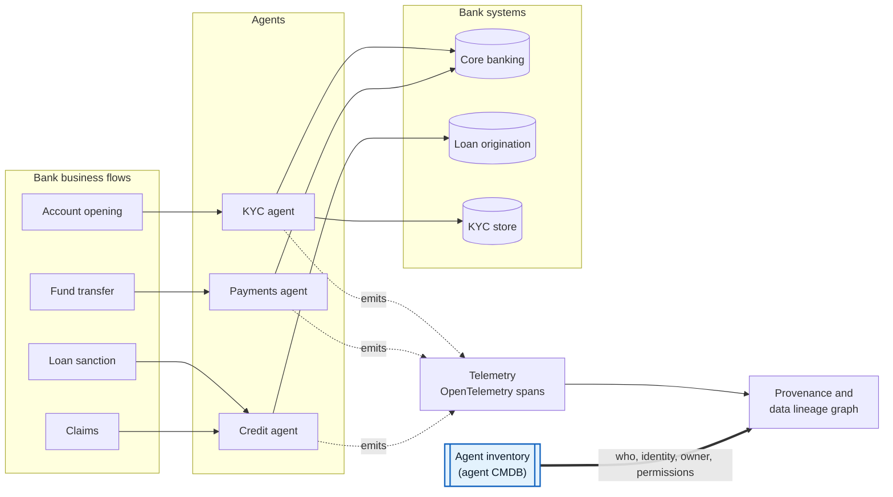
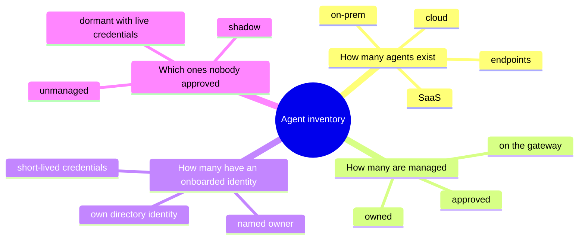
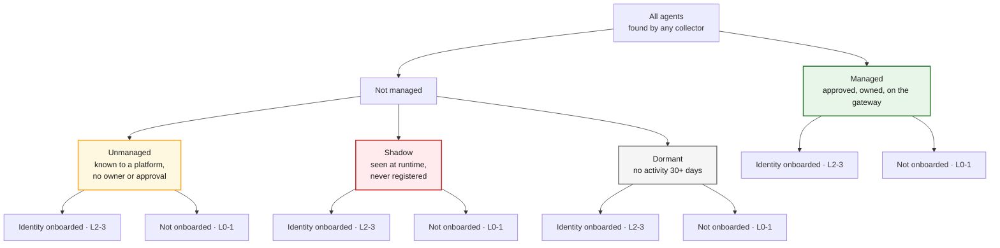
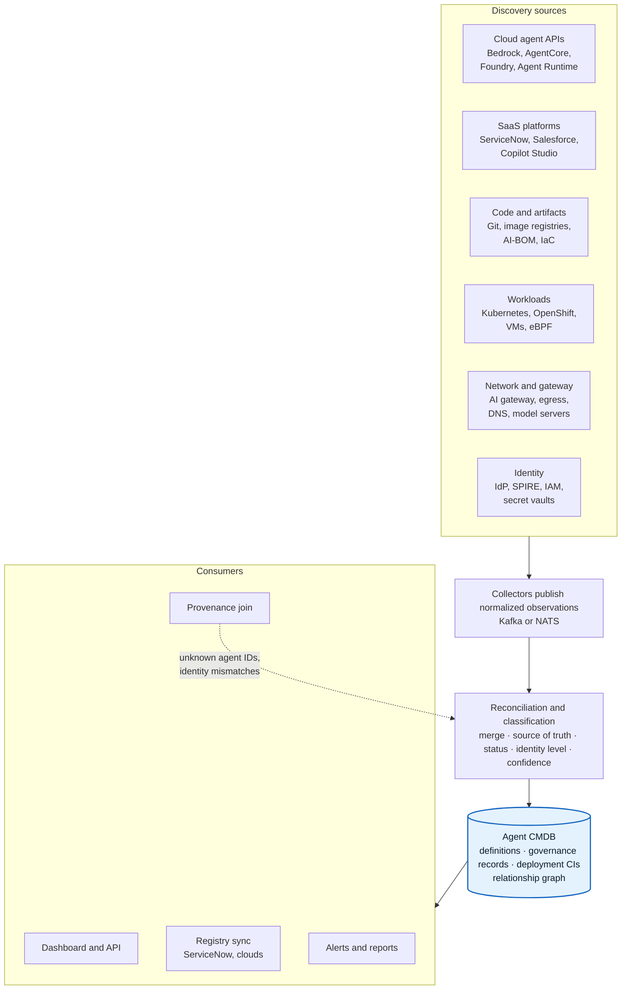
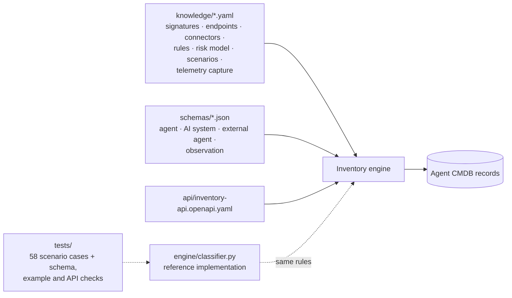

# Agentic-AI · Agent Inventory and Agent CMDB for Banking

> **Goal:** an agentic AI platform for banks where every business flow (account opening, transfers, loan sanction, claims) is traced end to end, and every step in that trace resolves to a **known, owned, identity-bound agent**.
>
> **This repo covers workstream 1: the agent inventory (agent CMDB).** It is the system of record that telemetry, provenance and risk all join against.

*Research as of November 2026. Diagrams are Mermaid and render directly on GitHub.*

---

## The big picture



Telemetry records **what happened**. The inventory records **who did it, under which identity, with what permissions, and who owns it**. Without the second, the lineage graph has holes exactly where the risk is.

---

## The four questions the inventory must answer



---

## The inventory tree

Every agent gets **one governance state** and **one identity state**.



"Managed" means **governed**, not "hosted on a managed cloud service". Hosting (platform-hosted vs self-hosted) is a separate filter. Details: [docs/02-inventory-tree.md](docs/02-inventory-tree.md).

---

## Reference architecture



The dashed line is the feedback loop: telemetry that references an unknown agent, or shows a different identity, becomes new discovery evidence. Details: [docs/11-architecture-roadmap.md](docs/11-architecture-roadmap.md).

---

## Roadmap

Phases follow dependencies, not a calendar. Each ends at a gate the bank can verify.

```mermaid
flowchart LR
    P1["Phase 1 · Foundation<br/>data model, intake,<br/>cloud and SaaS connectors"]
    G1{{"Gate: every cloud and<br/>SaaS agent in the CMDB"}}
    P2["Phase 2 · On-prem and code<br/>repo and AI-BOM scan,<br/>K8s and VM collectors,<br/>AI gateway rollout"]
    G2{{"Gate: prod LLM egress<br/>only via the gateway"}}
    P3["Phase 3 · Identity<br/>identity-level join,<br/>SPIRE on-prem,<br/>shadow rules and eBPF"]
    G3{{"Gate: identity level<br/>known for every agent"}}
    P4["Phase 4 · Provenance<br/>OTel span join,<br/>drift reviews,<br/>ServiceNow sync"]
    G4{{"Gate: first half-yearly<br/>inventory snapshot"}}

    P1 --> G1 --> P2 --> G2 --> P3 --> G3 --> P4 --> G4

    classDef gate fill:#e3f2fd,stroke:#1565c0,color:#0d1b2a
    class G1,G2,G3,G4 gate
```



---

## Documentation

| # | Page | What it shows |
|---|---|---|
| 01 | [Why inventory is step 1](docs/01-why-inventory.md) | How the inventory anchors provenance for bank business flows |
| 02 | [The inventory tree](docs/02-inventory-tree.md) | Managed / unmanaged / shadow / dormant × identity onboarded, and how each count is computed |
| 03 | [Agent CMDB data model](docs/03-data-model.md) | Three-layer model, entity-relationship diagram, ServiceNow mapping |
| 04 | [Discovery by environment](docs/04-discovery.md) | AWS, Azure, GCP, on-prem, SaaS, endpoints, code; the AI-gateway chokepoint |
| 05 | [Finding shadow agents](docs/05-shadow-agents.md) | Three evidence planes, classification flow, signals, decision rule |
| 06 | [Agent identity onboarding](docs/06-identity-onboarding.md) | Identity levels 0–3, per-platform identities, SPIFFE, delegation |
| 07 | [Reconciliation engine](docs/07-reconciliation.md) | Identification ranks, source-of-truth rules, confidence, drift |
| 08 | [ServiceNow vs from scratch](docs/08-servicenow-vs-scratch.md) | Two deployment paths and the open-source stack |
| 09 | [Telemetry and provenance](docs/09-telemetry-provenance.md) | OpenTelemetry GenAI join keys, W3C PROV mapping, feedback checks |
| 10 | [Regulatory drivers](docs/10-regulatory.md) | RBI FREE-AI, RBI MRM draft, MAS, EU AI Act, DORA |
| 11 | [Architecture and roadmap](docs/11-architecture-roadmap.md) | Component view, data flow, phased plan |
| 12 | [KPIs and dashboard](docs/12-kpis.md) | Coverage metrics and dashboard views |
| 13 | [Open questions and risks](docs/13-open-questions.md) | What to settle with the bank, and caveats |
| 14 | [Agent profile](docs/14-agent-profile.md) | The 12 core + 5 bank-specific things to know about every agent, mapped to OWASP agentic risks |
| 15 | [Pulling the inventory](docs/15-pulling-inventory.md) | Per-platform list APIs, fan-out, read-only permissions, sample code, gotchas |
| 16 | [Repository scanning](docs/16-repository-scanning.md) | Repo and image pipeline, detectors, AI-BOM, "uses an LLM" vs "is an agent" |
| 17 | [Tools landscape](docs/17-tools-landscape.md) | Native, commercial and open-source tools, and the gaps they leave |
| 18 | [Risk scoring](docs/18-risk-scoring.md) | Formula, override rules, tiers, worked example |
| 19 | [Scenario catalogue](docs/19-scenarios.md) | 99 situations across eleven angles, each with evidence, record type and action; 58 run as tests |
| 20 | [External agents](docs/20-external-agents.md) | Customer, partner and payment-network agents reaching the bank |
| 21 | [Threat model of the inventory](docs/21-inventory-threat-model.md) | Securing the inventory itself; using it as an enforcement control |
| 22 | [Change watchlist](docs/22-change-watchlist.md) | What moved in 2026, what is still draft, how the software copes |
| 23 | [Telemetry without code changes](docs/23-telemetry-without-code-changes.md) | Capture ladder from gateways and eBPF to operator injection; stitching lineage when trace context breaks |
| 24 | [Deployment model](docs/24-deployment-model.md) | Single-tenant inside each bank, RBI IT outsourcing, credentials, security-review pack |
| 25 | [Engine contracts](docs/25-engine-contracts.md) | Collector observation format, reconciliation steps, inventory API, reference engine |
| 26 | [Operating model](docs/26-operating-model.md) | Lifecycle from request to retirement, RACI, SLAs, exceptions |
| 27 | [Business-key provenance](docs/27-business-key-provenance.md) | Tokenised UTRs, application and claim numbers join lineage per flow |
| 28 | [AI systems and integrations](docs/28-ai-systems-and-integrations.md) | Non-agent AI register, SIEM/ITSM/GRC outputs, cost per agent, extra platforms |
| 29 | [Implementability scorecard](docs/29-implementability-scorecard.md) | Honest scores per part, what raised them, what a pilot must prove |
| — | [References](docs/references.md) | Sources behind every claim |

---

## The software's "brain"

The docs explain the reasoning; the files below are what the software loads. Rules are deterministic: an LLM may suggest, but never decides an agent's status ([docs/21](docs/21-inventory-threat-model.md)).



| Path | What it is |
|---|---|
| [`knowledge/`](knowledge/README.md) | Detection signatures, LLM endpoints and model-server fingerprints, platform connectors, classification rules, risk model, scenario catalogue, telemetry capture methods, business keys |
| [`schemas/`](schemas/agent-record.schema.json) | JSON Schemas: agent record (managed records must have an approved owner, a runtime identity and gateway traffic), AI system, external agent, collector observation |
| [`api/inventory-api.openapi.yaml`](api/inventory-api.openapi.yaml) | OpenAPI 3.1 contract for the inventory API |
| [`engine/classifier.py`](engine/classifier.py) | Reference classifier that executes the rules and risk model, returning rule IDs for every decision |
| [`tests/`](tests/test_engine.py) | 58 executable scenario cases plus schema, example, OpenAPI and generated-doc checks (`python3 -m pytest -q`) |
| [`examples/`](examples/kyc-onboarding-agent.yaml) | Managed agent, shadow agent, AI system, external agent, collector observation |
| [`scripts/validate.sh`](scripts/validate.sh) | Runs every check, including the Mermaid parse of all diagrams |

---

## Repository layout

```text
.
├── README.md                     ← you are here
├── docs/
│   ├── README.md                 ← docs index
│   ├── 01-why-inventory.md
│   ├── 02-inventory-tree.md
│   ├── 03-data-model.md
│   ├── 04-discovery.md
│   ├── 05-shadow-agents.md
│   ├── 06-identity-onboarding.md
│   ├── 07-reconciliation.md
│   ├── 08-servicenow-vs-scratch.md
│   ├── 09-telemetry-provenance.md
│   ├── 10-regulatory.md
│   ├── 11-architecture-roadmap.md
│   ├── 12-kpis.md
│   ├── 13-open-questions.md
│   ├── 14-agent-profile.md
│   ├── 15-pulling-inventory.md
│   ├── 16-repository-scanning.md
│   ├── 17-tools-landscape.md
│   ├── 18-risk-scoring.md
│   ├── 19-scenarios.md            ← generated tables from knowledge/scenarios.yaml
│   ├── 20-external-agents.md
│   ├── 21-inventory-threat-model.md
│   ├── 22-change-watchlist.md
│   ├── 23-telemetry-without-code-changes.md
│   ├── 24-deployment-model.md
│   ├── 25-engine-contracts.md
│   ├── 26-operating-model.md
│   ├── 27-business-key-provenance.md
│   ├── 28-ai-systems-and-integrations.md
│   ├── 29-implementability-scorecard.md
│   └── references.md
├── knowledge/                     ← machine-readable rules and facts
│   ├── README.md
│   ├── detection-signatures.yaml
│   ├── llm-endpoints.yaml
│   ├── platform-connectors.yaml
│   ├── classification-rules.yaml
│   ├── risk-model.yaml
│   ├── scenarios.yaml
│   ├── telemetry-capture.yaml
│   └── business-keys.yaml
├── schemas/
│   ├── agent-record.schema.json
│   ├── ai-system.schema.json
│   ├── external-agent.schema.json
│   └── observation.schema.json
├── api/
│   └── inventory-api.openapi.yaml
├── engine/                        ← reference classifier
│   ├── __init__.py
│   └── classifier.py
├── tests/
│   ├── scenario_cases.yaml
│   └── test_engine.py
├── examples/
│   ├── kyc-onboarding-agent.yaml
│   ├── shadow-loan-agent.yaml
│   ├── ai-system-faq-chatbot.yaml
│   ├── external-agent-partner.yaml
│   └── observation-ebpf-llm-call.yaml
├── scripts/
│   ├── render_scenarios.py
│   ├── validate.sh
│   └── mermaid-check/
└── requirements-dev.txt
```

Run every check: `scripts/validate.sh` (or `python3 -m pytest -q` for the Python checks only).

---

## Caveats

- Several building blocks are **drafts or preview**: OpenTelemetry `gen_ai.*` attributes (Development status), the CSA Agent Registry Specification, the IETF SCIM agents extension, RBI's FREE-AI recommendations and draft model-risk guidance.
- Vendor capabilities (ServiceNow, Okta, AWS, Microsoft, open-source scanners) come from documentation and announcements, **not hands-on validation**. Prove each in a pilot with seeded test agents.
- OpenTelemetry defines `gen_ai.agent.id` only on some agent spans, so the agent key also travels as a resource attribute ([docs/09](docs/09-telemetry-provenance.md)).
- RBI's draft model-risk guidance is summarised from secondary sources where the draft text was not reachable; confirm details against the draft itself.
- Implementability is about 7.5/10 as a design ([docs/29](docs/29-implementability-scorecard.md)); the rest has to be proven in a pilot with a real bank.
- See [docs/13-open-questions.md](docs/13-open-questions.md) and [docs/22-change-watchlist.md](docs/22-change-watchlist.md).
