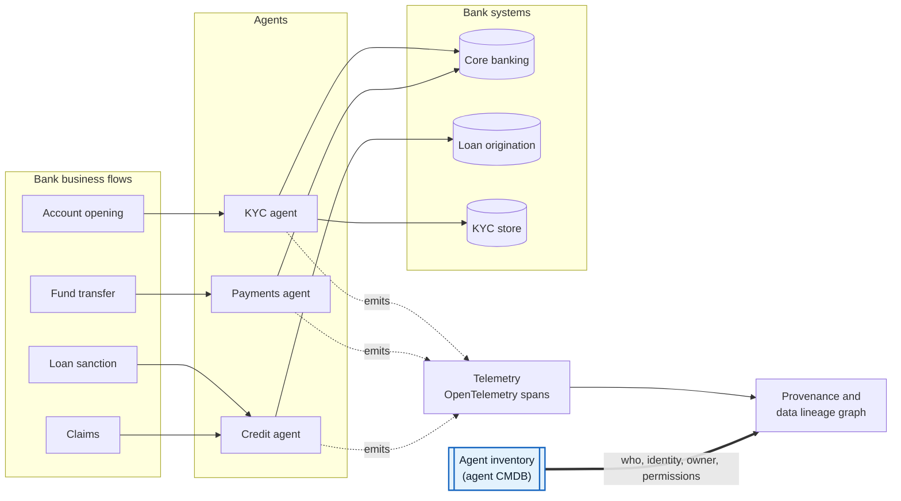
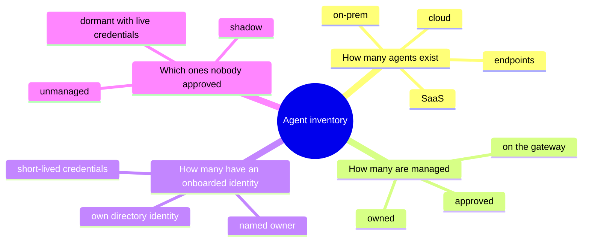
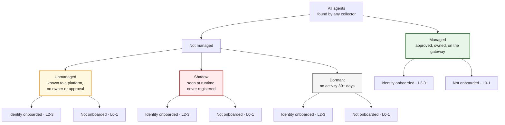
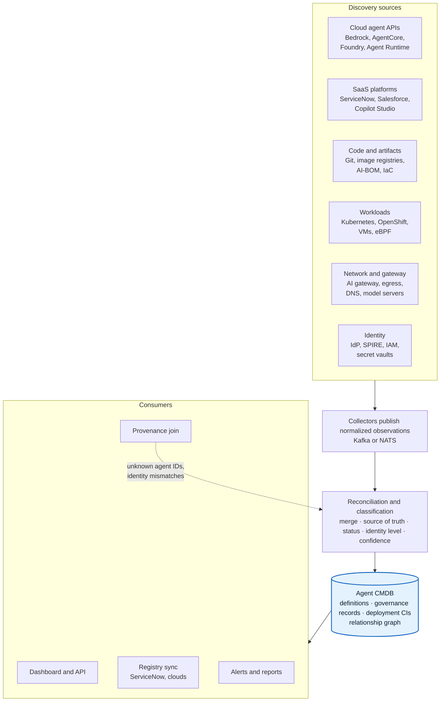

# Agentic-AI · Agent Inventory and Agent CMDB for Banking

> **Goal:** an agentic AI platform for banks where every business flow (account opening, transfers, loan sanction, claims) is traced end to end, and every step in that trace resolves to a **known, owned, identity-bound agent**.
>
> **This repo covers workstream 1: the agent inventory (agent CMDB).** It is the system of record that telemetry, provenance and risk all join against.

*Research as of November 2026. Diagrams are Mermaid and render directly on GitHub.*

---

## The big picture



Telemetry records **what happened**. The inventory records **who did it, under which identity, with what permissions, and who owns it**. Without the second, the lineage graph has holes exactly where the risk is.

---

## The four questions the inventory must answer



---

## The inventory tree

Every agent gets **one governance state** and **one identity state**.



"Managed" means **governed**, not "hosted on a managed cloud service". Hosting (platform-hosted vs self-hosted) is a separate filter. Details: [docs/02-inventory-tree.md](docs/02-inventory-tree.md).

---

## Reference architecture



The dashed line is the feedback loop: telemetry that references an unknown agent, or shows a different identity, becomes new discovery evidence. Details: [docs/11-architecture-roadmap.md](docs/11-architecture-roadmap.md).

---

## Roadmap

Phases follow dependencies, not a calendar. Each ends at a gate the bank can verify.

```mermaid
flowchart LR
    P1["Phase 1 · Foundation<br/>data model, intake,<br/>cloud and SaaS connectors"]
    G1{{"Gate: every cloud and<br/>SaaS agent in the CMDB"}}
    P2["Phase 2 · On-prem and code<br/>repo and AI-BOM scan,<br/>K8s and VM collectors,<br/>AI gateway rollout"]
    G2{{"Gate: prod LLM egress<br/>only via the gateway"}}
    P3["Phase 3 · Identity<br/>identity-level join,<br/>SPIRE on-prem,<br/>shadow rules and eBPF"]
    G3{{"Gate: identity level<br/>known for every agent"}}
    P4["Phase 4 · Provenance<br/>OTel span join,<br/>drift reviews,<br/>ServiceNow sync"]
    G4{{"Gate: first half-yearly<br/>inventory snapshot"}}

    P1 --> G1 --> P2 --> G2 --> P3 --> G3 --> P4 --> G4

    classDef gate fill:#e3f2fd,stroke:#1565c0,color:#0d1b2a
    class G1,G2,G3,G4 gate
```



---

## Documentation

| # | Page | What it shows |
|---|---|---|
| 01 | [Why inventory is step 1](docs/01-why-inventory.md) | How the inventory anchors provenance for bank business flows |
| 02 | [The inventory tree](docs/02-inventory-tree.md) | Managed / unmanaged / shadow / dormant × identity onboarded, and how each count is computed |
| 03 | [Agent CMDB data model](docs/03-data-model.md) | Three-layer model, entity-relationship diagram, ServiceNow mapping |
| 04 | [Discovery by environment](docs/04-discovery.md) | AWS, Azure, GCP, on-prem, SaaS, endpoints, code; the AI-gateway chokepoint |
| 05 | [Finding shadow agents](docs/05-shadow-agents.md) | Three evidence planes, classification flow, signals, decision rule |
| 06 | [Agent identity onboarding](docs/06-identity-onboarding.md) | Identity levels 0–3, per-platform identities, SPIFFE, delegation |
| 07 | [Reconciliation engine](docs/07-reconciliation.md) | Identification ranks, source-of-truth rules, confidence, drift |
| 08 | [ServiceNow vs from scratch](docs/08-servicenow-vs-scratch.md) | Two deployment paths and the open-source stack |
| 09 | [Telemetry and provenance](docs/09-telemetry-provenance.md) | OpenTelemetry GenAI join keys, W3C PROV mapping, feedback checks |
| 10 | [Regulatory drivers](docs/10-regulatory.md) | RBI FREE-AI, RBI MRM draft, MAS, EU AI Act, DORA |
| 11 | [Architecture and roadmap](docs/11-architecture-roadmap.md) | Component view, data flow, phased plan |
| 12 | [KPIs and dashboard](docs/12-kpis.md) | Coverage metrics and dashboard views |
| 13 | [Open questions and risks](docs/13-open-questions.md) | What to settle with the bank, and caveats |
| — | [References](docs/references.md) | Sources behind every claim |

Machine-readable artefacts:

- [`schemas/agent-record.schema.json`](schemas/agent-record.schema.json): JSON Schema for one agent deployment record
- [`examples/kyc-onboarding-agent.yaml`](examples/kyc-onboarding-agent.yaml): a filled-in example record

---

## Repository layout

```text
.
├── README.md                     ← you are here
├── docs/
│   ├── README.md                 ← docs index
│   ├── 01-why-inventory.md
│   ├── 02-inventory-tree.md
│   ├── 03-data-model.md
│   ├── 04-discovery.md
│   ├── 05-shadow-agents.md
│   ├── 06-identity-onboarding.md
│   ├── 07-reconciliation.md
│   ├── 08-servicenow-vs-scratch.md
│   ├── 09-telemetry-provenance.md
│   ├── 10-regulatory.md
│   ├── 11-architecture-roadmap.md
│   ├── 12-kpis.md
│   ├── 13-open-questions.md
│   └── references.md
├── schemas/
│   └── agent-record.schema.json
└── examples/
    └── kyc-onboarding-agent.yaml
```

---

## Caveats

- Several building blocks are **drafts or preview**: OpenTelemetry `gen_ai.*` attributes (Development status), the CSA Agent Registry Specification, the IETF SCIM agents extension, RBI's FREE-AI recommendations and draft model-risk guidance.
- Vendor capabilities (ServiceNow, Okta, AWS, Microsoft, open-source scanners) come from documentation and announcements, **not hands-on validation**. Prove each in a pilot with seeded test agents.
- See [docs/13-open-questions.md](docs/13-open-questions.md) for the full list.
