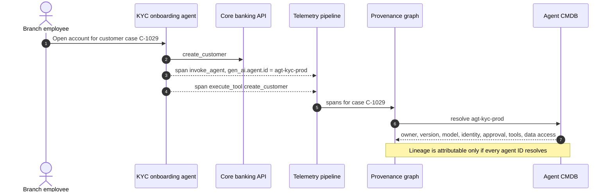
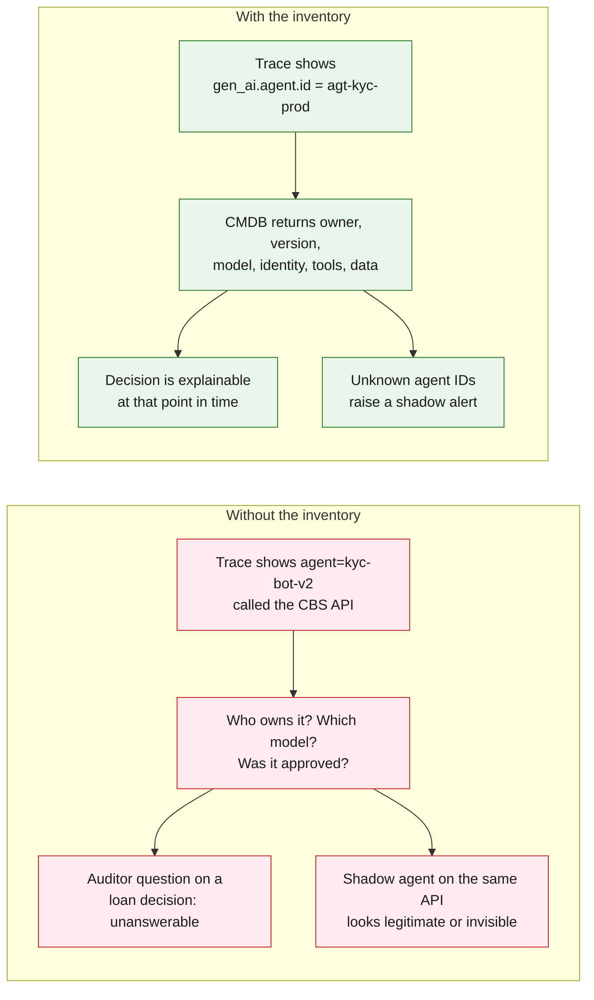
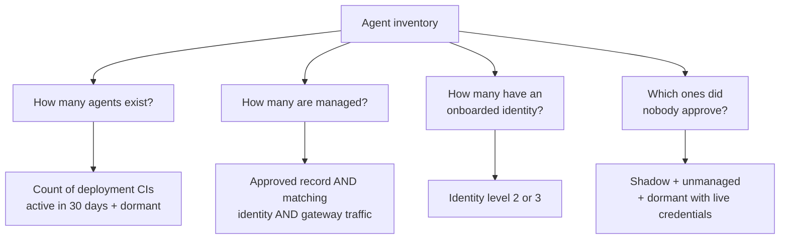

# 01 · Why inventory is step 1

**Provenance is only as good as the actor IDs inside it.** Every span, tool call and data read in a business flow must resolve to a known agent record, or the lineage graph has holes exactly where the risk is.

## One business flow, end to end

An account-opening request, traced. The provenance graph can only explain step 7 if the agent ID resolves in the inventory.

## With and without an inventory

## What the inventory module must answer, continuously

The rest of these docs explain how to compute each answer: the tree ([02](02-inventory-tree.md)), the record ([03](03-data-model.md)), where the evidence comes from ([04](04-discovery.md), [05](05-shadow-agents.md), [06](06-identity-onboarding.md)) and how it is merged ([07](07-reconciliation.md)).

---
[← Index](README.md) · [Next: 02 The inventory tree →](02-inventory-tree.md)
