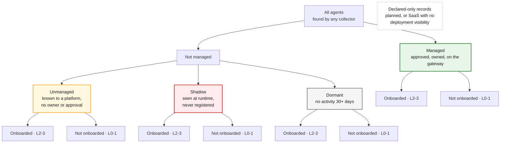
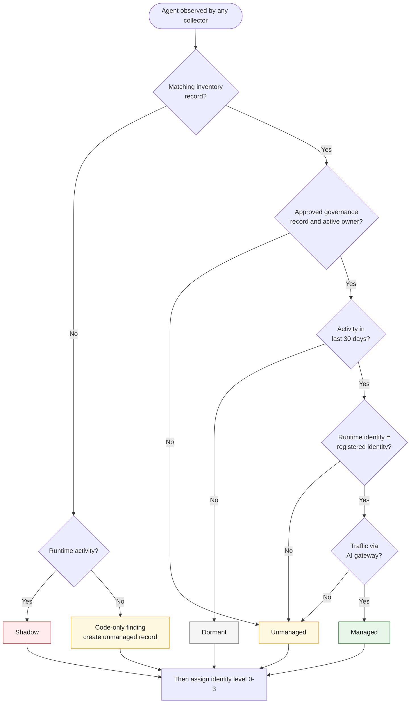
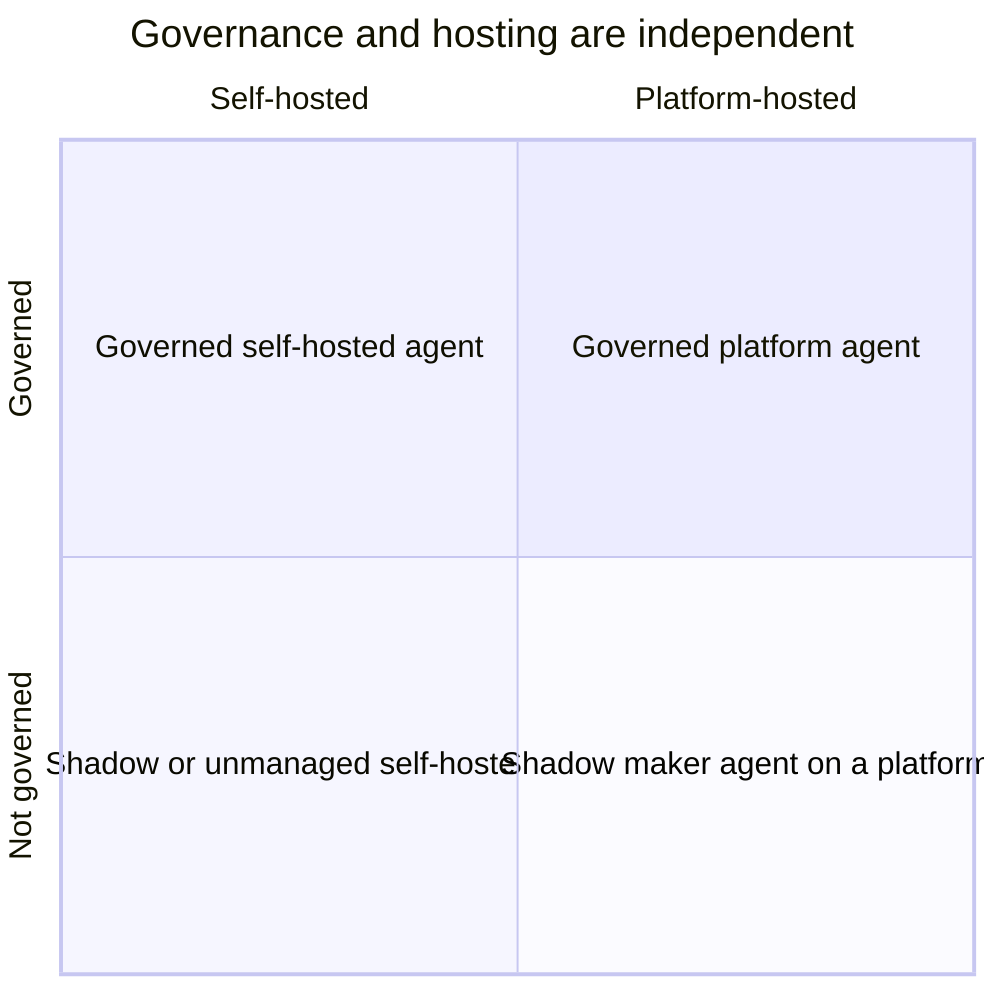

# 02 · The inventory tree

**Classify every agent on two independent axes:** its governance state (managed, unmanaged, shadow, dormant) and its identity state (onboarded or not). This tree is what the inventory dashboard should show first, with a count in every box.

## The tree

Declared-only records sit **beside** the tree: they are governance records with no running deployment yet (or SaaS agents you can govern but not see).

## How each count is computed

| Count | Rule |
|---|---|
| **All agents** | Distinct deployment CIs with runtime activity in the last 30 days, plus dormant ones |
| **Managed** | Approved governance record **and** runtime identity matches the registered one **and** traffic flows through the AI gateway |
| **Unmanaged** | Found by a platform API or collector, but no approved governance record or active owner |
| **Shadow** | Runtime evidence (traffic, traces, logs) with no matching inventory record |
| **Dormant** | Registered or found in code, with no runtime activity for 30+ days |
| **Identity onboarded** | Identity level 2 or 3 ([06](06-identity-onboarding.md)), counted inside each state |

## How an agent lands in a box

## What to do in each cell

| Governance state | Identity onboarded (L2–3) | Not onboarded (L0–1) |
|---|---|---|
| **Managed** | Healthy; monitor for drift | **Close first**: already approved, onboarding is quick |
| **Unmanaged** | Assign owner, run intake | Assign owner, run intake, then onboard identity |
| **Shadow** | Rare; investigate why an identity exists without a record | **Highest risk**: find owner, contain, onboard or kill |
| **Dormant** | Confirm, retire, revoke identity | Confirm, retire, rotate or revoke any keys |

## "Managed" ≠ "hosted on a managed service"

A Copilot Studio agent built by an employee in the default environment is platform-hosted **and** shadow. A LangGraph service on OpenShift that passed intake and runs behind the gateway is self-hosted **and** managed. Hosting is a filter on the tree, not a branch of it.

---
[← 01 Why inventory](01-why-inventory.md) · [Index](README.md) · [Next: 03 Data model →](03-data-model.md)
