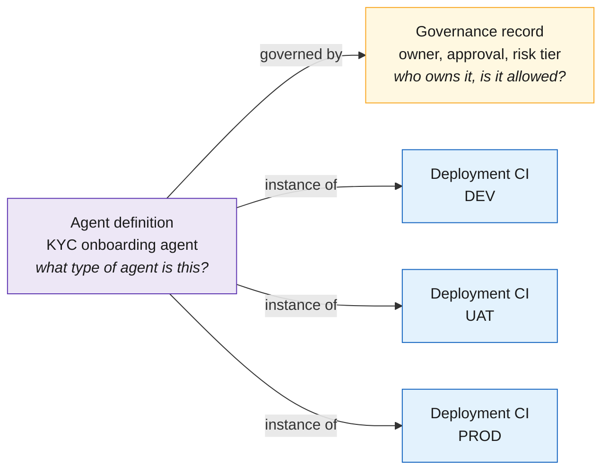
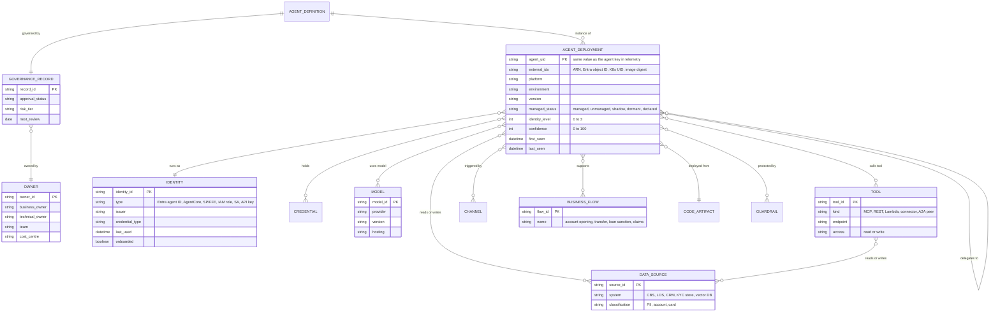
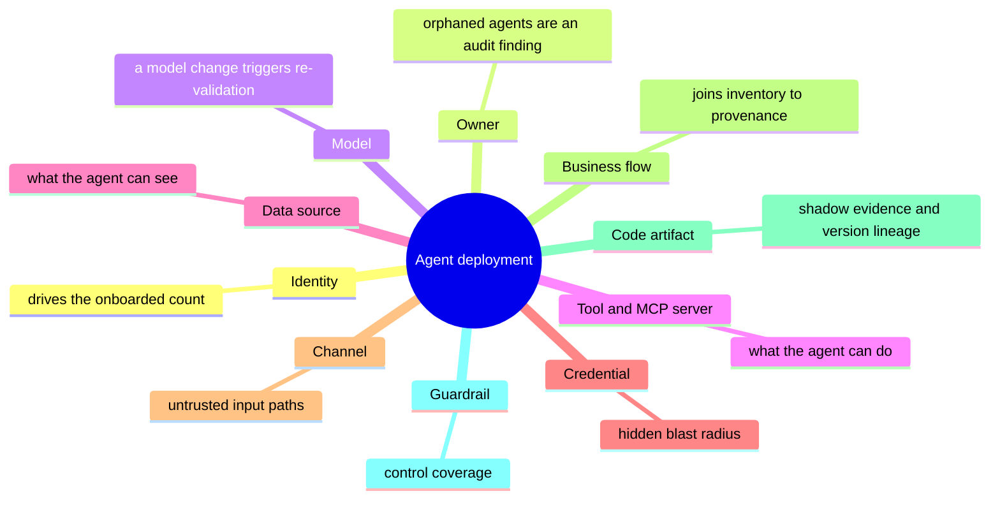
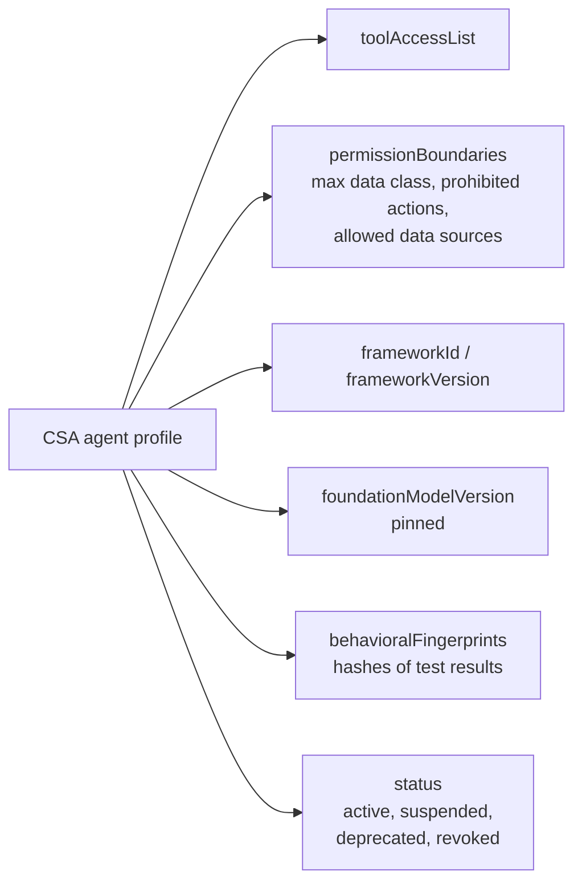

# 03 · Agent CMDB data model

**Model every agent in three layers** (definition, governance record, deployment) and attach identity, model, tools, data and business flow as first-class entities joined by typed relationships. This mirrors ServiceNow AI Control Tower, so a from-scratch build can sync to ServiceNow later without remodelling.

## Three layers per agent

One KYC onboarding agent running in DEV, UAT and PROD:

Each deployment CI can be paused or retired on its own. A SaaS agent you cannot see inside still gets a definition and a governance record, with **zero** CIs.

| Layer | Question it answers | ServiceNow equivalent | Cardinality |
|---|---|---|---|
| Agent definition | What type of agent is this? | `cmdb_ai_system_product_model` | One per agent type |
| Governance record | Who owns it, is it approved, what is the risk? | `alm_ai_system_digital_asset` + governance details | One per agent; exists even with no deployment visibility |
| Deployment CI | Where is it running right now? | `cmdb_ci_function_ai` (cloud/SaaS) or `cmdb_ci_appl_ai_application` (on-prem) | One per environment or region |

## Entity-relationship model

## Why each entity matters for a bank

## ServiceNow AI Control Tower mapping

| Asset type | Product model table | Digital asset table | CI table |
|---|---|---|---|
| Agents and skills | `cmdb_ai_system_product_model` | `alm_ai_system_digital_asset` | `cmdb_ci_function_ai` |
| Models | `cmdb_ai_model_product_model` | `alm_ai_model_digital_asset` | `cmdb_ci_ai_model_deployment` |
| MCP servers | `cmdb_mcp_product_model` | `alm_mcp_digital_asset` | `cmdb_ci_function_mcp` |
| Prompts | `cmdb_ai_prompt_product_model` | `alm_ai_prompt_digital_asset` | — |
| Datasets | `cmdb_ai_dataset_product_model` | `alm_ai_dataset_digital_asset` | — |

`cmdb_rel_asset_ci` links a digital asset to its CIs. Table names come from a ServiceNow employee's community blog and the Zurich docs; verify on the target instance.

## Fields worth borrowing from the CSA draft

The Cloud Security Alliance's Agent Registry Specification (draft, March 2026) adds fields a classic CMDB lacks:

It grounds the profile in the IETF SCIM agents extension draft and uses SPIFFE URIs as agent IDs.

> **One rule ties this to the rest of the platform:** `agent_uid` must be the same value the agent carries on every span (as a resource attribute, and as `gen_ai.agent.id` where the OpenTelemetry conventions define it; see [09](09-telemetry-provenance.md)). If the CMDB key and the trace value differ, provenance joins break.

See [`schemas/agent-record.schema.json`](../schemas/agent-record.schema.json) and the [example record](../examples/kyc-onboarding-agent.yaml).

---
[← 02 Inventory tree](02-inventory-tree.md) · [Index](README.md) · [Next: 04 Discovery →](04-discovery.md)
