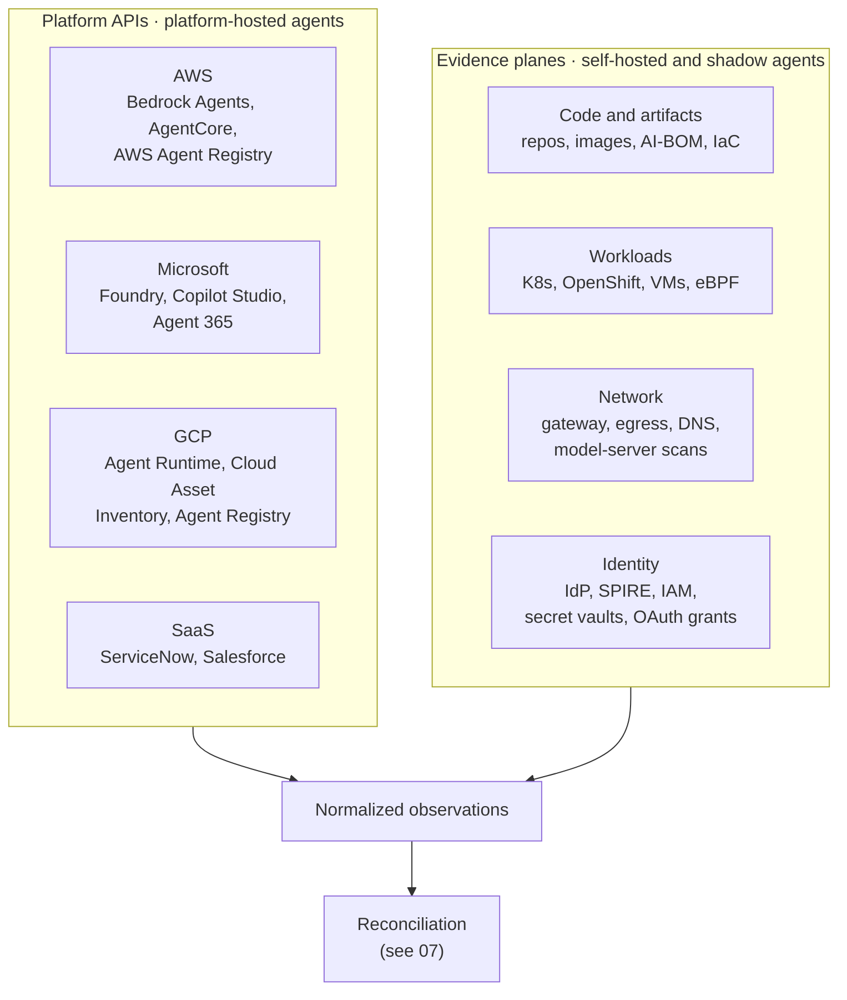
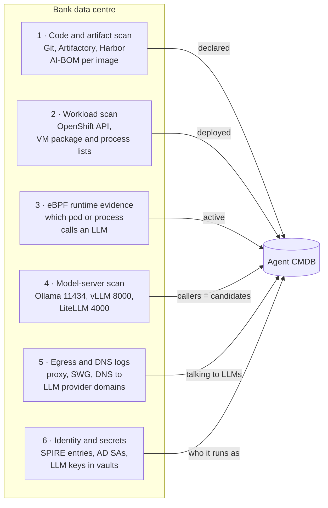
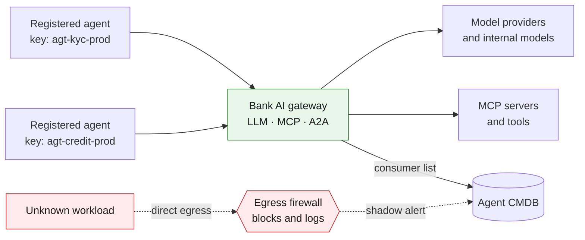

# 04 · Discovery by environment

**Use platform APIs for platform-hosted agents, and four evidence planes for everything else:** code and artifacts, running workloads, network traffic, and identities. Cloud platforms now have agent-aware APIs. On-prem has none, so there the inventory is built from those four planes.

## Where evidence comes from

## Source matrix

| Environment | Platform-hosted agents (pull via API) | Self-hosted and shadow signals | Identity source |
|---|---|---|---|
| **AWS** | Bedrock Agents (`ListAgents`, `GetAgent`); AgentCore (`ListAgentRuntimes`, `ListGateways`); AWS Agent Registry auto-detects AgentCore runtimes and gateways org-wide; Config, Resource Explorer | CloudTrail `InvokeModel`/`Converse` by principal; ECR image SBOMs; EKS/ECS workloads with agent frameworks; VPC Flow Logs and Route 53 Resolver logs to LLM endpoints | IAM roles, AgentCore workload identities |
| **Azure / M365** | Foundry project `GET /agents`; Power Platform inventory API (Copilot Studio, Agent Builder); Graph `/copilot/admin/catalog/packages` (Agent 365) | Azure OpenAI diagnostic logs by caller; AKS workloads; Entra consent grants to AI apps; Defender local-agent discovery | Entra Agent ID, service principals |
| **GCP** | `reasoningEngines.list`; Cloud Asset Inventory (`aiplatform.googleapis.com/ReasoningEngine`); Agent Registry | Vertex AI data-access audit logs; GKE workloads; Artifact Registry SBOMs | Agent Identity, service accounts |
| **On-prem K8s / OpenShift** | None native | Images with agent frameworks; pods with LLM API-key env vars; eBPF evidence of LLM calls per pod | K8s service accounts, SPIRE |
| **On-prem VMs / bare metal** | None native | Package and process inventory (`langchain`, `crewai`, `mcp`); listening model servers; outbound LLM traffic | AD service accounts, Vault/CyberArk |
| **SaaS platforms** | ServiceNow `sn_aia_agent`; Salesforce `BotDefinition`; Copilot Studio via Power Platform | Maker agents in default environments; embedded vendor AI | Platform users, integration accounts |
| **Endpoints** | — | MCP config files (Claude Desktop, Cursor, VS Code); coding-agent processes; local Ollama | Usually the developer's own account (L0) |
| **Code and registries** | — | Framework imports, MCP configs, A2A agent cards, IaC agent resources; agent images in Artifactory/Nexus/Harbor | — |

## On-prem: six collectors

On-prem is where most bank agents will live, because core banking, LOS and KYC systems sit there.

| Collector | Open-source examples | Notes |
|---|---|---|
| Code and AI-BOM | cdxgen, Syft | Declared inventory; cannot tell what is deployed |
| eBPF runtime | OpenLIT Controller, AIOStack, Tetragon | Needs privileged agents and recent kernels; check where each tool sends data |
| Model-server fingerprinting | Praetorian Julius | Detects Ollama, vLLM, LiteLLM, TGI and others by HTTP probing |
| Correlated layers | DefendAI AgentDiscover scanner | Code + network + K8s eBPF + endpoint, with ghost / zombie labels |

## Make the AI gateway the chokepoint

The single most effective control for a bank: route all LLM, MCP and agent-to-agent traffic through a **bank-owned AI gateway** and block direct egress to model providers. One virtual key or identity per agent.

Any LLM traffic that bypasses the gateway is shadow by definition. Self-hosted options include LiteLLM and agentgateway; Kong AI Gateway 3.14 (April 2026) covers LLM, MCP and A2A traffic in one runtime. On AWS, AgentCore Gateway plays this role for AgentCore agents, but agents on EKS, ECS or Lambda still need the egress control.

---
[← 03 Data model](03-data-model.md) · [Index](README.md) · [Next: 05 Shadow agents →](05-shadow-agents.md)
