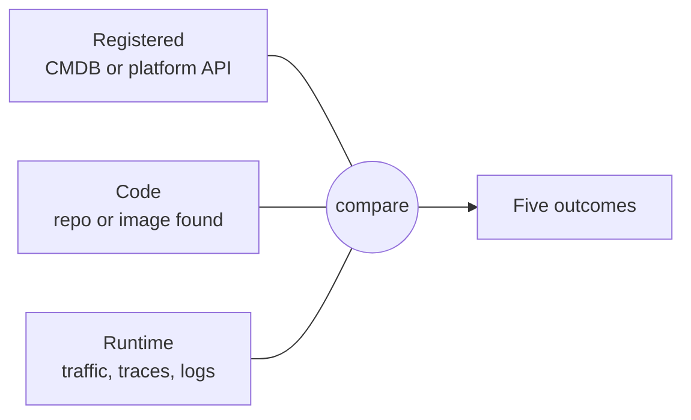
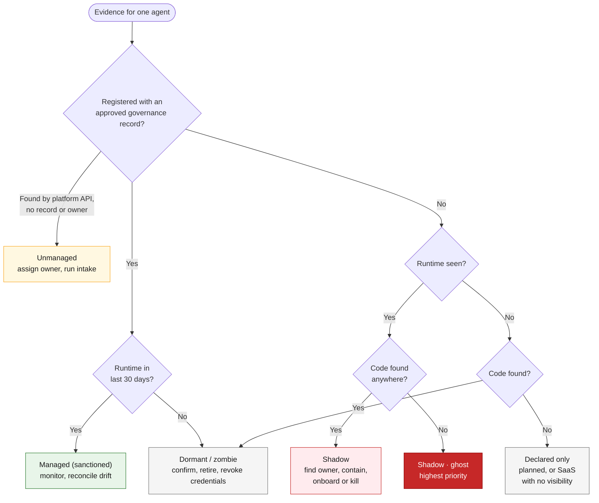
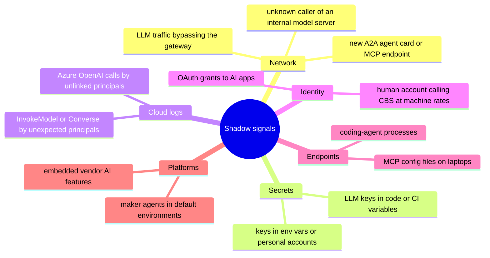
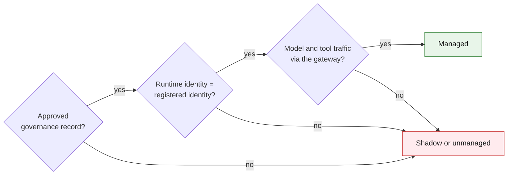

# 05 · Finding shadow agents

**A shadow agent is any agent whose runtime activity cannot be matched to an approved governance record and its registered identity.** Find them by comparing three evidence planes and classifying every mismatch.

## Three planes

## Classification flow

| Registered | Code found | Runtime seen | Classification | Action |
|---|---|---|---|---|
| Yes, approved | Yes | Yes | **Managed (sanctioned)** | Monitor; reconcile drift |
| No | Yes or no | Yes | **Shadow** ("ghost" if no code anywhere) | Find owner, contain, onboard or kill |
| Platform API only, no record or owner | Any | Any | **Unmanaged** | Assign owner, run intake |
| Yes or code only | Yes | No (30+ days) | **Dormant** ("zombie") | Confirm, retire, revoke credentials |
| Record only | No | No | **Declared only** | Keep as a governance record |

The ghost and zombie labels come from the open-source DefendAI AgentDiscover scanner, which flags workloads making live LLM calls with no corresponding source code: exactly what a code-only inventory misses.

## Shadow-agent signals

The "human account behaving like a machine" signal matters most in a bank: an employee principal calling core banking APIs around the clock at machine rates usually means an agent is running on that person's credentials (identity level 0).

## Decision rule

Fail any one check and the agent is not managed. The rule is cheap to evaluate continuously once the gateway ([04](04-discovery.md)) and the identity join ([06](06-identity-onboarding.md)) are in place.

---
[← 04 Discovery](04-discovery.md) · [Index](README.md) · [Next: 06 Identity →](06-identity-onboarding.md)
