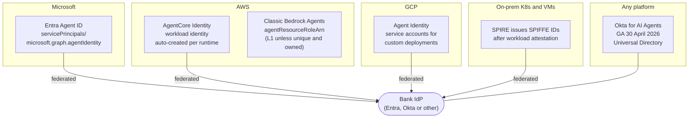
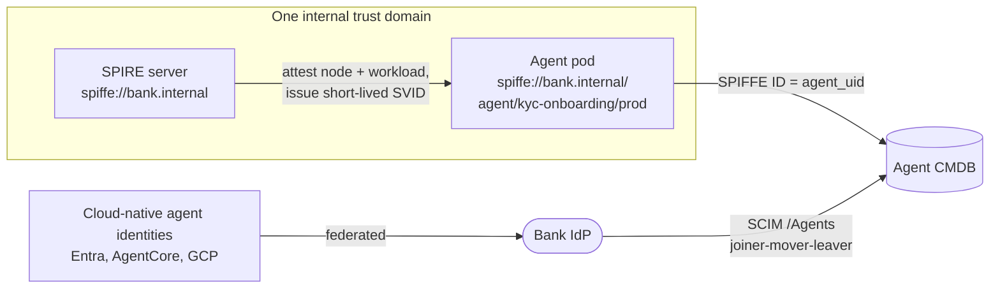
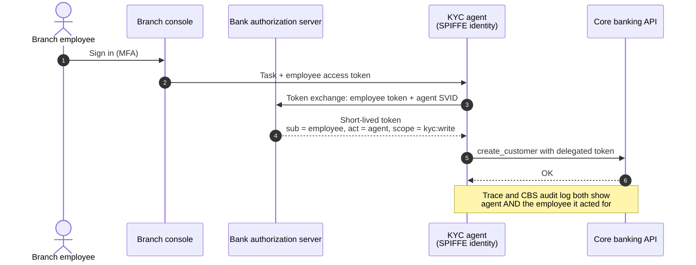
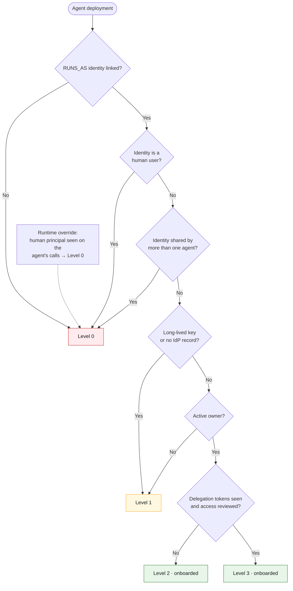

# 06 · Agent identity onboarding

**Count an agent as identity-onboarded only when it has its own identity in an identity directory, linked to its CMDB record and a named human owner, using short-lived credentials.** A unique API key or service account is not enough on its own.

This builds on NIST's *Design Tenets for Agent Identity Management Systems* (27 October 2026): agents should be uniquely and cryptographically identifiable, distinguishable from humans and service accounts (tenet 1), with no long-lived bearer tokens or static secrets (tenet 4). The tenets will guide the NCCoE agent-identity demonstrations, planned to produce an SP 1800 practice guide.

## Identity maturity ladder

```mermaid
flowchart LR
    L0["Level 0 · No own identity<br/>runs as a human, a shared<br/>service account, or a pasted key"]
    L1["Level 1 · Own but unmanaged<br/>unique role or key,<br/>long-lived secret, no owner"]
    L2["Level 2 · Onboarded<br/>directory identity, linked to<br/>CMDB and owner, short-lived creds"]
    L3["Level 3 · Governed<br/>L2 + delegation linking,<br/>least privilege reviewed,<br/>revocation tested"]

    L0 -->|"give it its own identity"| L1
    L1 -->|"register, link owner,<br/>rotate to short-lived"| L2
    L2 -->|"on-behalf-of tokens,<br/>access reviews"| L3

    classDef bad fill:#ffebee,stroke:#c62828,color:#1b1b1b
    classDef warn fill:#fff8e1,stroke:#f9a825,color:#1b1b1b
    classDef good fill:#e8f5e9,stroke:#2e7d32,color:#1b1b1b
    classDef best fill:#2e7d32,stroke:#1b5e20,color:#ffffff
    class L0 bad
    class L1 warn
    class L2 good
    class L3 best
```

| Level | Counts as onboarded? | Typical evidence |
|---|---|---|
| 0 | No | LLM or CBS calls made by a user principal; one service account shared by several agents |
| 1 | No | Static key in env vars or a config file; no IdP record |
| 2 | **Yes** | Entra agent identity, AgentCore workload identity, GCP agent identity, Okta agent record, or a SPIFFE ID from SPIRE |
| 3 | **Yes** | OAuth token-exchange (on-behalf-of) tokens in traces; periodic access certification |

A SecureWorld summary of a CSA and Aembit survey reports that 31% of organisations let agents run under a human user's identity and 43% rely on shared service accounts: levels 0 and 1 are the norm today.

## Where each environment's identity lives

AWS documents AgentCore Identity as a standalone service for agents on ECS, EKS, Lambda or on-premises, so it can cover self-hosted AWS agents too.

## Recommended pattern for a bank

1. **One internal trust domain** for on-prem and Kubernetes agents: run SPIRE, use the SPIFFE ID as (or map it to) `agent_uid`. Pin attestation selectors to service account and image digest.
2. **Native identity for managed cloud agents**, federated back to the bank IdP.
3. **Delegation on every business-flow call** so the trace records both the agent and the human (NIST tenet 2).
4. **SCIM provisioning** where the IdP supports the IETF SCIM agents extension draft (`/Agents` resource type).

## Delegation: the agent acts *for* someone

## How to compute the onboarded count

Runtime evidence beats configuration: if traces or CBS logs show a human principal on an agent's calls, the agent is level 0 whatever its config says.

---
[← 05 Shadow agents](05-shadow-agents.md) · [Index](README.md) · [Next: 07 Reconciliation →](07-reconciliation.md)
