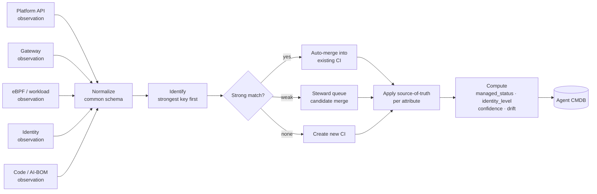
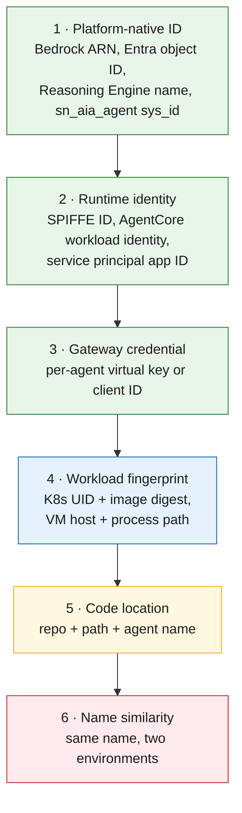
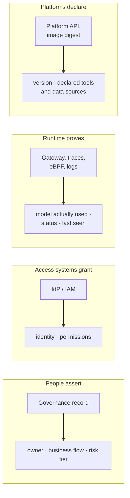
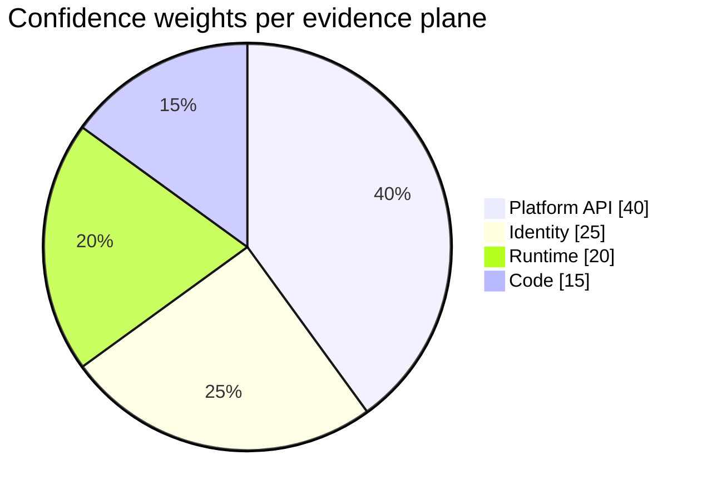
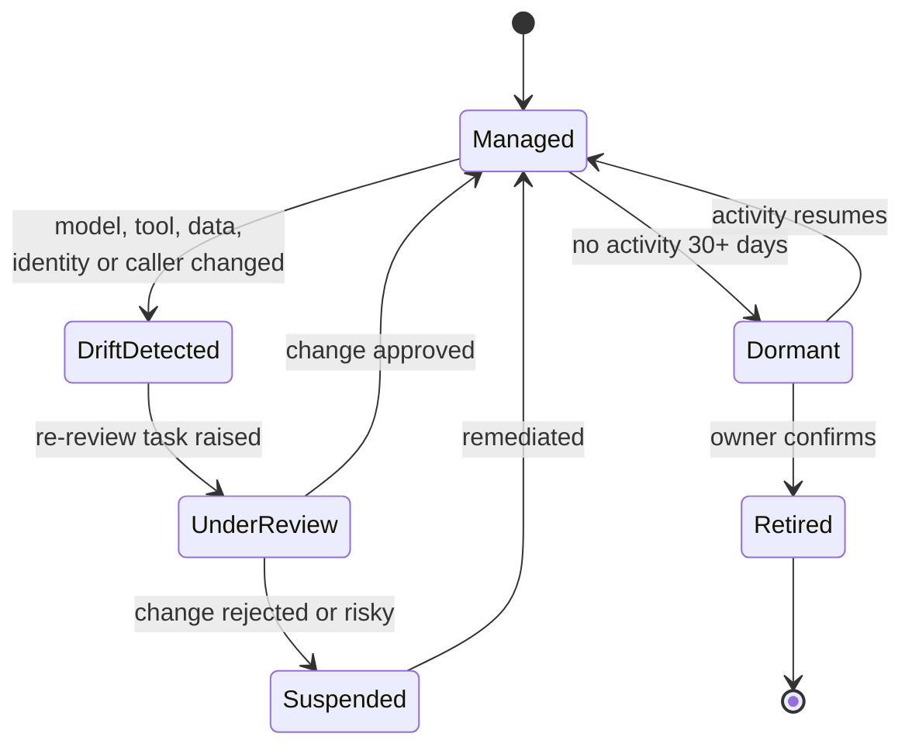

# 07 · Reconciliation and classification engine

**Every collector emits raw observations; the engine merges them into one deployment CI per agent**, decides which source wins for each attribute, and computes managed status, identity level and a confidence score. Without this step, one agent seen by five collectors becomes five inventory rows.

## Pipeline

## Identification rules, strongest first

| Rank | Merge behaviour |
|---|---|
| 1–3 | Auto-merge |
| 4 | Auto-merge within one environment only |
| 5 | Candidate merge; a steward confirms |
| 6 | Candidate only; never auto-merge |

This mirrors how ServiceNow's identification and reconciliation engine treats CIs; AI Control Tower also ships duplicate-AI-asset detection for steward review.

## Which source wins, per attribute

| Attribute | Source of truth | Why |
|---|---|---|
| Owner, business flow, risk tier | Governance record | Only people can assert accountability |
| Identity and permissions | IdP / IAM | Configuration can lie; the IdP grants access |
| Model actually used | Gateway or traces, then platform API | Runtime beats configuration |
| Tools and data sources | Platform API **plus** gateway MCP/tool logs | Union; flag observed-but-undeclared |
| Status, last seen | Runtime evidence | No traffic means dormant, whatever the config says |
| Version | Platform API or image digest | Ties to the code artifact |

## Confidence score

How many independent planes corroborate a record. Suggested starting weights (capped at 100); records below 40 go to a steward queue.

## Drift and re-review

A change in model, a new tool or data source, a new identity, or a new caller raises a re-review task. The CSA registry draft uses the same triggers (model update, capability expansion) to invalidate an agent's trust profile.

---
[← 06 Identity](06-identity-onboarding.md) · [Index](README.md) · [Next: 08 ServiceNow vs scratch →](08-servicenow-vs-scratch.md)
