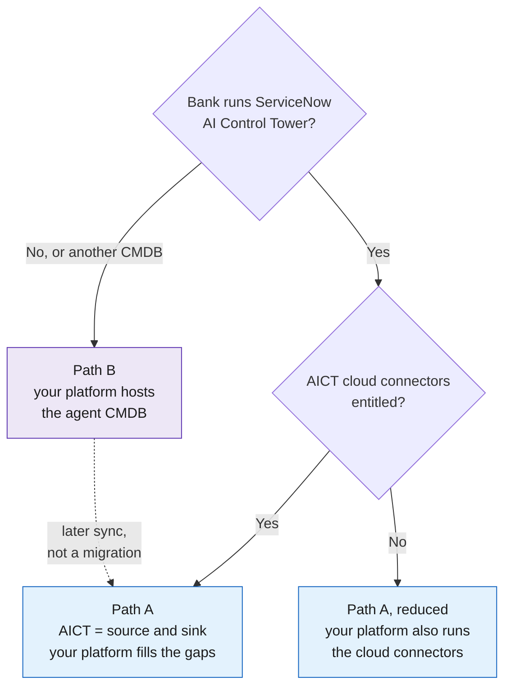
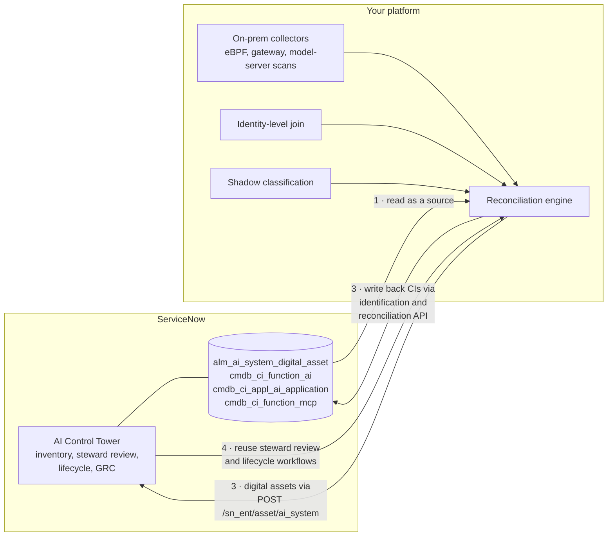
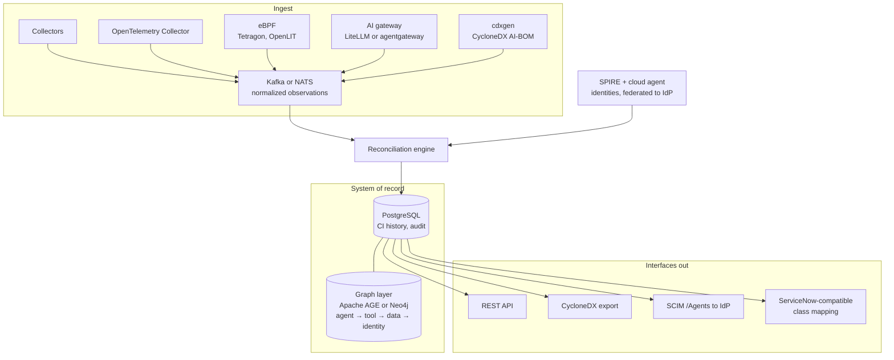

# 08 · Two deployment paths: ServiceNow or from scratch

**Build the same collectors and reconciliation engine in both cases; only the system of record and the governance workflows change.** If the bank runs ServiceNow AI Control Tower, it becomes one source and the sink. If not, your platform hosts the agent CMDB itself, modelled so it can sync to ServiceNow later.

## Which path?

## Path A: ServiceNow AI Control Tower already in place

AICT holds an AI asset inventory in the CMDB (AI systems, models, prompts, datasets, MCP servers) with a managed/unmanaged flag, steward review and duplicate detection. Its discovery covers ServiceNow-native AI, hyperscaler connectors (AWS Bedrock and SageMaker, Azure AI Foundry, GCP Vertex) and agent auto-discovery from observability logs. The data-model foundation plugin is free; cloud connectors may need an AICT entitlement.

Step 2 is the gap-filling inside your platform: on-prem runtime discovery, the identity join and shadow classification, which AICT does not cover well.

## Path B: no CMDB, start from scratch

Build the three-layer model (definition, governance record, deployment CI) from day one, using the same class names as AICT where possible.

## Comparison

| Question | Path A (ServiceNow) | Path B (scratch) |
|---|---|---|
| Who owns governance workflows? | ServiceNow (steward review, change, GRC) | Your platform |
| Time to first inventory | Faster for cloud and ServiceNow-native agents | Slower; you build intake and UI |
| On-prem and shadow coverage | Still needs your collectors | Your collectors |
| Licence dependency | AICT entitlement for connectors | None beyond infrastructure |
| Provenance join | Export AICT IDs into traces | Native; same store |

---
[← 07 Reconciliation](07-reconciliation.md) · [Index](README.md) · [Next: 09 Telemetry and provenance →](09-telemetry-provenance.md)
