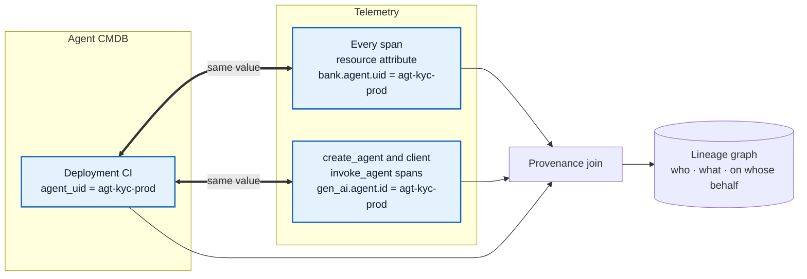
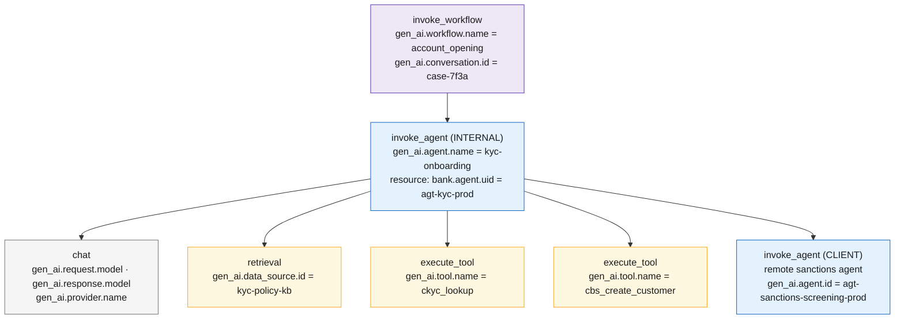
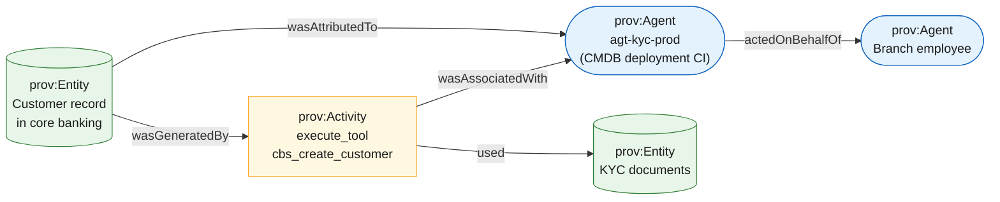
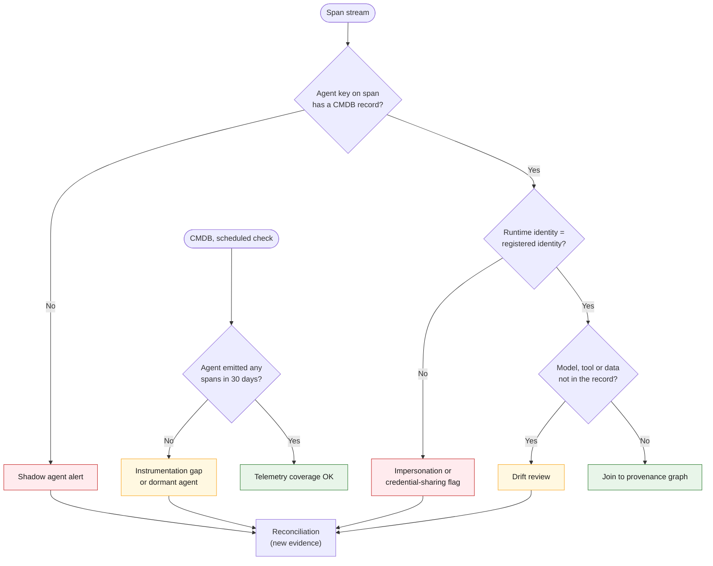

# 09 · Linking the inventory to telemetry and provenance

**Make the inventory and the telemetry share one key:** every agent process carries its CMDB `agent_uid` on every span it emits, and every model call, tool call and data lookup is a child span. The provenance graph is then a join of spans to CMDB records, and the same join exposes shadow agents.

## One key, two systems

Set the value at deploy time from the CMDB record (an environment variable injected by the pipeline or an admission controller), never by hand in code. If the CMDB key and the trace value differ, every downstream join breaks.

> **Clients rarely can change code on day one.** The key can also be added *outside* the application: the bank's OTel Collector looks up the gateway key, deployment or runtime identity in the CMDB and stamps `agent_uid` on the span. See [23 Telemetry without code changes](23-telemetry-without-code-changes.md).

### Where the key goes, and why it needs two places

In the current OpenTelemetry GenAI conventions (`semantic-conventions-genai`, main branch, November 2026):

| Span | `gen_ai.agent.id` defined? | Notes |
|---|---|---|
| `create_agent` (CLIENT) | Yes, conditionally required "if applicable" | Hosted agents should use the provider-assigned stable ID |
| Client `invoke_agent` (CLIENT, calling a remote agent) | Yes, conditionally required "if applicable" | Same guidance; also carries `gen_ai.agent.name` and `gen_ai.agent.version` |
| Internal `invoke_agent` / `invoke_workflow` (INTERNAL, in-process) | **No**, only `gen_ai.agent.name` and `gen_ai.agent.description` | This is what most self-hosted LangGraph/CrewAI agents emit |

So `gen_ai.agent.id` alone will be missing from most self-hosted agent traces. Carry `agent_uid` in two places:

1. **A resource attribute on every span** from the agent process, e.g. `bank.agent.uid` (use your organisation's namespace). Set it via `OTEL_RESOURCE_ATTRIBUTES` at deploy time.
2. **`gen_ai.agent.id`** wherever the conventions define it, with the same value.

An OpenTelemetry Collector `transform` processor can copy the resource attribute onto spans if a backend only indexes span attributes.

> **The key is self-asserted.** Any process can set any attribute. Treat the agent key on a span as a *claim*; the reconciliation engine confirms it by matching the span's runtime identity (SPIFFE ID, pod UID, gateway key) to the identity registered for that `agent_uid` ([21](21-inventory-threat-model.md)).

## One account-opening request as a span tree

The conventions define the operation names an agent run needs: `invoke_workflow`, `invoke_agent`, `plan`, `execute_tool`, `retrieval`, inference calls such as `chat`, and memory operations such as `search_memory` and `update_memory`.

## Join keys

| Telemetry attribute | Joins to CMDB entity | Bank use |
|---|---|---|
| Resource `bank.agent.uid`; `gen_ai.agent.id` where defined; `gen_ai.agent.name`, `gen_ai.agent.version` | Agent deployment CI (`agent_uid`, version) | Which approved agent and version acted |
| `gen_ai.request.model`, `gen_ai.response.model`, `gen_ai.provider.name` | Model | The model that actually served the call (response model), for re-validation |
| `gen_ai.tool.name`, `gen_ai.tool.type` | Tool / MCP server | Which CBS, LOS or KYC API was called |
| `gen_ai.data_source.id` (retrieval spans) | Data source | Which knowledge base or customer store was read |
| `gen_ai.workflow.name` (`invoke_workflow`) | Business flow | Account opening, transfer, loan sanction, claim |
| `gen_ai.conversation.id` | Case or session | Ties steps of one customer request together |
| Resource attributes (`service.name`, `k8s.pod.uid`, container image) | Workload fingerprint on the deployment CI | Confirms which deployment emitted the span |
| Custom: runtime SPIFFE ID, on-behalf-of principal, case ID (tokenised) | Identity, owner, business record | Who the agent acted for, without raw PII in spans |

> **Stability warning.** Every `gen_ai.*` agent attribute is still at Development status, and on 12 June 2026 the conventions moved to a dedicated [`semantic-conventions-genai`](https://github.com/open-telemetry/semantic-conventions-genai) repository with no tagged release yet. Keep attribute names behind a mapping layer, normalise older SDK dialects in a Collector `transform` processor, and expect renames. Prompt and response content are opt-in, which suits a bank's PII posture.

## From spans to provenance: W3C PROV

Map the joined data onto the W3C PROV model, which provenance and audit teams will recognise.

| PROV concept | Comes from |
|---|---|
| **Agent** (`prov:Agent`) | The CMDB agent deployment, plus the employee or customer it acted for (`actedOnBehalfOf`) |
| **Activity** (`prov:Activity`) | Each `invoke_agent`, `execute_tool` and `retrieval` span |
| **Entity** (`prov:Entity`) | The customer record, document, account or loan file read (`used`) or created (`wasGeneratedBy`) |

For dataset-level lineage between batch systems, emit OpenLineage events with the job namespace set to `agent_uid`, so record-level and dataset-level lineage share the same agent key.

## Telemetry feeds the inventory back

Run these checks continuously on the span stream:

Spans with **no** agent key but with GenAI operations (`chat`, `execute_tool`) are also evidence: something is calling models or tools without declaring itself. Attribute them through resource attributes (`service.name`, pod UID) and treat them like shadow candidates.

---
[← 08 ServiceNow vs scratch](08-servicenow-vs-scratch.md) · [Index](README.md) · [Next: 10 Regulatory drivers →](10-regulatory.md)
