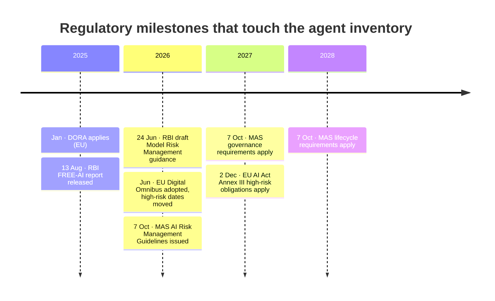
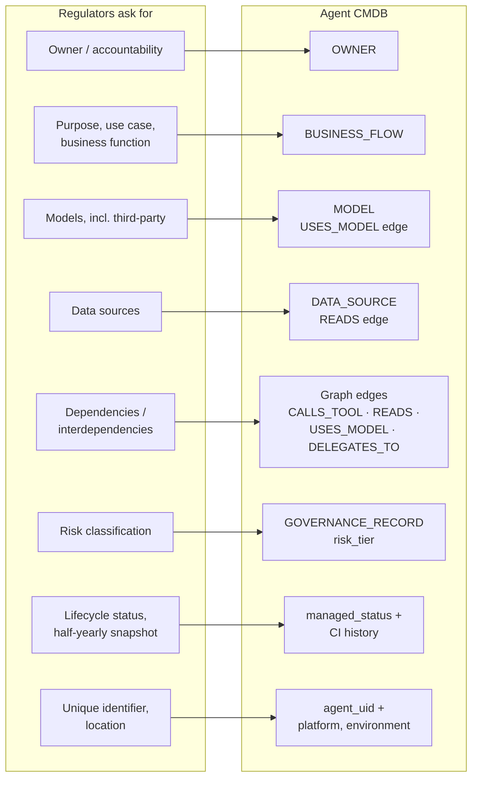
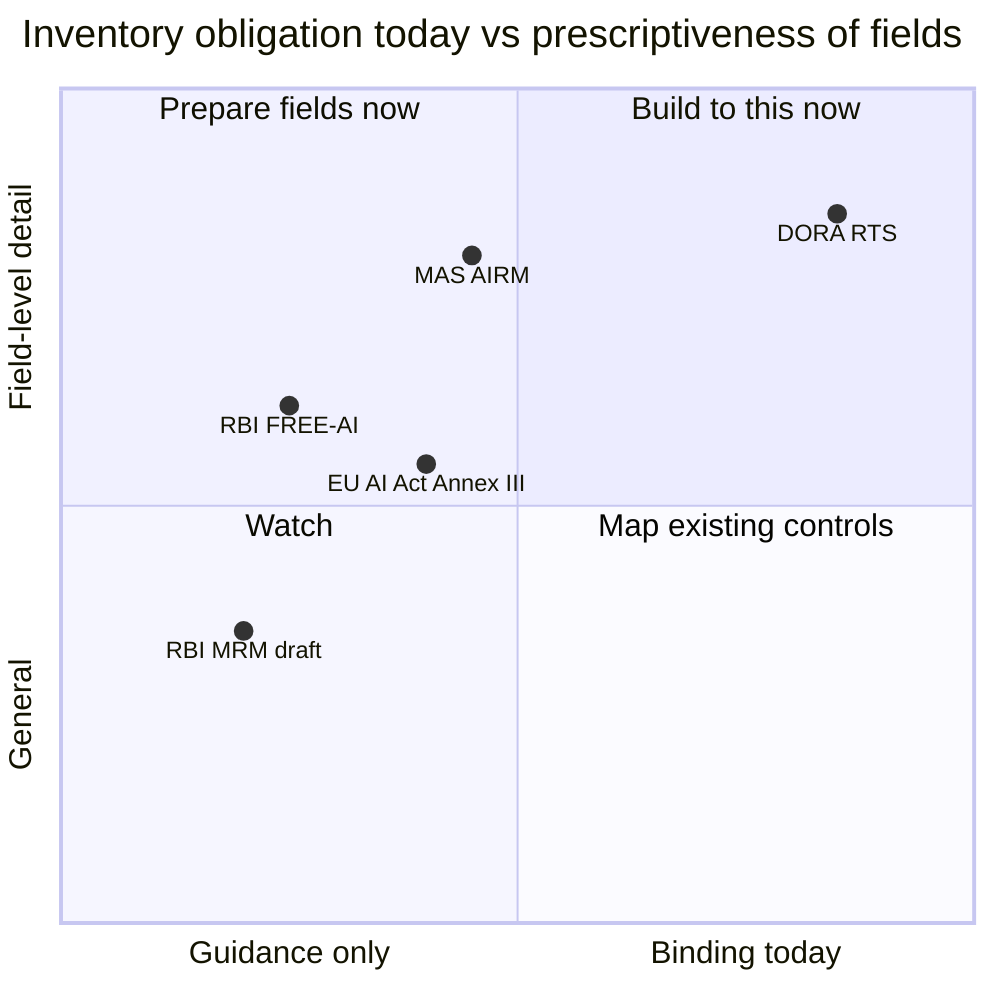

# 10 · Banking regulatory drivers

**Every major banking regulator now expects an AI inventory, and their field lists converge on the same data model:** owner, purpose, models, data sources, dependencies, lifecycle status and risk. For an Indian bank, RBI's FREE-AI report is the primary driver today; MAS, the EU AI Act and DORA apply to banks with operations in those jurisdictions.

## Timeline

## What each framework asks for

| Framework | Status (November 2026) | What it asks of the inventory |
|---|---|---|
| [RBI FREE-AI report](https://www.mondaq.com/india/financial-services/1672260/rbis-move-toward-ethical-and-responsible-ai-in-financial-sector) | Released 13 August 2025; recommendations not yet binding, expected to flow into RBI master directions | An AI-inventory recommendation (numbered 11 in Mondaq's summary; other summaries number it differently, so cite it by title): a comprehensive internal AI inventory, updated half-yearly, covering all models, use cases, target groups, dependencies, risks and grievances. Also proposes access controls for autonomous AI in the IT Governance Master Direction |
| [RBI draft Model Risk Management guidance](https://www.rbi.org.in/Scripts/Bs_Connect2RegulateDetails.aspx?prid=487) | Draft released 24 June 2026; comments closed 24 July 2026 | Governance and oversight of models, explicitly including AI/ML and third-party models. Check the final text for inventory specifics |
| [MAS Guidelines on AI Risk Management](https://hlc.com/en/publications/mas-issues-new-ai-risk-management-guidelines-for-financial-institutions) | Issued 7 October 2026; governance requirements from 7 October 2027, lifecycle requirements from 7 October 2028 | Inventory recording purpose, ownership, data sources, dependencies, lifecycle status and risk classification, integrated with data, vendor and outsourcing registers. Explicitly covers AI agents and AI embedded in third-party products |
| [EU AI Act](https://www.leaseurope.org/new-application-dates-high-risk-ai-system-rules) (as amended by the Digital Omnibus, adopted June 2026) | Annex III high-risk obligations apply from 2 December 2027 | Creditworthiness assessment of individuals is high-risk, so a loan-sanction agent that scores applicants needs high-risk deployer controls, including logging and human oversight |
| [DORA](https://advisera.com/cdr-2024-1774/ict-asset-management-policy/) (EU) | Applies since January 2025 | Agents are ICT assets. The RTS on ICT risk management requires, per asset: unique identifier, location, classification, owner, business functions supported, continuity requirements, external exposure and interdependencies |

## Where the requirements land in the data model

## Coverage by framework

Positions are a qualitative reading for prioritisation, not a legal assessment.

## What this means for the build

- **Business flow, owner and risk tier are mandatory fields**, not optional enrichment. Every regulator above asks for them.
- **Dependencies must be a graph**, not a text field: DORA's interdependencies and FREE-AI's dependencies are both answered by the `CALLS_TOOL`, `READS`, `USES_MODEL` and `DELEGATES_TO` edges.
- **Third-party AI belongs in the inventory** even with no deployment visibility, as a governance record with zero CIs ([03](03-data-model.md)).
- **Half-yearly snapshots** (FREE-AI) argue for keeping CI history, so the bank can show the inventory as it stood on any reporting date.

Regulation is in motion: FREE-AI is not yet binding and RBI's model-risk guidance is still a draft. This page is a research summary, not legal advice; confirm obligations with the bank's compliance team.

---
[← 09 Telemetry and provenance](09-telemetry-provenance.md) · [Index](README.md) · [Next: 11 Architecture and roadmap →](11-architecture-roadmap.md)
