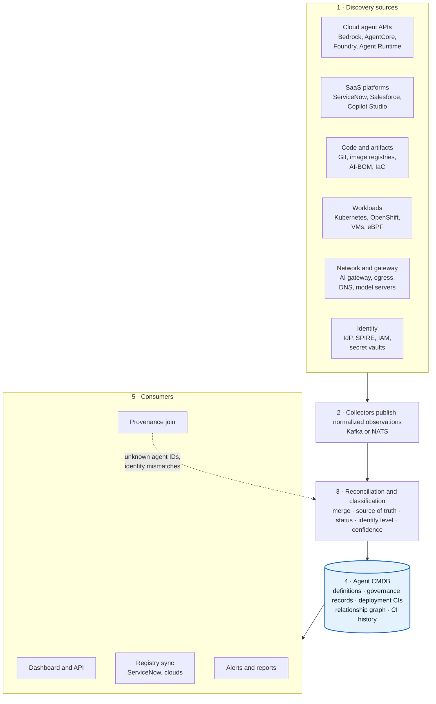
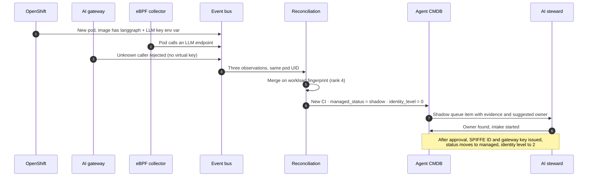
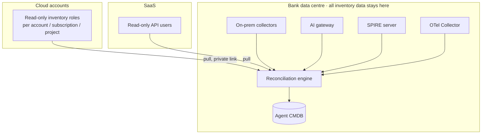

# 11 · Reference architecture and roadmap

**Six kinds of source feed one reconciliation engine and one agent CMDB; the dashboard, provenance join, registry sync and alerts all read from that single store.** Build it in four phases, starting where evidence is cheapest (cloud and SaaS APIs) and ending where it is hardest (runtime identity and provenance).

## Component view

The dashed line is the feedback loop: spans that reference unknown agents, or show a different identity, go back into reconciliation as new evidence.

## Data flow for one new agent

What happens when a team deploys a new loan agent on OpenShift without telling anyone:

## Phased roadmap

Phases follow dependencies, not a calendar: identity work needs the gateway and collectors in place, and the provenance join needs stable agent IDs. Durations depend on the size of the bank's estate and whether ServiceNow is in play.

```mermaid
flowchart LR
    P1["Phase 1 · Foundation<br/>data model, intake,<br/>cloud and SaaS connectors"]
    G1{{"Gate: every cloud and<br/>SaaS agent in the CMDB"}}
    P2["Phase 2 · On-prem and code<br/>repo and AI-BOM scan,<br/>K8s and VM collectors,<br/>AI gateway rollout"]
    G2{{"Gate: prod LLM egress<br/>only via the gateway"}}
    P3["Phase 3 · Identity<br/>identity-level join,<br/>SPIRE on-prem,<br/>shadow rules and eBPF"]
    G3{{"Gate: identity level<br/>known for every agent"}}
    P4["Phase 4 · Provenance<br/>OTel span join,<br/>drift reviews,<br/>ServiceNow sync"]
    G4{{"Gate: first half-yearly<br/>inventory snapshot"}}

    P1 --> G1 --> P2 --> G2 --> P3 --> G3 --> P4 --> G4

    classDef gate fill:#e3f2fd,stroke:#1565c0,color:#0d1b2a
    class G1,G2,G3,G4 gate
```

| Phase | Builds | Depends on | Exit gate |
|---|---|---|---|
| 1 · Foundation | Three-layer data model, intake form, AWS / Azure / GCP / SaaS connectors, first dashboard | — | Every cloud and SaaS agent has a CI and a governance record |
| 2 · On-prem and code | cdxgen AI-BOM scan, OpenShift and VM collectors, model-server scan, bank AI gateway with per-agent keys | Phase 1 data model | Production LLM egress only via the gateway |
| 3 · Identity | `RUNS_AS` join, SPIRE on-prem, identity-level computation, shadow classification, eBPF evidence | Gateway and collectors | Identity level known for every deployment |
| 4 · Provenance | `gen_ai.agent.id` = `agent_uid` enforced, span join, PROV graph, drift reviews, ServiceNow sync | Stable agent IDs and identities | First half-yearly inventory snapshot (FREE-AI) |

## Where it runs

Keep collectors and the store in-house: some open-source tools can send results to a vendor platform by default (see [13](13-open-questions.md)).

---
[← 10 Regulatory drivers](10-regulatory.md) · [Index](README.md) · [Next: 12 KPIs →](12-kpis.md)
