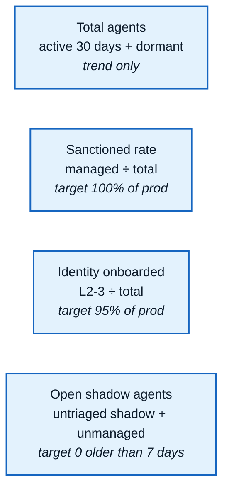
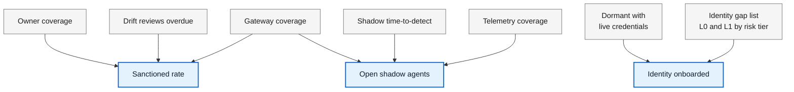
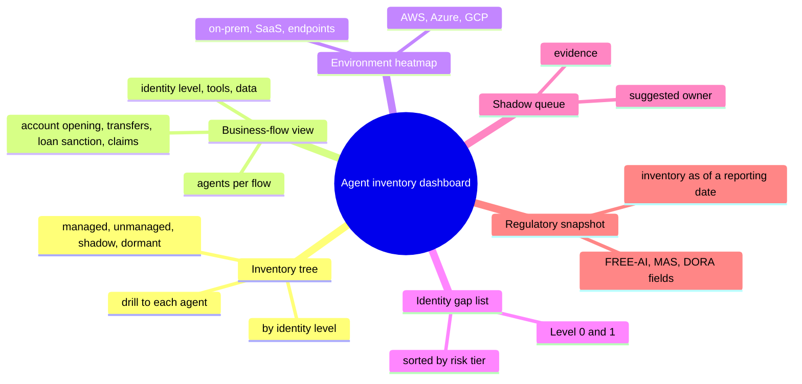
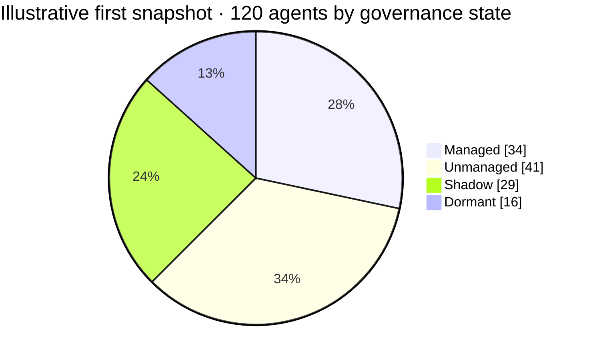

# 12 · Coverage KPIs and dashboard views

**Lead the dashboard with four numbers: total agents, percent sanctioned, percent identity-onboarded, and open shadow agents.** Everything else explains why those numbers move.

## Headline row

## What drives each headline number

## KPI definitions

| KPI | Definition | Suggested starting target |
|---|---|---|
| Total agents | Distinct deployment CIs with activity in the last 30 days, plus dormant ones; declared-only records reported separately | Trend only |
| Sanctioned rate | Sanctioned deployments ÷ total, per the three-part decision rule ([05](05-shadow-agents.md)) | 100% of production |
| Identity onboarded | Deployments at identity level 2 or 3 ÷ total | 95% of production within two quarters |
| Open shadow agents | Shadow and unmanaged records not yet triaged | Zero older than 7 days |
| Shadow time-to-detect | First runtime evidence → shadow alert | Under 24 hours |
| Owner coverage | Deployments with an active named owner | 100% of production |
| Gateway coverage | Agents whose model and tool traffic flows through the AI gateway | 100% of production |
| Telemetry coverage | Agents emitting spans with a valid agent key (resource attribute or `gen_ai.agent.id`) that matches their attested identity | 100% of agents in regulated flows |
| Dormant with live credentials | Dormant agents whose identity or keys are still active | Zero |
| Drift reviews overdue | Model, tool or data changes without a completed re-review | Zero older than 14 days |

The targets are starting proposals for the bank's risk committee to adjust, not industry benchmarks.

## Dashboard views

| View | Answers | Primary audience |
|---|---|---|
| Inventory tree | How many, how many managed, how many onboarded | CISO, AI steward |
| Business-flow view | Which agents touch account opening, transfers, loan sanction, claims, and with what access | Business owners, model risk |
| Environment heatmap | Where the gaps are: AWS, Azure, GCP, on-prem, SaaS | Platform teams |
| Identity gap list | Which Level 0 and 1 agents to fix first, by risk tier | IAM team |
| Shadow queue | New shadow and unmanaged findings, with evidence and suggested owner | AI steward, SOC |
| Regulatory snapshot | The inventory as of a reporting date, with the fields FREE-AI, MAS or DORA ask for | Compliance, audit |

## Example: what a first snapshot might look like

Made-up numbers, only to show how the tree and the KPIs relate; here the sanctioned rate would be 34 ÷ 120 = 28%. Close the managed-but-not-onboarded box first: those agents are already approved, so onboarding them is quick.

---
[← 11 Architecture and roadmap](11-architecture-roadmap.md) · [Index](README.md) · [Next: 13 Open questions →](13-open-questions.md)
