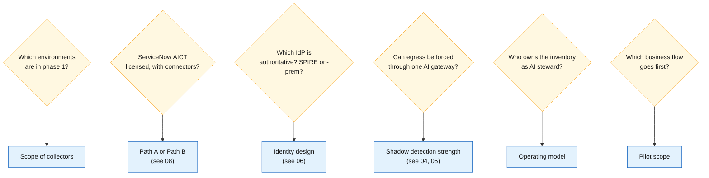
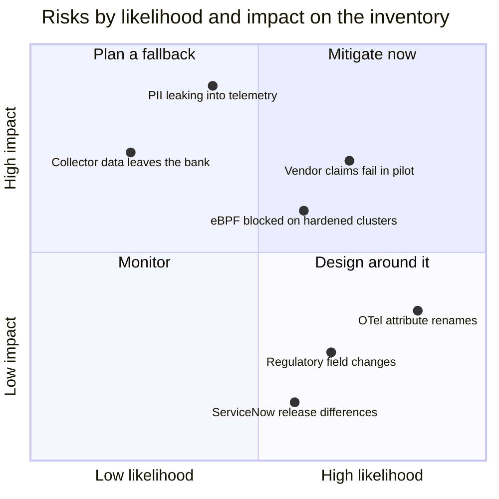
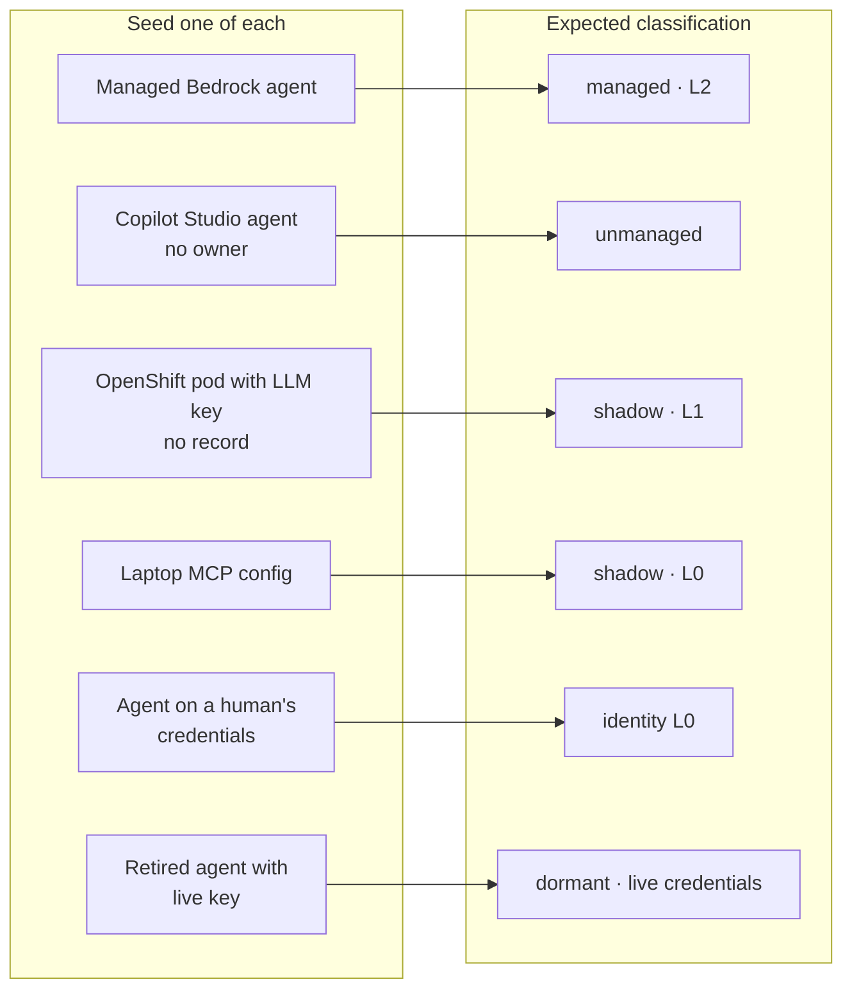

# 13 · Open questions, risks and caveats

**Settle six questions with the bank before build; they decide scope, path and ownership.** Then track the risks below, most of which come from standards and regulation still being in draft.

## Questions to settle before build

- [ ] Which environments are in scope for phase 1: which clouds, which on-prem platforms (OpenShift, VMware, bare metal), which SaaS agent platforms?
- [ ] Is ServiceNow AI Control Tower licensed, including the cloud connectors? That decides Path A or Path B.
- [ ] Which identity provider is authoritative (Entra, Okta, other), and will the bank run SPIRE on-prem?
- [ ] Can the bank enforce LLM and MCP egress through a single AI gateway? Without it, shadow detection falls back to logs and eBPF.
- [ ] Who owns the inventory as AI steward: CISO, model risk, or the CTO's office?
- [ ] Which business flow goes first? Account opening or loan sanction are good pilots because both touch PII and credit decisions.

## Risk map

Positions are a starting judgement for the risk register, not a measured assessment.

## Risks and caveats

| Risk | Why it matters | Mitigation |
|---|---|---|
| **Standards are still drafts** | OpenTelemetry `gen_ai.*` attributes are at Development status; the CSA Agent Registry Specification and the IETF SCIM agents extension are drafts; NIST's tenets are guidance and the NCCoE practice guide is not yet published | Keep mapping layers so renames are cheap |
| **Regulation is in motion** | FREE-AI is not yet binding and RBI's model-risk guidance is still a draft | Model fields generously; re-check when directions are issued |
| **ServiceNow specifics vary by release** | Table and class names here come largely from a ServiceNow employee's community blog and the Zurich docs | Verify on the target instance and release |
| **eBPF needs privileges** | Kernel probes need privileged agents and recent kernels (AIOStack lists Kubernetes 1.29+ and Linux 5.15+); OpenShift security context constraints may block them | Agree an exception early, or lean on gateway and egress logs |
| **Telemetry carries PII risk** | Spans flow to observability tools with wide access | Prompt and response content off by default in production; tokenise customer identifiers; align retention with the DPDP Act |
| **Vendor claims are untested** | Capabilities attributed to ServiceNow, Okta, AWS, Microsoft and open-source tools come from documentation and announcements | Prove each in a pilot with seeded test agents |
| **Collector data may leave the bank** | AIOStack's dashboard is hosted at app.aurva.io; AgentDiscover can optionally upload results to DefendAI's platform | Use collectors that keep all data in-house, or self-host their back ends |

## Pilot with seeded agents

The quickest way to test every claim in these docs: plant known agents and check what the inventory finds.

Measure detection rate and time-to-detect per seed; any miss shows which collector or rule needs work.

---
[← 12 KPIs](12-kpis.md) · [Index](README.md) · [References →](references.md)
