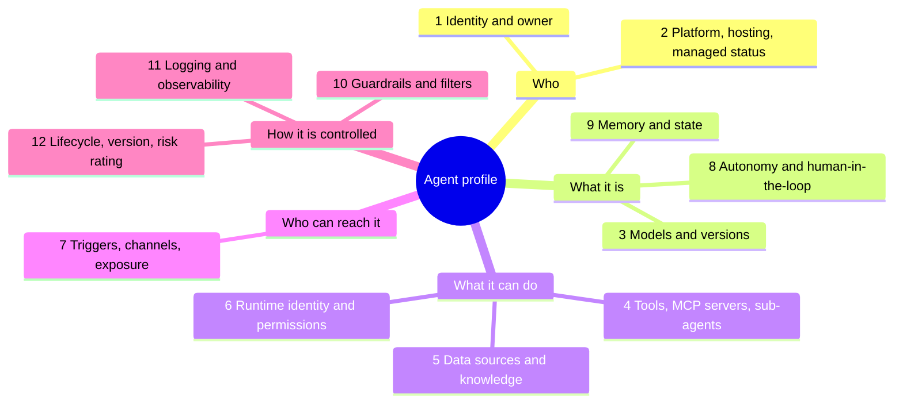
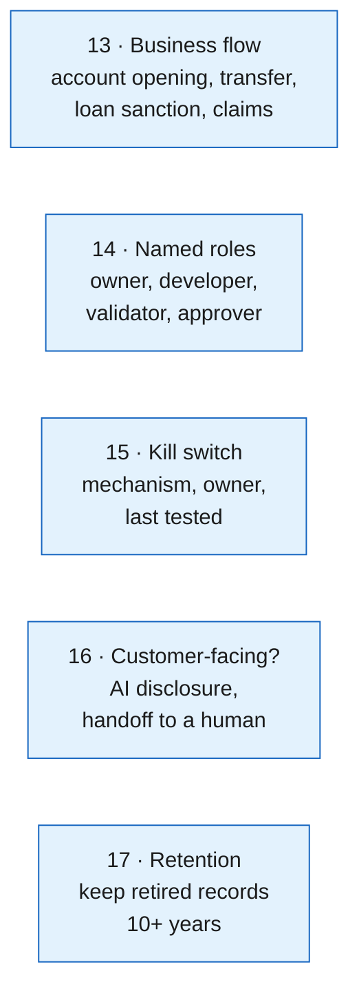
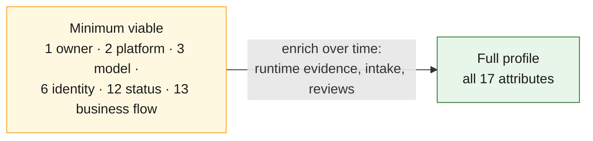

# 14 · What to know about every agent: the agent profile

**Collect twelve core attributes for every agent, plus five bank-specific ones.** Identity/permissions and exposure are kept as separate attributes because that is where most real incidents start. Each attribute maps to an OWASP agentic risk, so the profile doubles as the input to risk scoring ([18](18-risk-scoring.md)).

## The twelve core attributes

| # | Attribute | Why it matters | OWASP agentic risk |
|---|---|---|---|
| 1 | **Identity and owner**: ID, name, business and technical owner, sponsor, business unit | Accountability; orphaned agents behave like rogue ones | ASI10 Rogue Agents |
| 2 | **Platform, hosting and managed status** | Scopes which collector and which controls apply | — (scoping) |
| 3 | **Models and versions**: requested and actually served | Supply chain; model swaps change behaviour | ASI04 Agentic Supply Chain |
| 4 | **Tools, actions, MCP servers, sub-agents** | What the agent can *do*; the largest attack surface | ASI02 Tool Misuse, ASI04, ASI07 Inter-Agent Communication |
| 5 | **Data sources, knowledge bases, RAG** | What the agent can *see*; poisoning entry point | ASI06 Memory and Context Poisoning |
| 6 | **Runtime identity, permissions, credentials** | Blast radius; the identity level from [06](06-identity-onboarding.md) | ASI03 Identity and Privilege Abuse |
| 7 | **Triggers, channels, exposure**: who can send it input | Untrusted input paths (email, web, tickets, customers) | ASI01 Agent Goal Hijack, ASI09 Human-Agent Trust |
| 8 | **Autonomy and human-in-the-loop** | Whether a human approves before money or data moves | ASI08 Cascading Failures, ASI09 |
| 9 | **Memory and state persistence** | Long-lived memory carries poisoning across sessions | ASI06 |
| 10 | **Guardrails and content filters** | Control coverage | ASI01, ASI05 Unexpected Code Execution |
| 11 | **Logging and observability** | Forensics and provenance ([09](09-telemetry-provenance.md)) | All (detection) |
| 12 | **Lifecycle, version, risk rating** | Change control, review cadence, retirement | ASI10 |

The OWASP Top 10 for Agentic Applications 2026 was published in December 2025 by the OWASP GenAI Security Project: ASI01 Agent Goal Hijack, ASI02 Tool Misuse and Exploitation, ASI03 Identity and Privilege Abuse, ASI04 Agentic Supply Chain Vulnerabilities, ASI05 Unexpected Code Execution, ASI06 Memory and Context Poisoning, ASI07 Insecure Inter-Agent Communication, ASI08 Cascading Failures, ASI09 Human-Agent Trust Exploitation, ASI10 Rogue Agents.

## Five bank-specific attributes

These come from the RBI draft model-risk guidance, FREE-AI and the business-flow focus of this platform.

| # | Attribute | Driver |
|---|---|---|
| 13 | **Business flow(s) supported** | Joins inventory to provenance; FREE-AI use-case field |
| 14 | **Named roles**: owner, developer, validator, approver as named people | RBI draft MRM guidance, as reported in secondary summaries; confirm against the draft text |
| 15 | **Kill switch**: how to suspend this agent, who can, when it was last tested | RBI draft proposes override, suspension or deactivation mechanisms including kill switches |
| 16 | **Customer-facing**: does it talk to customers; is AI use disclosed; can the customer switch to a human | RBI draft (customer disclosure and human handoff) |
| 17 | **Retention**: record kept after retirement | RBI draft: decommissioned models stay on the register for at least 10 years (secondary sources) |

The RBI draft, as summarised by two independent law-firm and press write-ups, also says **no model may be used unless it is in the central register**. For agents, that turns the inventory from a report into a control: the AI gateway should refuse traffic from any agent key not in the CMDB ([21](21-inventory-threat-model.md)).

## Where each attribute comes from

| # | AWS | Azure / Microsoft | GCP | On-prem and code |
|---|---|---|---|---|
| 1 | ARN/ID, tags, Agent Registry publisher | Foundry agent name; Entra `agentIdentity` `/owners` and sponsors; Power Platform owner | `reasoningEngines` name and labels; Agent Registry entry | CODEOWNERS, repo owner, K8s labels, intake form |
| 2 | Bedrock Agent vs AgentCore vs ECS/EKS/Lambda | Foundry `kind`; Copilot Studio environment | Agent Runtime vs Cloud Run/GKE | Collector that found it |
| 3 | `GetAgent.foundationModel`; inference profile; CloudTrail `modelId` | Foundry agent model; Power Platform inventory model column | Agent spec; Data Access logs | Code config; gateway logs (served model) |
| 4 | Action groups (Lambda + schema); AgentCore Gateway targets; collaborators | Foundry tools; Copilot Studio connectors (preview column) | Agent Registry MCP/tool links; Agent Gateway | MCP configs, `@tool` code, kagent `tools`, gateway MCP logs |
| 5 | `ListAgentKnowledgeBases` → data sources | Foundry file/search tools | Data stores in config | Vector DB connections, retrieval spans |
| 6 | `agentResourceRoleArn`; AgentCore workload identity and credential providers | Entra `appRoleAssignments`, `oauth2PermissionGrants` | Agent identity / service account via `SearchAllIamPolicies` | SPIRE entries, K8s service account RBAC, vault paths |
| 7 | Alias endpoints, resource policies, API Gateway | Copilot Studio channels and sharing; Agent 365 package sharing (per-agent GET) | IAM invoker bindings | Ingress, A2A agent card, queue subscriptions |
| 8 | Return-of-control / user confirmation | Approval steps; tool approval settings | Code-level callbacks | kagent `requireApproval`; code review |
| 9 | `memoryConfiguration`; AgentCore Memory | Foundry threads/memory | Sessions, Memory Bank | Memory stores; `*_memory` spans |
| 10 | `guardrailConfiguration` | Content Safety / Prompt Shields | Model Armor | Gateway guardrail policies |
| 11 | CloudTrail, model invocation logging, AgentCore observability | Foundry tracing, Purview, Defender | Cloud Logging/Trace, Data Access logs | OTel spans, gateway logs |
| 12 | `agentStatus`, versions/aliases, Registry approval state | Agent versions, publish status | Runtime revisions; Registry status | Image digest, Git tags, CMDB lifecycle |

## Minimum viable profile vs full profile

Not every field is knowable for every agent on day one. The reconciliation engine should accept partial records and compute completeness.

An agent missing any minimum-viable field cannot be **managed**, whatever else is known. Track profile completeness per agent as a KPI alongside the ones in [12](12-kpis.md).

The schema for all of this is [`schemas/agent-record.schema.json`](../schemas/agent-record.schema.json).

---
[← 13 Open questions](13-open-questions.md) · [Index](README.md) · [Next: 15 Pulling the inventory →](15-pulling-inventory.md)
