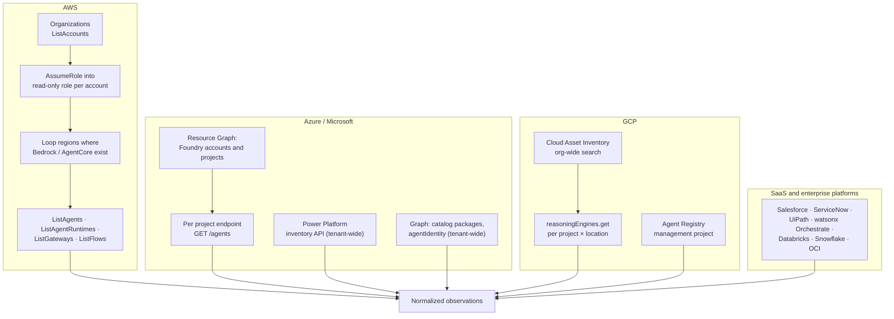
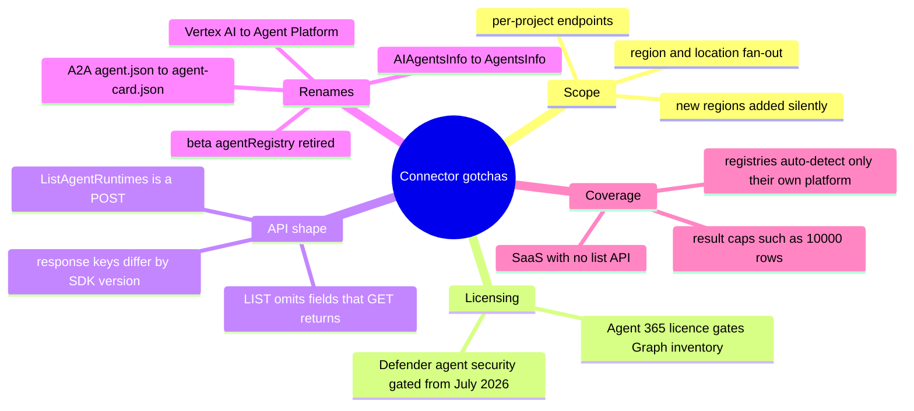

# 15 · Pulling the inventory, platform by platform

**Every platform-hosted agent can be listed through a first-party API, but every API is scoped (account × region, project × location, environment, workspace), so the connector's real job is the fan-out.** This page lists the calls, the read-only permissions and the gotchas. Machine-readable versions live in [`knowledge/platform-connectors.yaml`](../knowledge/platform-connectors.yaml).

> Sample code here has **not** been run against live tenants. API names come from vendor documentation and a November 2026 research pass; confirm each against the current docs before production use.

## The fan-out



## AWS

| What | List call | Detail calls | Notes |
|---|---|---|---|
| Bedrock Agents | `bedrock-agent:ListAgents` | `GetAgent` (role ARN, model, guardrail, memory), `ListAgentActionGroups`, `GetAgentActionGroup`, `ListAgentKnowledgeBases`, `ListAgentAliases`, `ListAgentVersions`, `ListAgentCollaborators` | Account × region |
| Bedrock Flows | `bedrock-agent:ListFlows` | `GetFlow`, `ListFlowAliases`, `ListFlowVersions` | Account × region |
| AgentCore | `bedrock-agentcore-control:ListAgentRuntimes` | `ListAgentRuntimeEndpoints` (live version), `ListGateways`, `ListGatewayTargets`, `ListMemories`, `ListWorkloadIdentities`, credential-provider lists | `ListAgentRuntimes` is a **POST** to `/runtimes/`; the control-plane surface keeps growing |
| AWS Agent Registry | Registry record search/list | Records for MCP servers, A2A agents, skills | GA 31 August 2026; auto-detects AgentCore runtimes and gateways org-wide. Classic Bedrock Agents and self-hosted agents need manual records |
| AWS Config | Aggregator queries | AgentCore Gateway, Memory, WorkloadIdentity, GatewayTarget, RuntimeEndpoint, and more added through 2026 | `AWS::Bedrock::Agent` itself not confirmed as a Config type: call the API directly |
| Resource Explorer | Aggregator index search | `bedrock:agent`, `bedrock:flow`, `bedrock:knowledge-base`, `bedrock:agent-alias` | Cheap first-pass census |
| Shadow evidence | CloudTrail / Athena | `InvokeModel`, `Converse`, `InvokeAgent` grouped by `userIdentity.arn` | Subtract principals of registered agents |

```python
# AWS: Bedrock Agents and AgentCore runtimes across accounts and regions (sketch)
import boto3

def session_for(account_id, role="AgentInventoryReadOnly"):
    c = boto3.client("sts").assume_role(
        RoleArn=f"arn:aws:iam::{account_id}:role/{role}",
        RoleSessionName="agent-inventory")["Credentials"]
    return boto3.Session(aws_access_key_id=c["AccessKeyId"],
                         aws_secret_access_key=c["SecretAccessKey"],
                         aws_session_token=c["SessionToken"])

def bedrock_agents(sess, region):
    ba = sess.client("bedrock-agent", region_name=region)
    for page in ba.get_paginator("list_agents").paginate():
        for s in page["agentSummaries"]:
            a = ba.get_agent(agentId=s["agentId"])["agent"]
            yield {"platform": "aws-bedrock-agents", "external_id": a["agentArn"],
                   "name": a["agentName"], "model": a.get("foundationModel"),
                   "runs_as": a.get("agentResourceRoleArn"), "status": a.get("agentStatus")}

def agentcore_runtimes(sess, region):
    ac = sess.client("bedrock-agentcore-control", region_name=region)
    for page in ac.get_paginator("list_agent_runtimes").paginate():
        for r in page["agentRuntimes"]:
            yield {"platform": "aws-agentcore", "external_id": r["agentRuntimeArn"],
                   "name": r["agentRuntimeName"], "status": r["status"]}
```

```sql
-- CloudTrail (Athena): who is calling Bedrock models in the last 30 days?
SELECT useridentity.arn AS principal, eventname, count(*) AS calls
FROM cloudtrail_logs
WHERE eventsource = 'bedrock.amazonaws.com'
  AND eventname IN ('InvokeModel','InvokeModelWithResponseStream','Converse','ConverseStream','InvokeAgent')
  AND eventtime > date_format(current_timestamp - interval '30' day, '%Y-%m-%dT%H:%i:%sZ')
GROUP BY 1, 2 ORDER BY calls DESC;
```

## Microsoft (Azure, Power Platform, Microsoft 365)

| What | Call | Scope | Notes |
|---|---|---|---|
| Foundry Agent Service | `GET {projectEndpoint}/agents` (filter `kind`: prompt, hosted, workflow, external, voice) | Per Foundry project | Find projects first with Resource Graph. `external` agents are metadata-only registrations of agents running elsewhere: a signal to look for them |
| Foundry classic / Azure OpenAI Assistants | `GET {endpoint}/assistants` | Per project or resource | Legacy path |
| Copilot Studio and Agent Builder | Power Platform inventory API `POST https://api.powerplatform.com/resourcequery/resources/query` (`type == 'microsoft.copilotstudio/agents'`) | Tenant-wide | GA early 2026; model column; connectors column in preview. Dataverse `bots` table for deeper config |
| Agent 365 registry | Graph `GET /v1.0/copilot/admin/catalog/packages` | Tenant-wide | Needs at least one Agent 365 licence and AI Administrator. LIST does not return sharing scope; GET each package. `/beta/agentRegistry` retired 15 June 2026 |
| Entra Agent ID | Graph `GET /v1.0/servicePrincipals/microsoft.graph.agentIdentity` | Tenant | Join `/owners`, `appRoleAssignments`, `oauth2PermissionGrants` for blast radius |
| Defender | Advanced hunting (`AIAgentsInfo` migrating to `AgentsInfo`) | Tenant | Copilot Studio and Foundry agent security needs an Agent 365-eligible licence from 1 July 2026 |
| Local agents | Defender for Endpoint local AI agent inventory | Windows and macOS devices | Process-based; MCP config discovery needs antivirus active mode and real-time protection |

Agent 365 became generally available on 1 May 2026 (Microsoft 365 E7 or standalone). Its registry sync with AWS Bedrock and Google Cloud was announced in public preview, so in a Microsoft-heavy bank it can be a federation source, but not a complete one.

```bash
# Foundry projects across subscriptions, then agents per project
az graph query -q "resources | where type =~ 'microsoft.cognitiveservices/accounts/projects' | project id, name, location"
az rest --method GET --resource https://ai.azure.com \
  --url "https://<account>.services.ai.azure.com/api/projects/<project>/agents?api-version=${API_VERSION}"

# Entra agent identities
curl -H "Authorization: Bearer $GRAPH_TOKEN" \
  "https://graph.microsoft.com/v1.0/servicePrincipals/microsoft.graph.agentIdentity"
```

## Google Cloud

| What | Call | Scope | Notes |
|---|---|---|---|
| Agent Runtime (Reasoning Engine) | `GET https://{region}-aiplatform.googleapis.com/v1/projects/{p}/locations/{l}/reasoningEngines` | Project × location | Vertex AI rebranded as Gemini Enterprise Agent Platform (22 April 2026); API name unchanged |
| Cloud Asset Inventory | `searchAllResources` with `aiplatform.googleapis.com/ReasoningEngine` | Organisation | One call for an org-wide census |
| Agent Registry | Agent Registry API / console | Management project aggregating member projects | Agents deployed to Agent Platform register automatically; best source for agent → MCP/tool links |
| Dialogflow CX | `projects.locations.agents.list` | Project × location | |

```bash
gcloud asset search-all-resources --scope=organizations/$ORG_ID \
  --asset-types=aiplatform.googleapis.com/ReasoningEngine --format=json
```

## Enterprise and SaaS platforms common in banks

| Platform | How to list agents | Status / caveat |
|---|---|---|
| **Oracle OCI Generative AI Agents** | Generative AI Agents API: list agents and agent endpoints (`GenerativeAiAgentClient`; Terraform data sources `oci_generative_ai_agent_agents`, `..._agent_endpoints`) | Per compartment × region; confirm exact operation names in the SDK |
| **Salesforce Agentforce** | SOQL `BotDefinition`; Tooling `GenAiPlannerDefinition`, `GenAiFunctionDefinition`; Metadata `GenAiPlannerBundle`, `GenAiPlugin`, `GenAiFunction` | Agent metadata changed at API v68; permissions unconfirmed |
| **ServiceNow AI Agents** | Table API `sn_aia_agent`, `sn_aia_tool`, `sn_aia_agent_tool_m2m` | AI Control Tower table names vary across sources; check `sys_db_object` |
| **UiPath Agents** | Automation Cloud **Agents** page is the registry and monitoring hub; TypeScript SDK `Agents.getAll(start, end)` returns runtime data | Types: conversational, low-code (Studio Web), coded, advanced (preview). A documented admin list API across tenants was not confirmed |
| **IBM watsonx Orchestrate** | `GET /v2/orchestrate/agents/unified` (bearer token; `include_hidden`, `query`, `limit`/`offset`) | Response schema not documented on the reference page |
| **Pega (Infinity, Blueprint, Agentic Process Fabric)** | No public list-agents API confirmed | Agents are anchored in Pega workflows: inventory via Pega application metadata and intake until an API is confirmed |
| **Databricks** | Agents deployed via Model Serving: serving-endpoints list API. Agent Services in Unity Catalog: `GET /api/2.1/unity-catalog/agent-services` | Agent Services is beta; `owner` returns null in this release |
| **Snowflake Cortex Agents** | `SHOW AGENTS IN ACCOUNT` | Needs OWNERSHIP, USAGE, MODIFY or MONITOR on each agent; results capped at 10,000 rows |
| **OpenAI (ChatGPT Enterprise, API)** | Compliance API (GPTs, audit); org Admin API (projects, service accounts, keys) | Endpoint shapes from third-party integrator docs; custom GPTs moving to "plugins" |
| **n8n / Flowise / Dify (self-hosted)** | Workflow export JSON; look for AI Agent nodes and model credentials | Treat as self-hosted workloads |
| **kagent (Kubernetes)** | `kubectl get agents.kagent.dev -A` (CRD `kagent.dev/v1alpha2`, `kind: Agent`) | Spec lists `modelConfig`, `tools` (MCP servers or other agents) and `requireApproval` per tool |

```sql
-- Snowflake
SHOW AGENTS IN ACCOUNT;
```

```bash
# Kubernetes agents declared as kagent CRDs, cluster-wide
kubectl get agents.kagent.dev -A -o json \
  | jq '.items[] | {ns: .metadata.namespace, name: .metadata.name,
         model: .spec.declarative.modelConfig, tools: [.spec.declarative.tools[]?]}'

# Databricks Agent Services (beta)
databricks api get /api/2.1/unity-catalog/agent-services
```

## Minimal read-only permissions

| Platform | Starting point |
|---|---|
| AWS | Custom policy: `bedrock:List*`, `bedrock:Get*` (no invoke), `bedrock-agentcore:List*`, `bedrock-agentcore:Get*` (no data-plane invoke or memory read), registry list/search, `config:SelectAggregateResourceConfig`, `resource-explorer-2:Search`, CloudTrail Lake or Athena query, `iam:Get*`, `iam:List*`, `iam:SimulatePrincipalPolicy`, `organizations:ListAccounts`. AWS-managed `ReadOnlyAccess` may lag new services |
| Azure | Reader at management group; Azure AI User (or custom read data actions) on Foundry projects; Power Platform Administrator for the inventory API |
| Microsoft Graph | `Application.Read.All`, `Directory.Read.All`; AI Administrator + Agent 365 licence for catalog packages; `ThreatHunting.Read.All` for Defender hunting |
| GCP | `roles/cloudasset.viewer` at org; `roles/aiplatform.viewer` on projects; Agent Registry viewer; `roles/logging.privateLogViewer` only if reading Data Access logs |
| Salesforce | Integration user with API Enabled and View Setup and Configuration (verify for Tooling objects) |
| ServiceNow | Read ACLs on `sn_aia_*` and AI Control Tower tables |
| Snowflake | A monitoring role granted MONITOR on agents plus usage on parent databases and schemas |
| Kubernetes | ClusterRole with `get`/`list` on `agents.kagent.dev`, pods, deployments, service accounts (no `secrets` read) |

These read-only credentials together can see every agent, model and permission in the bank. Treat the connector identities as crown jewels ([21](21-inventory-threat-model.md)).

## Gotchas the connectors must handle



---
[← 14 Agent profile](14-agent-profile.md) · [Index](README.md) · [Next: 16 Repository scanning →](16-repository-scanning.md)
