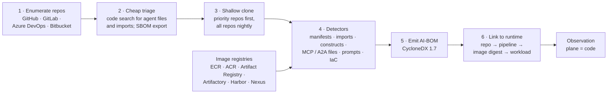
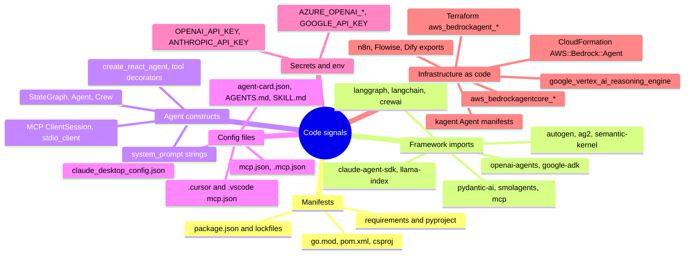
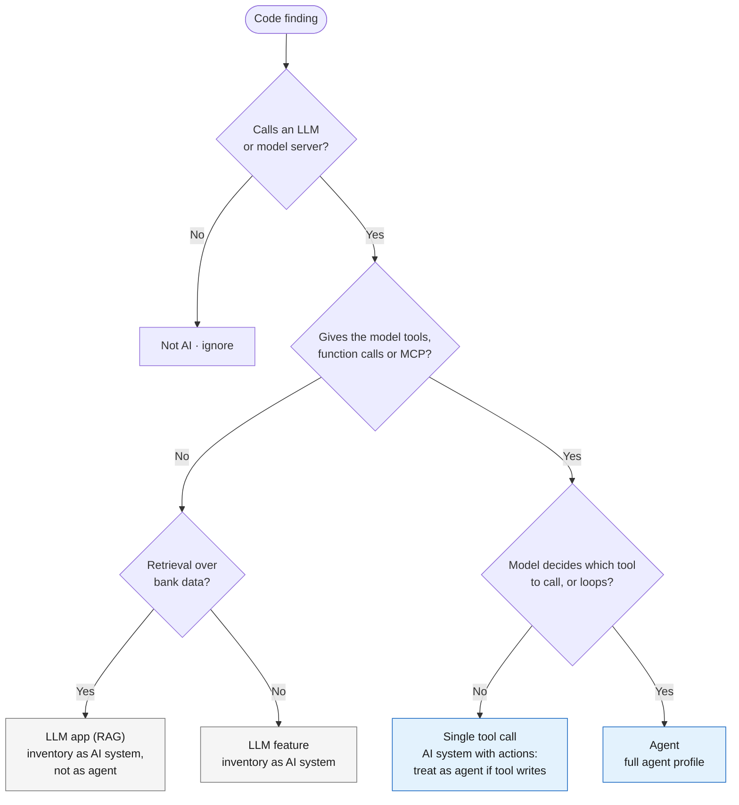
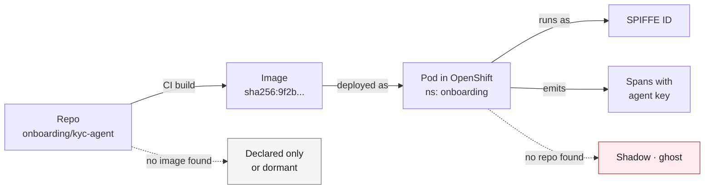

# 16 · Repository and artifact scanning

**Code finds agents before they run, including ones no platform API will ever list.** Scan every repository and image registry for agent frameworks, agent constructs, MCP and A2A files, prompts and infrastructure-as-code, then link each finding to a running workload so it becomes a deployment record rather than a guess. Detection patterns live in [`knowledge/detection-signatures.yaml`](../knowledge/detection-signatures.yaml).

## Pipeline

| Step | How | Watch out for |
|---|---|---|
| 1 Enumerate | GitHub `GET /orgs/{org}/repos`; GitLab `GET /groups/:id/projects?include_subgroups=true`; Azure DevOps `GET {org}/_apis/git/repositories`; Bitbucket `GET /2.0/repositories/{workspace}` | Archived repos, forks, personal namespaces, mirrors of vendor code |
| 2 Triage | GitHub code search for `filename:mcp.json`, `agent-card.json`, `SKILL.md`, `AGENTS.md`, framework imports; dependency-graph SBOM export per repo | Code search is rate-limited and capped: use it to prioritise, never as the system of record |
| 3 Clone | Shallow clone, default branch plus release branches | Large monorepos: scan by path; secrets in history are a separate scan |
| 4 Detect | Static detectors only; never execute code or start MCP servers | See signature groups below |
| 5 AI-BOM | `cdxgen` (`aibom` mode) or Cisco AI BOM → CycloneDX 1.7, agent fields as custom `properties` | No standard models agent → tool → permission edges well yet; keep your graph as the source of truth |
| 6 Link | CI metadata and image labels (`org.opencontainers.image.source`, `revision`) → image digest → running pod/function/ARN | Without this link, a code finding stays "declared" or "dormant" |

## What the detectors look for

## "Uses an LLM" is not the same as "is an agent"

The inventory must not flood with every app that calls a model. Classify each code finding:

Regulators (FREE-AI, RBI MRM draft, MAS) want **all** AI systems in an inventory, so non-agent LLM apps are still recorded, as AI systems rather than agents. The rule above only decides which records need the agent-specific profile.

## AI-BOM formats and Indian guidance

| Format / guidance | Use |
|---|---|
| **CycloneDX 1.7** (ML-BOM / AI-BOM) | Practical interchange format; `cdxgen` emits it for prompt files, AI services, MCP configs and model metadata |
| **SPDX 3.0.1 AI profile** | Model-level documentation; weaker for agent and tool topology |
| **CERT-In Technical Guidelines on SBOM, QBOM & CBOM, AIBOM and HBOM (v2.0, 9 July 2025)** | Advisory, not mandatory; aimed at government, public sector, essential services and software exporters. Its SBOM minimum fields apply to AIBOMs "as applicable". Worth aligning to, since bank vendors will be asked for AIBOMs |
| **OWASP AIBOM Generator** | CycloneDX for Hugging Face models only; model provenance, not agent discovery |

## Tools for this step

| Tool | Strength | Caution |
|---|---|---|
| `cdxgen` (`aibom`) | Best AI-BOM emitter for pipelines; CycloneDX 1.7 and SPDX 3.0.1 | Declared inventory only |
| Cisco AI BOM (open source) | Code, images and cloud; 30 component types incl. agent, tool, MCP server/client, memory, prompt, guardrail, secret | Deepest agent/MCP/A2A detection is Python-only |
| Snyk AI-BOM | Code-level detection incl. MCP usage | Commercial; check data handling |
| SPLX Agentic Radar | Per-repo workflow graphs for LangGraph, CrewAI, n8n, OpenAI Agents SDK, AutoGen; OWASP mapping | Per-repo, not org-scale |
| Syft | Package SBOMs from images | Not agent-aware; pair with signatures |

## Linking code to runtime

---
[← 15 Pulling the inventory](15-pulling-inventory.md) · [Index](README.md) · [Next: 17 Tools landscape →](17-tools-landscape.md)
