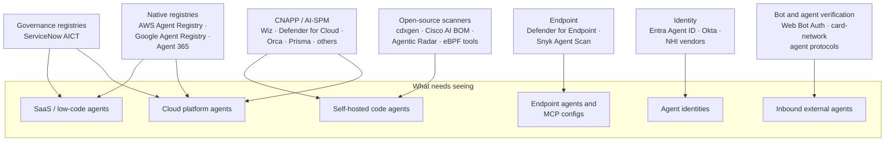
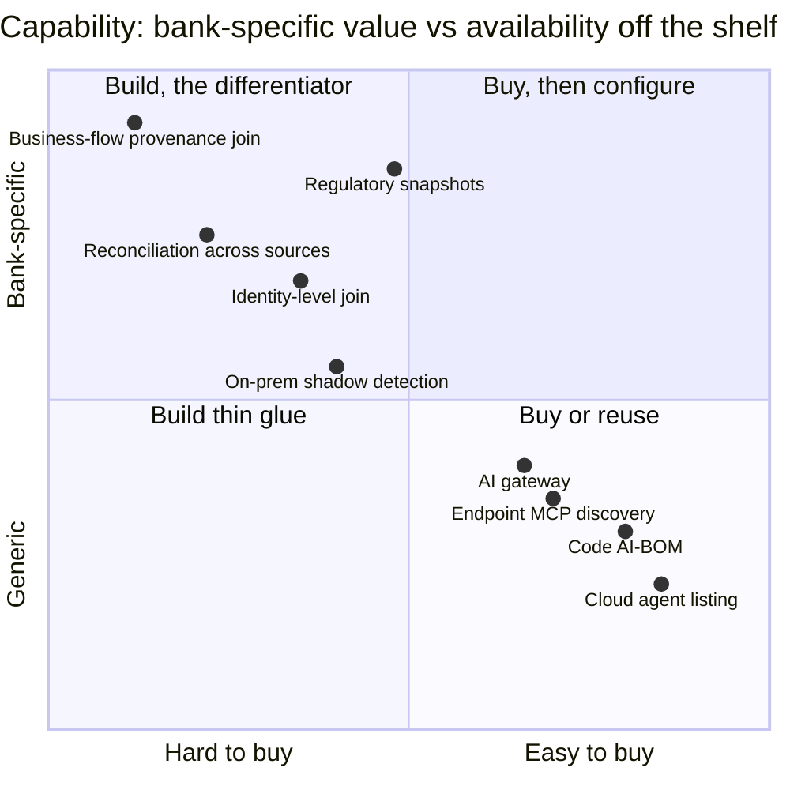

# 17 · Tools available today (November 2026)

**No single product covers a bank's whole agent estate.** Native registries see their own platform, CNAPPs are cloud-first, Microsoft is Microsoft-first, and open-source scanners are point tools. The platform in this repo federates them; this page says what each can contribute.

> Capabilities below come from vendor documentation, announcements and practitioner write-ups, **not hands-on testing**. Validate each in a pilot with seeded agents ([13](13-open-questions.md)).

## Where each kind of tool sees

## Native and platform tools

| Tool | Discovers | Method | Coverage | Notes |
|---|---|---|---|---|
| **AWS Agent Registry** | AgentCore runtimes and gateways (auto, org-wide); anything registered manually | Native | AWS; indexes agents elsewhere only if registered | GA 31 August 2026; a catalog, not a scanner |
| **Google Agent Registry** | Agent Platform agents (auto), MCP servers, tools, skills | Native | GCP; aggregates member projects | |
| **Microsoft Agent 365 + Entra Agent ID + Defender** | Copilot Studio, Foundry, M365 agents, partner agents; local endpoint agents and MCP configs; registry sync with Bedrock and Google (public preview) | API connectors, Defender for Endpoint | Microsoft-first | GA 1 May 2026; licence-gated |
| **ServiceNow AI Control Tower** | AI systems incl. hyperscaler agents via connectors; managed/unmanaged flag; duplicate detection | Discovery + CMDB | Multi-source | Governance registry; see [08](08-servicenow-vs-scratch.md) |
| **Okta for AI Agents / Okta ISPM** | Agent identities; endpoint agents, MCP servers and shadow AI OAuth grants | Identity plane | IdP-centred | |

## Commercial security tools

| Tool | Discovers | Method | Notes |
|---|---|---|---|
| **Wiz (AI-SPM)** | Bedrock, Azure AI, Vertex, SaaS AI, custom agents via code/workload analysis; AI-BOM incl. tool definitions and MCP servers | Agentless cloud APIs + code/workload scanning | Graph-based attack paths; Google completed its acquisition of Wiz in March 2026; reported not to cover laptop MCP configs |
| **Microsoft Defender for Cloud / XDR** | AI workloads and agents in Microsoft and some other clouds | Agentless + sensor | Hunting table moving from `AIAgentsInfo` to `AgentsInfo` |
| **Orca, Palo Alto Prisma AIRS, CrowdStrike Falcon Cloud Security, Tenable, Zscaler AI-SPM** | Cloud AI services and models; agent depth varies | Agentless cloud APIs | Listed in 2026 AI-SPM buyer's guides; agent-level depth not verified |
| **Zenity, Noma, Lasso, Astrix, Oasis, Check Point/Lakera, SentinelOne/Prompt Security, Varonis, Cisco AI Defense** | Varies: low-code/SaaS agents, NHI and agent identity, runtime/browser, MCP posture | Mixed | Not individually verified in this research |

## Open-source building blocks

| Tool | Role in this platform | Caution |
|---|---|---|
| **cdxgen** (`aibom`) | Code and image AI-BOM → CycloneDX 1.7 | Declared inventory only |
| **Cisco AI BOM**, **MCP Scanner**, **A2A Scanner**, **Skill Scanner** | Code/image/cloud AI-BOM; MCP server, agent card and skill scanning | Scanners may call an external API (AI Defense) for LLM judging; run offline modes |
| **SPLX Agentic Radar** | Per-repo agent workflow graphs, OWASP mapping | Not org-scale |
| **Snyk Agent Scan** (ex-mcp-scan) | Finds local MCP configs on developer machines | **Executes** stdio MCP server commands and sends tool descriptions to an external analysis API; a consent flow was added later. Parse configs statically instead, or run sandboxed |
| **DefendAI AgentDiscover** | Code + network + K8s eBPF + endpoint correlation; ghost/zombie labels | Can optionally upload results to a vendor platform |
| **OpenLIT Controller, AIOStack, Tetragon** | eBPF runtime evidence of LLM calls per pod/process | Privileged; AIOStack's dashboard is vendor-hosted |
| **Praetorian Julius** | Fingerprints 17 model servers and AI UIs (Ollama, vLLM, LiteLLM, TGI, NIM, Open WebUI and others) | Active probing: schedule and scope with network teams |
| **LiteLLM, agentgateway, Kong AI Gateway** | The AI gateway chokepoint ([04](04-discovery.md)) | Gateway is a control, not just a sensor |
| **SPIRE** | Agent workload identity on-prem ([06](06-identity-onboarding.md)) | |
| **OpenTelemetry Collector** | Span ingestion and attribute normalisation ([09](09-telemetry-provenance.md)) | GenAI conventions still Development status |
| **Promptfoo, Garak** | Not discovery: red-team discovered agents, feed results into risk | |

## Build vs buy, per capability

Positions are a judgement to start a build-vs-buy discussion, not a market study.

## Gaps a new tool can fill

1. **Vendor-neutral federation** of AWS Agent Registry, Google Agent Registry, Agent 365, Power Platform inventory, Salesforce, ServiceNow, UiPath, watsonx, Databricks, Snowflake and OCI into one normalised record.
2. **Code ↔ runtime ↔ identity correlation**: repo finding → image → workload → the identity it runs as → the business flow it touches.
3. **Agent-specific blast radius**: the agent's own permissions plus its tools' credentials (AgentCore credential providers, MCP server tokens, connector connections).
4. **Safe MCP and A2A discovery**: static parsing first, no execution, no data leaving the bank.
5. **Licence-independent coverage** for Microsoft tenants without Agent 365, rebuilt from Power Platform inventory, Entra and Foundry APIs.
6. **Drift and lifecycle**: new tools or MCP servers, model swaps, sharing expansion, owner departure.
7. **Inbound external agents** as a register of counterparties, not just a bot-management log ([20](20-external-agents.md)).

---
[← 16 Repository scanning](16-repository-scanning.md) · [Index](README.md) · [Next: 18 Risk scoring →](18-risk-scoring.md)
