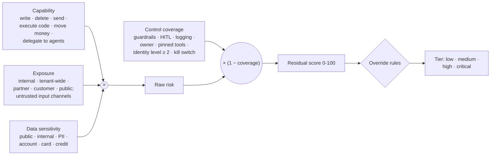
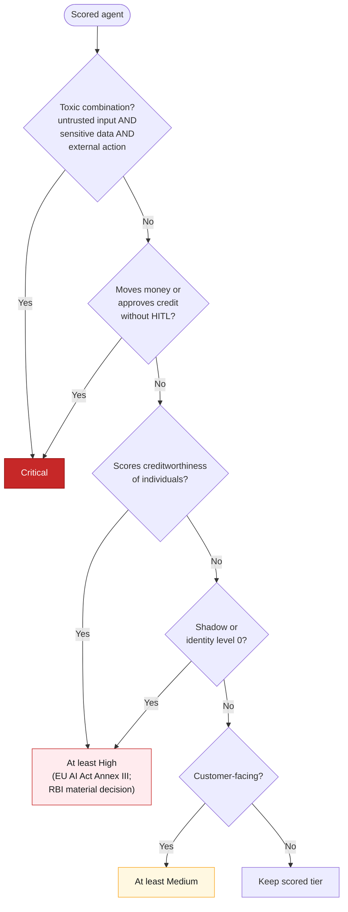

# 18 · Risk scoring and tiering

**Score each agent from what it can do, who can reach it, what it can see, and how well it is controlled; then let a few bank-specific rules override the score.** The tier drives review cadence, approval level and which alerts page someone. The machine-readable model is [`knowledge/risk-model.yaml`](../knowledge/risk-model.yaml).

## The formula

`Residual = Capability × Exposure × Data sensitivity × (1 − Control coverage)`, each factor normalised to 0–1 and the product scaled to 0–100. Score bands: **low** below 10, **medium** 10–24, **high** 25–49, **critical** 50 and above. Starting weights are in the YAML; the bank's risk committee should calibrate them on the first real inventory.

## Factor scales

| Factor | 0.2 | 0.5 | 0.8 | 1.0 |
|---|---|---|---|---|
| **Capability** | Read-only tools | Writes to internal systems | Sends external messages, executes code, delegates to agents | Moves money, changes customer records, approves credit |
| **Exposure** | Single team, internal input only | Tenant-wide internal | Partner or vendor input | Customers or public internet; email, web or ticket input |
| **Data sensitivity** | Public | Internal | PII | Account, card or credit data |

| Control | Coverage credit |
|---|---|
| Guardrails / content filters on input and output | 0.15 |
| Human-in-the-loop before any write | 0.25 |
| Full telemetry with agent key | 0.10 |
| Active named owner | 0.10 |
| Pinned tool and MCP versions, allow-listed | 0.10 |
| Identity level 2 or 3 | 0.15 |
| Kill switch tested in the last quarter | 0.15 |

Coverage is the sum of credits, capped at 0.9 so no agent scores zero.

## Override rules (applied after the score)

The **toxic combination** (untrusted input + sensitive data + external action) is the pattern behind most agent prompt-injection incidents: whatever the arithmetic says, it is critical.

## Worked example: the KYC onboarding agent

| Step | Value |
|---|---|
| Capability | Creates customer records in core banking → **1.0** |
| Exposure | Mobile onboarding channel takes customer-uploaded documents → **1.0** |
| Data sensitivity | PII and account data → **1.0** |
| Control coverage | Guardrails 0.15 + HITL 0.25 + telemetry 0.10 + owner 0.10 + pinned tools 0.10 + identity L3 0.15 + kill switch tested 0.15 = 1.0 → capped at **0.9** |
| Residual | 1.0 × 1.0 × 1.0 × (1 − 0.9) × 100 = **10** → medium |
| Overrides | Untrusted input + PII/account data + record-changing action → toxic combination → **critical** |

Good controls lower the score, but a customer-facing agent that writes to core banking stays critical: the tier sets the review cadence, and the controls are what make that tier acceptable. This matches the [example record](../examples/kyc-onboarding-agent.yaml).

## What the tier changes

| Tier | Approval | Re-review | Risk rating review | Telemetry | Kill switch test |
|---|---|---|---|---|---|
| Critical | Board risk committee (RBI draft: high-risk models need RMCB clearance) | On every drift event | Quarterly | Full, content opt-in under DLP | Monthly |
| High | Risk committee | On every drift event | At least annually (RBI draft) | Full | Quarterly |
| Medium | Business owner + AI steward | Model or tool change | Annually | Full | Half-yearly |
| Low | AI steward | Annual | Annually | Basic | Annually |

## Map risks to OWASP, ATLAS and MAESTRO

| Profile signal | OWASP agentic | Typical finding |
|---|---|---|
| Untrusted input channel + write tools | ASI01 Goal Hijack | Indirect prompt injection via email or document |
| Write/delete tools without HITL | ASI02 Tool Misuse | Excessive agency |
| Identity level 0–1; shared or human credentials | ASI03 Identity and Privilege Abuse | Agent acting as a person |
| Unpinned MCP servers; third-party tools loaded at runtime | ASI04 Supply Chain | Tool description changes after approval |
| Code-execution tool | ASI05 Unexpected Code Execution | Sandbox escape |
| Persistent memory; RAG over editable content | ASI06 Memory and Context Poisoning | Poisoned knowledge base |
| A2A calls without auth; unsigned agent cards | ASI07 Inter-Agent Communication | Spoofed peer agent |
| Long delegation chains; no circuit breaker | ASI08 Cascading Failures | One agent's error amplified |
| Customer-facing persuasion or approvals | ASI09 Human-Agent Trust | Staff rubber-stamping agent output |
| No owner; dormant with live credentials; drift unreviewed | ASI10 Rogue Agents | Zombie agent |

Map individual findings to MITRE ATLAS techniques, and architecture layers to CSA MAESTRO, when the security team uses them.

---
[← 17 Tools landscape](17-tools-landscape.md) · [Index](README.md) · [Next: 19 Scenario catalogue →](19-scenarios.md)
