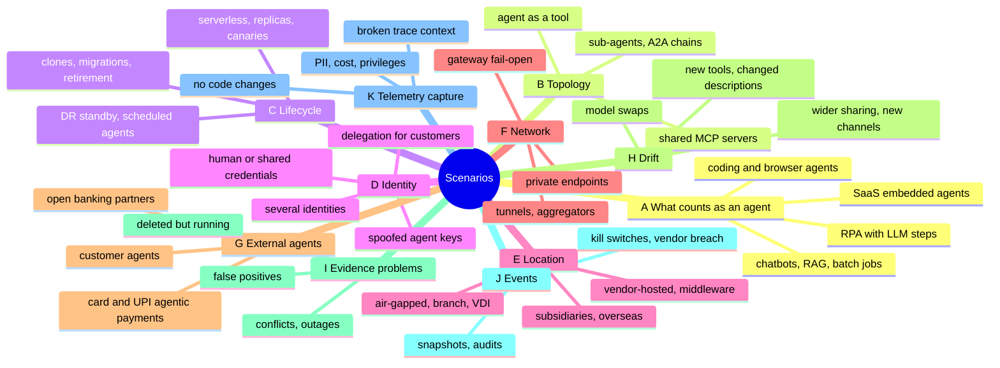
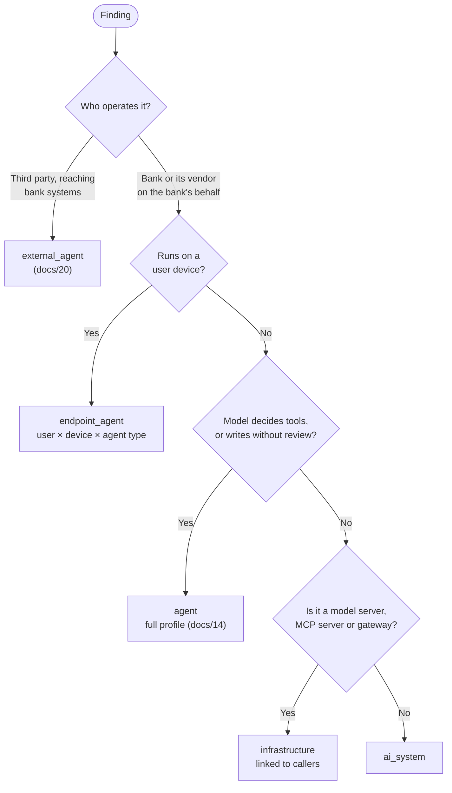
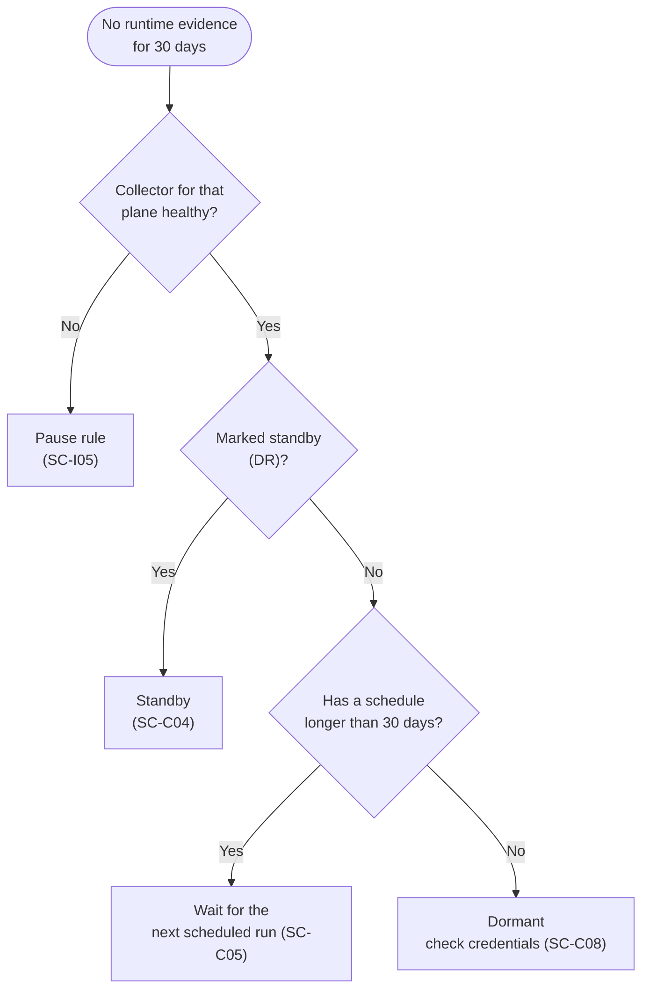
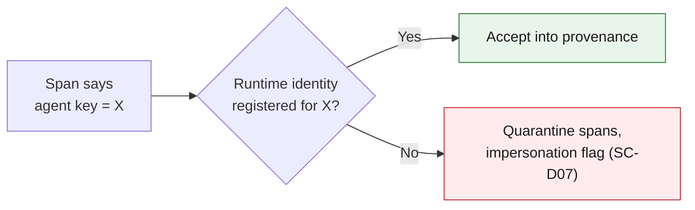

# 19 · Scenario catalogue

**The inventory engine meets the same situations again and again; each one needs a known answer for what the evidence looks like, how to record it and what to do.** This catalogue covers eleven angles. The tables below are generated from [`knowledge/scenarios.yaml`](../knowledge/scenarios.yaml), which the software loads directly; edit the YAML, not the tables, then run `python3 scripts/render_scenarios.py`.

## Eleven angles

## Three decisions that most scenarios reduce to

**1. What kind of record is this?**

**2. Quiet does not always mean dormant.**

**3. A self-asserted key never beats attested identity.**

<!-- BEGIN GENERATED: scenarios -->
99 scenarios in 11 groups.

## A · What counts as an agent

| ID | Situation | Evidence | Record as · expected | Action |
|---|---|---|---|---|
| SC-A01 | **Chatbot with no tools**. Website or app assistant answers questions; it calls an LLM but has no tools. | LLM calls from one service; no execute_tool spans; no function-calling payloads | **AI system**: AI system; customer-facing flag if customers use it | Record purpose, model, data sources, AI disclosure and human-handoff evidence. |
| SC-A02 | **RAG app over bank data**. Staff assistant retrieves from policy documents or customer records and answers. | retrieval spans; vector DB connections; no write tools | **AI system**: AI system with data sources; data sensitivity from the indexed content | Record each data source and its classification; re-review when the index scope grows. |
| SC-A03 | **LLM step inside a batch job**. Nightly job summarises call transcripts and writes results to CRM. | scheduled workload; LLM calls in bursts; writes to CRM API | **Agent**: Treat as agent when model output is written to a system of record without human review | Profile it as an autonomous agent with a schedule; dormancy threshold follows the schedule (SC-C05). |
| SC-A04 | **RPA bot with an LLM step**. UiPath or similar robot uses an LLM to decide or extract, then acts in core systems. | robot account calling LLM endpoints; RPA platform agent records; screen or API actions | **Agent**: Agent; identity is usually a shared robot account (identity level 0 or 1) | Give each agent its own robot identity; record the RPA platform as the hosting platform. |
| SC-A05 | **Vendor SaaS with an embedded AI feature**. CRM or HR SaaS summarises or drafts using AI; no autonomous actions. | vendor release notes; SaaS admin settings; OAuth grants | **AI system**: Third-party AI system; governance record with zero deployment CIs | Record vendor, data shared, contractual audit rights; review on vendor feature changes. |
| SC-A06 | **Vendor SaaS with an embedded agent that acts**. Agentforce, ServiceNow AI Agents or similar take actions in the SaaS or via connectors. | SaaS agent APIs list it; connector calls to bank systems | **Agent**: Platform-hosted agent, vendor-operated; managed only if approved, owned and on the gateway where possible | Pull via the SaaS API (docs/15); map connectors to tools and integration users to identities. |
| SC-A07 | **Coding assistant in a developer IDE**. Copilot, Cursor, Claude Code or similar on developer machines with MCP servers configured. | endpoint process; MCP config files; IDE extensions; egress to provider | **Endpoint agent**: One record per user x device x agent type; identity level 0 (runs as the developer) | Inventory configured MCP servers; allow-list approved assistants and MCP servers; block access to production secrets. |
| SC-A08 | **Coding agent in CI/CD**. An agent opens pull requests or changes infrastructure from a pipeline. | bot account commits; CI jobs calling LLMs; GitHub App or token with write scope | **Agent**: Agent with repository write capability; supply-chain risk (ASI04, ASI05) | Unique app identity, branch protection, human review before merge, record repos in scope. |
| SC-A09 | **Agentic browser on an employee machine**. An AI browser (for example ChatGPT Atlas or Perplexity Comet) acts in web apps using the employee's sessions. | browser process on endpoint; egress to the browser vendor; human sessions acting at machine pace | **Endpoint agent**: Shadow endpoint agent at identity level 0 unless explicitly approved | Detect on the endpoint and at egress; apply acceptable-use policy; block from internal banking apps. |
| SC-A10 | **Standalone MCP server**. An MCP server exposes CBS or LOS functions; no agent found yet. | MCP endpoint (/mcp); service with appProtocol mcp; MCP SDK in code | **Infrastructure**: Tool CI; every caller is an agent candidate | Record tools, credentials it holds and who may call it; route through the gateway; list callers. |
| SC-A11 | **Model server with no known caller**. Ollama, vLLM or TGI is listening on an internal host. | model-server fingerprint (docs/04); GPU host; open port 11434 or 8000 | **Infrastructure**: Model CI; callers seen in flow logs are agent candidates | Identify owner and callers; require gateway in front; shadow alert if callers are unknown. |
| SC-A12 | **Notebook experiments with tools**. Data scientists build agents in Jupyter, SageMaker Studio or Databricks notebooks. | notebook kernels with agent frameworks; workspace audit logs | **Agent**: Declared or dev-stage; not managed production | Record as dev; flag immediately if it reads production customer data or calls production APIs. |
| SC-A13 | **Consumer AI used by employees with bank data**. Staff use personal ChatGPT, Claude or Gemini accounts, including agent modes, for work. | egress to consumer AI domains; CASB events; OAuth grants from corporate accounts | **Not an agent**: Shadow AI usage, not a bank agent; tracked as a usage risk, not a CI | CASB policy, DLP, sanctioned alternative; agent modes acting on bank systems are treated as SC-A09. |
| SC-A14 | **Contact-centre voice bot**. IVR or voice agent authenticates customers and performs account actions. | telephony platform AI config; calls to account APIs | **Agent**: Customer-facing agent; high capability if it moves money | Record channels, step-up authentication, disclosure and human handoff; risk override for customer-facing. |

## B · Topology and multi-agent systems

| ID | Situation | Evidence | Record as · expected | Action |
|---|---|---|---|---|
| SC-B01 | **Supervisor with in-process sub-agents**. One LangGraph service contains a supervisor and several sub-agents. | one workload; several internal invoke_agent spans with different gen_ai.agent.name | **Agent**: One deployment CI; sub-agents listed as components unless separately versioned or deployed | Record sub-agent names and their tools in the profile; split into CIs only if they get separate identities. |
| SC-B02 | **Agents calling each other over A2A**. Several agents in different services delegate tasks over A2A. | client invoke_agent spans; A2A agent cards; mTLS or OAuth between services | **Agent**: One CI per agent with DELEGATES_TO edges | Require authenticated A2A; propagate delegation (act claims) so the original human stays visible. |
| SC-B03 | **Agent exposed as a tool**. An agent is wrapped as an MCP tool or function for another agent. | MCP server whose handler invokes an agent; nested invoke spans | **Agent**: Both are CIs; edge CALLS_TOOL with kind a2a_peer | Inherit the stricter risk tier along the edge; cap delegation depth. |
| SC-B04 | **Delegation chain crosses trust boundaries**. Bank agent calls a vendor agent that calls another provider. | outbound A2A or API calls to vendor domains | **External agent**: External dependency recorded on the bank agent; cascading-failure risk (ASI07, ASI08) | Record each external peer, data shared and contract; circuit breakers and timeouts. |
| SC-B05 | **Same agent in many environments**. One agent definition deployed in DEV, UAT, PROD and two regions. | same image digest family; same repo; different namespaces or accounts | **Agent**: One definition and governance record, one CI per environment or region | Never merge across environments; production approval does not cover DEV copies with production data (SC-C06). |
| SC-B06 | **Agent factory creates agents on demand**. A no-code builder lets staff create agents from templates. | platform API lists many new agents; template IDs | **Agent**: Each persistent agent is a CI; per-request instances are not | Apply intake at publish time; inherit template risk; detect mass creation. |
| SC-B07 | **Shared MCP server used by many agents**. One MCP server holds CBS credentials and serves ten agents. | many callers in gateway MCP logs | **Infrastructure**: One tool CI; its credentials are part of every caller's effective permissions | Compute blast radius through the tool; per-caller authorisation at the MCP server. |
| SC-B08 | **Agent calls another institution's agent**. Bank agent negotiates or exchanges data with a fintech or another bank's agent. | outbound A2A to external domains; signed agent cards | **External agent**: Outbound counterparty in the external agent register | Verify the counterparty card and keys; contractual basis; log every exchange. |

## C · Lifecycle and runtime shape

| ID | Situation | Evidence | Record as · expected | Action |
|---|---|---|---|---|
| SC-C01 | **Ephemeral serverless agent**. Each request spins up a function that runs the agent and exits. | Lambda or Cloud Run invocations; no long-lived pod | **Agent**: CI is the function and version, not each invocation | last_seen from invocation logs; identity is the function role. |
| SC-C02 | **Autoscaled replicas**. Twenty pods of the same agent behind a service. | same deployment; many pod UIDs | **Agent**: One CI; replicas share identity and key | Count once; fingerprint on deployment plus image digest, not pod UID. |
| SC-C03 | **Canary or blue-green versions live together**. Version 2.4 and 2.5 both serve traffic in production. | two image digests under one deployment or two aliases | **Agent**: One CI per environment with live versions and traffic split | Drift review must approve the new version before traffic ramps. |
| SC-C04 | **Disaster-recovery standby**. A cold or warm copy in a second region gets no traffic. | platform record present; no runtime evidence | **Agent**: CI with status standby, not dormant | Mark standby explicitly so dormancy rules skip it; still revoke unused standing credentials where possible. |
| SC-C05 | **Scheduled monthly or quarterly agent**. Month-end or quarter-end reconciliation agent runs a few days per period. | schedule in orchestrator; activity bursts | **Agent**: Active on its schedule; dormancy threshold equals the period plus grace | Store the schedule; flag only if a scheduled run is missed or credentials are used off-schedule. |
| SC-C06 | **Dev or test copy using production data**. A UAT agent reads a production customer store. | non-prod environment; data-source classification PII or account | **Agent**: High risk regardless of environment | Alert; block or mask; data access is judged by the data, not the environment label. |
| SC-C07 | **Agent cloned or forked by another team**. Same code, new name, new owner. | name or code similarity; different repo or namespace | **Agent**: New definition and governance record; never auto-merged with the original | Steward review; link lineage (forked_from) for supply-chain tracking. |
| SC-C08 | **Retired agent with live credentials**. Agent was switched off but its keys, roles or identities remain. | no runtime 30+ days; credentials still valid; vault entries | **Agent**: Dormant with live credentials (KPI must be zero) | Revoke credentials and identities; confirm retirement with owner; keep the record. |
| SC-C09 | **Owner leaves the bank**. The named owner is a leaver in the IdP or HR feed. | SCIM or HR leaver event; owner account disabled | **Agent**: Orphaned; not managed until reassigned (ASI10) | Auto-open reassignment task; suspend after a grace period for high or critical tiers. |
| SC-C10 | **Reorganisation renames teams**. Business units merge; team and cost-centre names change. | HR org changes; owner team mismatch | **Agent**: Same agents, new owner mapping | Update owner references in bulk; never create new CIs from an org change. |
| SC-C11 | **Agent migrated to a new platform**. Moved from Bedrock Agents to AgentCore, or from a VM to OpenShift. | new platform record; old one stops; same repo and name | **Agent**: New CI under the same definition; old CI retired; lineage link | Re-run identity onboarding for the new runtime; carry over approvals only after review. |
| SC-C12 | **Long-term retention of retired agents**. An agent retired years ago is asked about. | audit or regulator request | **Procedure**: Retired record retained for at least 10 years (RBI draft MRM guidance as reported) | Soft-delete only; keep CI history, approvals and provenance links. |

## D · Identity

| ID | Situation | Evidence | Record as · expected | Action |
|---|---|---|---|---|
| SC-D01 | **Agent runs on a human's credentials**. Calls to CBS or the LLM provider carry an employee principal. | human principal on agent spans or CBS logs; machine-rate activity | **Agent**: Identity level 0; not managed | Issue an agent identity and delegation; revoke the human-credential path. |
| SC-D02 | **Service account shared by several agents**. Three agents use one integration account. | one principal mapped to several agent keys | **Agent**: Identity level 0 for each | Split identities; until then, provenance cannot tell the agents apart. |
| SC-D03 | **One agent, several identities and credentials**. A cloud role, a database login and an API key all belong to one agent. | several principals with the same workload fingerprint | **Agent**: One primary runtime identity plus HOLDS edges to every credential | Identity level comes from the primary identity; any static secret caps the level at 1 until rotated to short-lived. |
| SC-D04 | **Identity re-issued after migration**. Cluster rebuild gives the agent a new SPIFFE ID or role ARN. | new identity; same workload fingerprint and image | **Agent**: Same CI with a new identity, not a new shadow agent | Re-link by fingerprint (identification rank 4); require steward confirmation for production. |
| SC-D05 | **Agent acts on behalf of a customer**. Customer chat agent performs a transfer for the logged-in customer. | customer session token; delegated token with act claim | **Agent**: Delegation with sub = customer and act = agent; step-up authentication for money movement | Record consent and step-up evidence in provenance; risk override for customer-facing money movement. |
| SC-D06 | **Cross-cloud identity federation**. A GCP agent calls AWS through workload identity federation. | federated principal in CloudTrail; GCP service account | **Agent**: One CI with linked identities in both clouds | Join on the federation mapping; permissions are the union. |
| SC-D07 | **Telemetry claims an agent key that the runtime identity contradicts**. Spans say agt-kyc-prod but come from a pod running as another identity. | agent key on span; mismatched SPIFFE ID or pod UID | **Agent**: Impersonation or misconfiguration flag; spans quarantined from provenance | Investigate; never let a self-asserted key override attested identity (docs/21). |
| SC-D08 | **Vendor-operated agent using a bank-issued integration user**. A SaaS agent reaches bank APIs through one integration account used for everything. | integration user activity; vendor IP ranges | **Agent**: Identity level 0 if the account is shared beyond the agent | Dedicated credential per vendor agent; scope to the business flow. |
| SC-D09 | **Agent holds a long-lived provider API key**. Code calls the LLM provider directly with a static key. | key in env or vault; egress to provider bypassing gateway | **Agent**: Identity level 1 at best; not managed (gateway bypass) | Move to gateway virtual key; rotate and remove the provider key. |

## E · Location and hosting

| ID | Situation | Evidence | Record as · expected | Action |
|---|---|---|---|---|
| SC-E01 | **Air-gapped segment with local models**. No internet egress; agents use on-prem model servers. | model servers inside segment; no egress logs | **Agent**: Normal agents; discovery must run inside the segment | Deploy collectors (workload, eBPF, model-server scan) inside; ship observations out through an approved one-way path. |
| SC-E02 | **Branch or edge servers**. Agents run on branch servers outside the central clusters. | endpoint management inventory; process lists | **Agent**: Self-hosted agents found through endpoint or VM collectors | Extend package and process inventory to branch estates. |
| SC-E03 | **Virtual desktops**. Endpoint agents run in shared VDI or Citrix sessions. | process per session; many users per host | **Endpoint agent**: Keyed by user, not host | Map sessions to users before counting. |
| SC-E04 | **Unmanaged or personal devices**. Staff run agents on devices the bank does not manage. | OAuth grants; sign-ins from unmanaged devices; CASB | **Endpoint agent**: Mostly invisible; recorded as a coverage gap, not a count | Conditional access; block agent OAuth grants without approval. |
| SC-E05 | **Subsidiary or acquired entity**. A newly acquired NBFC or fintech has its own cloud org and IdP. | new cloud orgs; separate IdP | **Procedure**: Separate trust domain until integrated | Onboarding playbook with connectors and federation; separate KPIs until integrated. |
| SC-E06 | **Overseas branch or GIFT City entity**. Agents serve jurisdictions such as Singapore, the EU or IFSC. | region; legal entity | **Agent**: Jurisdiction attribute drives MAS, EU AI Act or local rules | Tag jurisdiction; keep inventory data residency aligned with local rules. |
| SC-E07 | **Vendor-hosted agent processing bank data**. An outsourced provider runs an agent on its own infrastructure for the bank. | contract; data-sharing agreement; API traffic to vendor | **Agent**: Governance record with zero CIs; third-party model rules apply | Contractual rights to documentation and audit; vendor attestation of model, tools and controls. |
| SC-E08 | **Agents reaching core banking through middleware**. Agents call CBS through an ESB or API gateway; code is not visible. | API gateway or ESB consumer lists; new consumers | **Agent**: Candidates found from middleware consumer lists | Treat every new consumer of CBS APIs as a candidate; reconcile with the CMDB. |

## F · Network paths and evasion

| ID | Situation | Evidence | Record as · expected | Action |
|---|---|---|---|---|
| SC-F01 | **Private endpoints hide provider domains**. Bedrock, Azure OpenAI or Vertex reached through PrivateLink or Private Service Connect. | private DNS answers; no public egress; VPC endpoint traffic | **Agent**: Egress detection misses it; cloud audit logs still record callers | Use CloudTrail, Azure diagnostics and GCP audit logs; restrict endpoint policies to registered agent roles. |
| SC-F02 | **Aggregator or unfamiliar provider**. Calls go to OpenRouter or a new model provider. | egress to domains outside the known list; OpenAI-compatible payloads | **Agent**: Shadow candidate | Keep knowledge/llm-endpoints.yaml current; detect OpenAI-compatible request shapes at the proxy. |
| SC-F03 | **Traffic tunnelled through an allowed service**. LLM calls relayed through a personal proxy, VPN or allowed SaaS. | unusual payload sizes and timing; CASB anomalies | **Agent**: Hard to see; behavioural detection only | TLS inspection where lawful; block unapproved tunnels; rely on endpoint and identity planes. |
| SC-F04 | **GPU box under a desk**. Someone runs a local model server on unmanaged hardware. | model-server fingerprint; new device on NAC; GPU power draw | **Infrastructure**: Shadow model server; its callers are shadow agents | Network scan and NAC; owner discovery; remove or onboard. |
| SC-F05 | **Agent drives internal web apps through a browser**. Browser automation scrapes or clicks through internal apps instead of calling APIs. | human session at machine pace; headless browser user agents | **Agent**: Identity level 0; not managed | Provide an API with agent identity; detect headless sessions in app logs. |
| SC-F06 | **Gateway outage and fail-open**. The AI gateway is down and agents fall back to direct egress. | spike in direct egress; gateway health alerts | **Procedure**: Gateway must fail closed for production agents | Alert on direct egress during outages; test fail-closed behaviour. |
| SC-F07 | **Encrypted DNS hides lookups**. DNS over HTTPS bypasses resolver logs. | traffic to public DoH resolvers | **Procedure**: DNS-based detection blind spot | Block DoH to unapproved resolvers; rely on egress proxy logs. |

## G · External and inbound agents

| ID | Situation | Evidence | Record as · expected | Action |
|---|---|---|---|---|
| SC-G01 | **Customer's personal AI agent uses net banking**. A customer gives an AI agent their login, or the agent drives their browser. | customer session with automation patterns; bot-management scores | **External agent**: Inbound agent acting as the customer; not a bank agent | Bank policy decision; prefer a delegated, scoped API path over credential sharing; step-up for money movement. |
| SC-G02 | **Third-party agent through open APIs or Account Aggregator**. A fintech's agent reads or initiates through consented APIs. | OAuth client of a registered partner; consent artefacts | **External agent**: Counterparty in the external agent register | Record operator, client ID, consent scope and agent declaration; monitor behaviour per client. |
| SC-G03 | **Agentic card payments**. Transactions initiated by agents via card-network agent programmes. | network agent indicators; agent tokens | **External agent**: Agent provider recorded as counterparty for the transaction | Use network-provided agent signals in fraud and dispute handling; track standards (docs/20). |
| SC-G04 | **UPI agentic payments**. AI agents making UPI payments for users under NPCI's proposed Unified Agent Protocol. | protocol not launched as of the research date | **External agent**: Watch item; prepare fields for agent ID, mandate limits and accountable operator | Track NPCI circulars; design the external agent register so UPI agents fit without remodelling. |
| SC-G05 | **Partner agent calling B2B APIs**. A corporate customer's treasury agent calls the bank's corporate APIs. | API client of a corporate customer; automated patterns | **External agent**: Counterparty agent under the corporate's mandate | Agent flag on the API client; limits and approvals per corporate mandate. |
| SC-G06 | **Bot pretending to be a known agent**. Traffic claims to be a well-known AI agent but is not. | user agent claims without valid signature | **External agent**: Unverified; treat as untrusted automation | Verify signatures (Web Bot Auth style HTTP message signatures) before granting agent treatment. |

## H · Change and drift

| ID | Situation | Evidence | Record as · expected | Action |
|---|---|---|---|---|
| SC-H01 | **Provider retires or swaps a model**. A model version is deprecated and traffic moves to a new one. | gen_ai.response.model differs from approved model | **Agent**: Drift detected | Re-validation per model-risk policy before the forced date; track deprecation calendars. |
| SC-H02 | **MCP server adds tools at runtime**. The tool list returned by an MCP server changes without a redeploy. | new tool names in gateway MCP logs or tools/list results | **Agent**: Observed-but-undeclared tools; drift | Pin allowed tool names per agent at the gateway; re-review new tools. |
| SC-H03 | **Tool description changed after approval**. A tool's description or schema changes, possibly with injected instructions. | hash of tool definitions changed | **Agent**: Supply-chain drift (ASI04) | Hash tool definitions at approval; block or review on change. |
| SC-H04 | **System prompt changed**. Instructions edited in a config store without a release. | prompt hash change; config audit log | **Agent**: Drift if material | Version prompts with the agent; review material changes. |
| SC-H05 | **Knowledge base grows to include PII**. A previously internal index now includes customer documents. | classification of indexed sources changes | **Agent**: Data-sensitivity drift; risk re-score | Re-score; DLP; owner confirmation. |
| SC-H06 | **Agent permissions expanded**. The agent's role or identity gets new permissions. | IAM change events; new app role assignments | **Agent**: Identity drift | Re-review; least-privilege check. |
| SC-H07 | **Agent sharing widened**. A maker agent shared with one team is now shared tenant-wide. | sharing settings change in the platform | **Agent**: Exposure drift | Re-score; approval for tenant-wide sharing. |
| SC-H08 | **New input channel**. The agent now reads email or a public form. | new trigger or channel configuration | **Agent**: Exposure drift; possible toxic combination | Re-score; guardrails on the new channel before go-live. |

## I · Conflicting or missing evidence

| ID | Situation | Evidence | Record as · expected | Action |
|---|---|---|---|---|
| SC-I01 | **Platform says active, no runtime evidence**. The record exists but nothing has run for weeks. | platform API record; no spans; no gateway traffic | **Agent**: Dormant candidate unless standby or scheduled | Check SC-C04 and SC-C05 first; then confirm with owner. |
| SC-I02 | **Runtime traffic but the platform record is gone**. The agent was deleted in the console but something still runs with its identity. | runtime evidence; missing platform record | **Agent**: Shadow, high priority | Contain and revoke; investigate who runs it. |
| SC-I03 | **Sources disagree on the owner**. The governance record and the cloud tags name different owners. | conflicting owner attributes | **Agent**: Governance record wins | Steward task to reconcile; update tags. |
| SC-I04 | **Same name in two places**. Two unrelated agents share a name. | name match only | **Agent**: Never auto-merge (identification rank 6) | Candidate merge for steward review only. |
| SC-I05 | **Collector outage**. A collector stops reporting for a day. | collector heartbeat missing | **Procedure**: Missing evidence is not evidence of dormancy | Track evidence freshness per plane; pause dormancy and shadow rules that depend on the missing plane. |
| SC-I06 | **Clock skew and late events**. Events arrive out of order from different sources. | timestamps outside tolerance | **Procedure**: Order by source timestamp with tolerance | Idempotent merges; never flip status on a single late event. |
| SC-I07 | **Security or test tooling calls LLMs**. Red-team harnesses, evaluators or the inventory itself call models. | known tooling identities | **Agent**: Recorded as test tooling with an owner, not shadow | Register and allow-list by identity; exclude from shadow counts. |
| SC-I08 | **Framework pulled in as a transitive dependency**. An unrelated library depends on an agent framework. | package in lockfile only; no agent constructs | **Not an agent**: Not an agent | Require constructs or runtime evidence, not imports alone. |

## J · Regulatory and operational events

| ID | Situation | Evidence | Record as · expected | Action |
|---|---|---|---|---|
| SC-J01 | **Half-yearly inventory snapshot**. FREE-AI style half-yearly inventory as of a reporting date. | reporting calendar | **Procedure**: Point-in-time query over CI history | Keep full CI history; export with the fields each regulator asks for. |
| SC-J02 | **Which agents touched this loan file**. Auditor asks for every agent and person involved in a decision. | case ID | **Procedure**: Provenance query joined to CMDB state at that time | Query PROV graph by entity; resolve agent versions as of the event time. |
| SC-J03 | **Suspend every agent using a model or tool**. A model or MCP server is found unsafe. | incident ticket | **Procedure**: Graph query returns all affected agents | Fan out kill switches; revoke gateway keys; track completion. |
| SC-J04 | **Regulator asks for retired agents**. Request covers agents retired in past years. | regulator request | **Procedure**: Answered from retained records | See SC-C12. |
| SC-J05 | **Customer complaint about an AI decision**. A customer disputes a decision made or assisted by an agent. | grievance ticket; conversation ID | **Procedure**: Trace, disclosure evidence and human-handoff record available | Pull provenance by conversation ID; record outcome against the agent. |
| SC-J06 | **Tool vendor breach**. An MCP server or tool vendor reports a compromise. | vendor advisory | **Procedure**: All agents using the vendor's tools found in minutes | Graph query on tool vendor; revoke tokens; rotate credentials held by the tool. |
| SC-J07 | **Validation overdue**. An agent's model validation or risk review is past due. | next_review date passed | **Procedure**: Not compliant with use-only-if-approved | Escalate; for high or critical tiers, restrict at the gateway until reviewed. |

## K · Telemetry capture without code changes

| ID | Situation | Evidence | Record as · expected | Action |
|---|---|---|---|---|
| SC-K01 | **Client cannot change code on day one**. Application teams will not import an SDK for months. | no OTel in dependencies; release freeze | **Procedure**: Telemetry from tiers 0 to 2 only (docs/23) | Gateway routing, platform-native telemetry, audit logs and CDC first; OBI or Operator injection next. |
| SC-K02 | **Vendor SaaS agent is a black box**. No access to the agent's runtime or code. | SaaS platform agent | **Procedure**: Platform-native export where offered, plus gateway logs of calls into the bank | Enable the platform's telemetry export; record lineage edges as stitched, not observed. |
| SC-K03 | **Encrypted HTTP/2 between services**. Service-to-service traffic uses TLS HTTP/2 and apps do not forward trace headers. | broken traces at a hop; TLS everywhere | **Procedure**: eBPF cannot inject context into encrypted HTTP/2 | Use Operator injection (library-level, before encryption) or stitch by business key. |
| SC-K04 | **Core banking or mainframe with no tracing**. CBS calls disappear into a system that emits no spans. | ESB or API gateway edge spans only | **Procedure**: Lineage through edge spans, DB audit or CDC, and transaction references | Capture at the ESB or API gateway; enable CDC on agent-written tables; stitch by tokenised UTR or account plus timestamp. |
| SC-K05 | **Asynchronous hops through Kafka or MQ**. An agent publishes work that another service consumes later. | producer and consumer spans with different trace IDs | **Procedure**: Context in message headers when clients are instrumented; otherwise business key | Instrument messaging clients via Operator; use case ID as message key as fallback. |
| SC-K06 | **Privileged eBPF not allowed**. Hardened OpenShift or security policy forbids privileged DaemonSets. | SCC or policy denial | **Procedure**: No OBI; Go auto-instrumentation also needs privileges | Use gateway, platform telemetry and Operator injection for non-Go runtimes; agree an exception for critical flows. |
| SC-K07 | **PII in captured payloads**. Prompts, responses or tool arguments contain customer data. | content capture enabled somewhere | **Procedure**: Content capture off by default at every layer | Redact and tokenise in the Collector; restrict who can enable content capture; align retention with DPDP. |
| SC-K08 | **Telemetry volume and cost**. Full tracing of every agent is too expensive. | collector or backend cost alerts | **Procedure**: Sampling by risk | Sample low-risk flows at the Collector; keep complete traces for regulated flows and critical-tier agents. |
| SC-K09 | **Spans arrive without an agent key**. Auto-instrumented apps do not know their agent_uid. | GenAI spans with pod or gateway attributes but no bank.agent.uid | **Procedure**: Collector enrichment from CMDB lookup | Map gateway key, deployment or runtime identity to agent_uid in the Collector; unmatched spans become shadow candidates. |
| SC-K10 | **Legacy language or stored procedures**. Agent actions land in COBOL programs or PL/SQL with no instrumentation path. | no supported runtime | **Procedure**: Data-level lineage only | DB audit or CDC plus business keys; mark edges as data lineage. |
| SC-K11 | **Telemetry must stay in the bank**. Policy forbids sending traces to a SaaS backend. | data residency requirement | **Procedure**: All collection and storage on bank infrastructure | Self-hosted Collector and backends; disable vendor upload options in collectors and operators. |
| SC-K12 | **Endpoint agents produce no traces**. IDE assistants and agentic browsers run on laptops. | EDR inventory only | **Procedure**: Inventory and egress evidence, not traces | Use EDR discovery and gateway or proxy logs; do not expect provenance-grade traces from endpoints. |

<!-- END GENERATED: scenarios -->

---
[← 18 Risk scoring](18-risk-scoring.md) · [Index](README.md) · [Next: 20 External agents →](20-external-agents.md)
