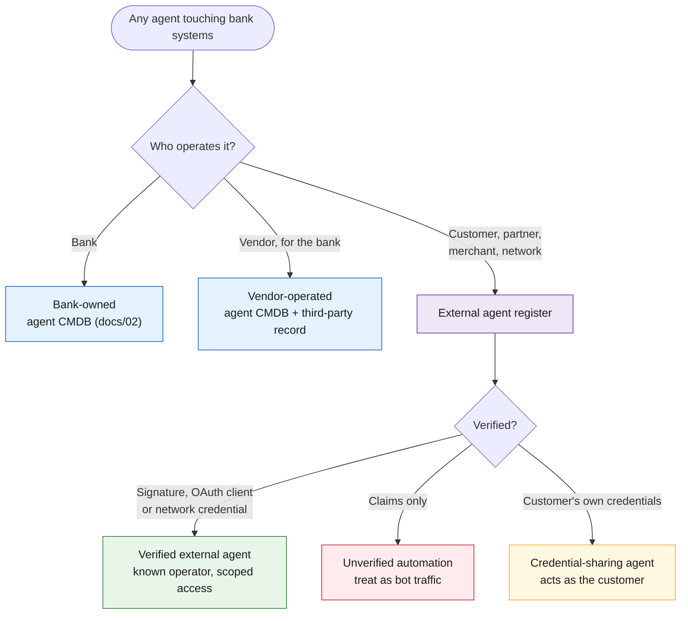
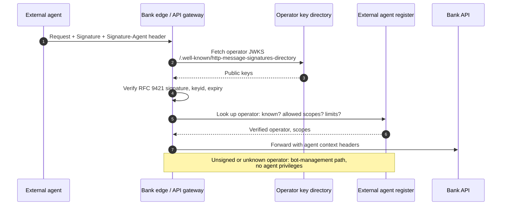
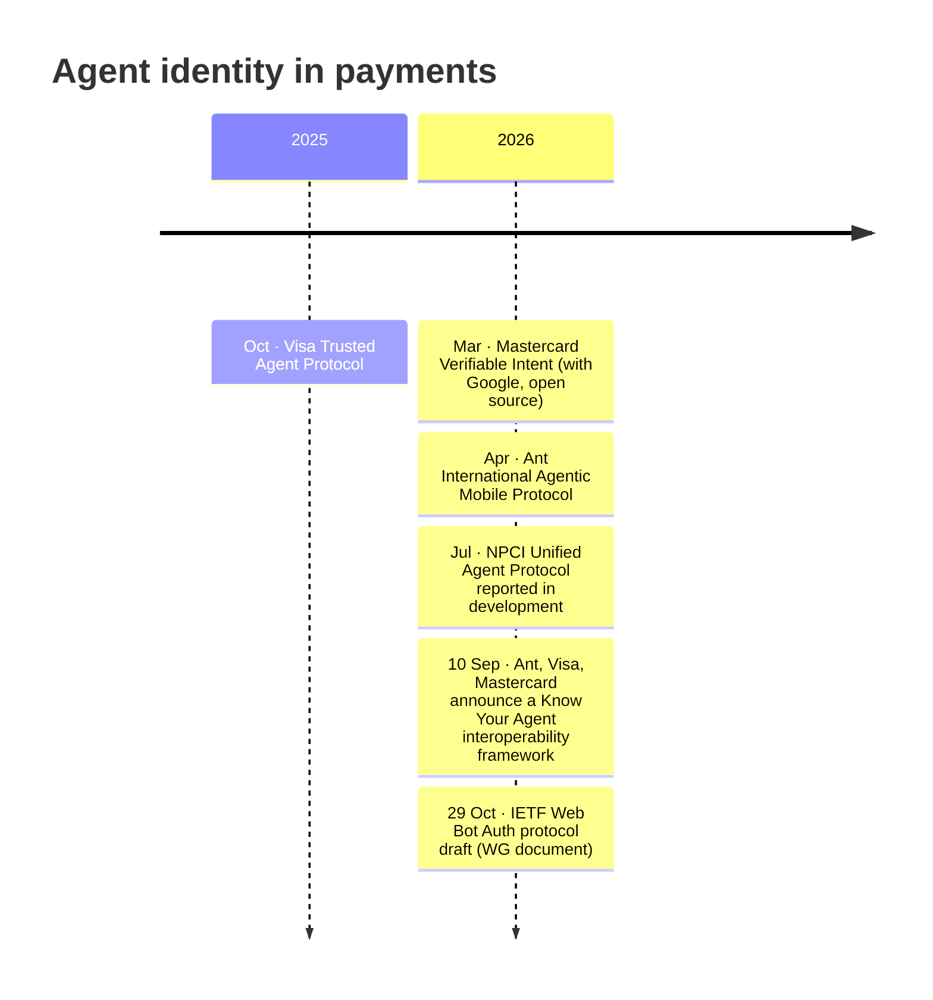

# 20 · External and inbound agents

**Not every agent that touches the bank belongs to the bank.** Customers' personal assistants, fintech partners' agents, merchants' agents and card-network agent programmes will increasingly call the bank's channels and APIs. They need a separate register, a counterparty register rather than a CMDB, because the bank governs *access*, not the agent itself.

## Third axis: who operates the agent

The inventory tree ([02](02-inventory-tree.md)) classifies the bank's own agents. Add an ownership axis so external agents are counted, but never mixed into the bank's managed/unmanaged numbers.

## Inbound paths and what each one reveals

| Path | Example | What the bank can see | Record |
|---|---|---|---|
| Customer gives an agent their login or browser | Personal assistant or agentic browser using net banking | A customer session behaving like automation | Credential-sharing agent; policy decision; push towards a delegated path |
| Delegated API with consent | Fintech or Account Aggregator flow; partner OAuth client | OAuth client, consent artefact, operator | Verified external agent per client and consent scope |
| Card-network agentic payments | Agent-initiated purchases via network programmes | Network-provided agent signals on the transaction | Agent provider as transaction counterparty |
| UPI agentic payments | NPCI's proposed Unified Agent Protocol | Not launched as of November 2026 | Watch item; fields prepared |
| Corporate customer's agent | Treasury agent on corporate APIs | API client of the corporate | Agent flag on the client; corporate mandate limits |
| Signed web agents | Agents signing HTTP requests (Web Bot Auth style) | Verified operator key | Verified external agent by key directory |

## Verifying an inbound agent

The Web Bot Auth working group's draft (*HTTP Message Signatures for automated traffic*, 29 October 2026, Cloudflare and Google authors) has clients sign each request with RFC 9421 HTTP Message Signatures, publish keys as a JWKS at an HTTPS URL given in a `Signature-Agent` header, and recommends the `/.well-known/http-message-signatures-directory` path. It is an Internet-Draft on the Standards Track, not an RFC.

## Payments-specific standards to track

| Standard | Status (November 2026) | What it means for the register |
|---|---|---|
| Visa Trusted Agent Protocol | Launched October 2025 | Agent identity at transaction level; capture the agent indicator on card transactions |
| Mastercard Verifiable Intent | Introduced March 2026, open source, co-developed with Google | Evidence that an agent action reflects user intent: store it with disputes |
| Know Your Agent framework (Ant, Visa, Mastercard) | Announced 10 September 2026; statement of intent, no technical spec, governance or timeline disclosed | Expect shared agent registration across networks; issuers named as beneficiaries, role undefined |
| NPCI Unified Agent Protocol (UPI) | Reported in development (July 2026); agents registered, verified and authorised before transacting, with limits on authority | Prepare fields: agent operator, user mandate, limits, accountable party |

## External agent register fields

| Field | Why |
|---|---|
| Operator (legal entity) and contact | Accountability and disputes |
| Verification method: signature key directory, OAuth client, network credential, none | Trust level |
| Agent declaration: name, version, purpose (as claimed) | Context; never trusted on its own |
| Consent or mandate: scope, limits, expiry, customer | What it may do and for whom |
| Channels and APIs used | Exposure on the bank side |
| Behaviour baseline and anomalies | Fraud and AML: agent behaviour breaks human-behaviour assumptions |
| Incidents and disputes | Feeds operator trust level |

Fraud and AML models built around human behaviour need an agent dimension: agent-initiated traffic is fast, repetitive and mandate-driven, so the same signals that flag fraud for a person can be normal for an agent, and vice versa.

---
[← 19 Scenario catalogue](19-scenarios.md) · [Index](README.md) · [Next: 21 Threat model of the inventory →](21-inventory-threat-model.md)
