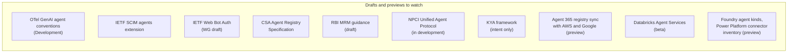
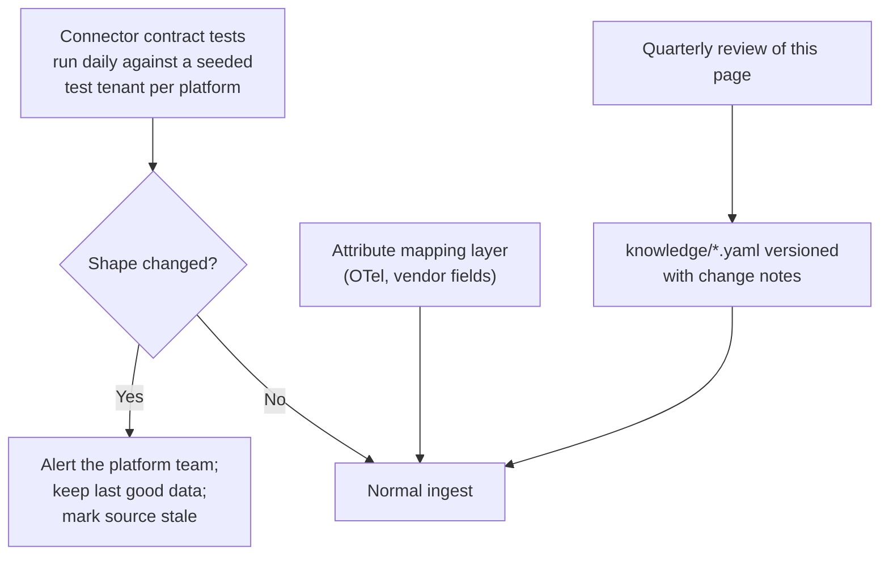

# 22 · Change watchlist: what will move under the software

**Most of the APIs, standards and rules this platform depends on changed at least once in 2026, and several are still drafts.** The software must expect renames and new fields, and the team needs a list of what to re-check.

## Recent breaking or significant changes

| Date | Change | Impact on the software |
|---|---|---|
| 15 Jun 2026 | Microsoft retired `/beta/agentRegistry/*`; Agent 365 Graph List/Get moved to v1.0 and need an Agent 365 licence | Connector must call `/v1.0/copilot/admin/catalog/packages`; tenants without the licence need the fallback path ([15](15-pulling-inventory.md)) |
| 1 Jul 2026 | Defender agent security for Copilot Studio and Foundry needs an Agent 365-eligible licence | Defender may not be a source in every tenant |
| 2026 | Defender hunting table `AIAgentsInfo` → `AgentsInfo` | Parse both; feature-detect |
| 22 Apr 2026 | Vertex AI rebranded Gemini Enterprise Agent Platform; API names unchanged | Labels and docs change, endpoints do not |
| 12 Jun 2026 | OpenTelemetry GenAI conventions moved to `semantic-conventions-genai`; still Development status | Attribute mapping layer; `gen_ai.agent.id` only on some spans ([09](09-telemetry-provenance.md)) |
| A2A v0.3 → v1.0 (frozen 12 Mar 2026) | Agent card path `/.well-known/agent.json` → `/.well-known/agent-card.json`; A2A and MCP now under the Agentic AI Foundation | Probe both paths |
| 28 Jul 2026 | MCP specification 2026-07-28: stateless core, session handshake removed, new required headers, authorization changes, Roots/Sampling/Logging deprecated | MCP parsers and gateway rules must handle both old and new servers |
| 31 Aug 2026 | AWS Agent Registry GA (five regions plus GovCloud) | New source; auto-detects AgentCore only |
| 2026 | Salesforce agent metadata changed at API v68 | Version-aware Salesforce connector |
| 2026 | OpenAI moving custom GPTs to "plugins" | Inventory object type will change |
| 24 Jun 2026 | RBI draft Model Risk Management guidance (comments closed 24 Jul 2026) | Final text may change required fields, retention and kill-switch rules |
| 13 Nov 2025 → 12 May 2027 | DPDP Rules: most obligations (notice, consent, breach notice, significant data fiduciary duties) apply from 12 May 2027 | Telemetry and CMDB retention and PII handling |
| 2 Dec 2027 | EU AI Act Annex III high-risk obligations (as amended) | Credit-scoring agents in EU operations |
| 7 Oct 2027 / 7 Oct 2028 | MAS AI risk guidelines: governance, then lifecycle requirements | Singapore operations |

## Still drafts or preview

## How the software should cope

- **Seeded canary agents** on every platform (the pilot set from [13](13-open-questions.md)) double as permanent contract tests: if a canary disappears from the inventory, the connector broke, not the agent.
- **Feature-detect, don't assume**: check for a table, endpoint or field before relying on it, and record which version of each source produced an observation.
- **Keep knowledge separate from code**: detection signatures, endpoints, connectors and rules live in [`knowledge/`](../knowledge/README.md) so updates do not need a release.

---
[← 21 Threat model](21-inventory-threat-model.md) · [Index](README.md) · [Next: 23 Telemetry without code changes →](23-telemetry-without-code-changes.md)
