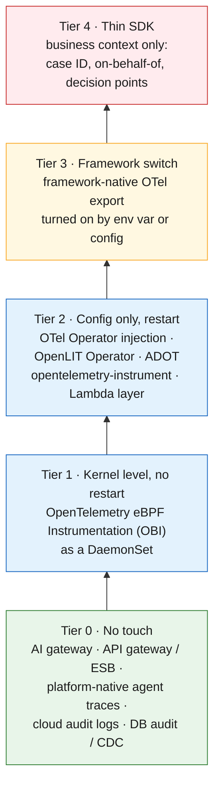
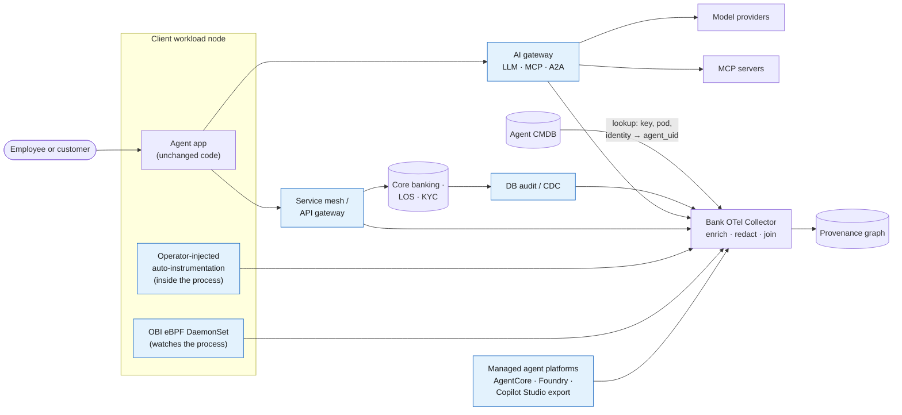
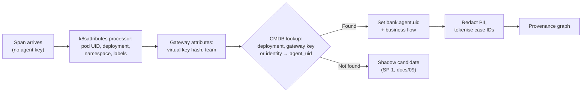
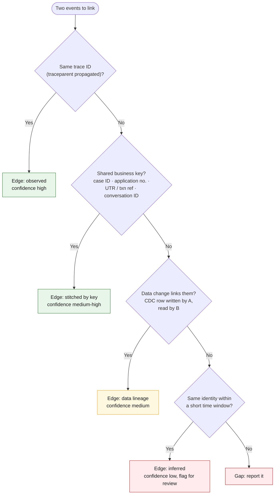
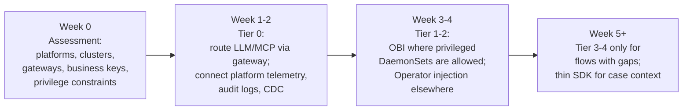

# 23 · Capturing telemetry without changing client code

**Don't make an SDK the entry ticket.** Most bank teams cannot change application code on day one, so the platform should capture telemetry where it already flows (gateways, the network, the kernel, the cloud platforms and the databases) and add identity and business context *outside* the application. A thin SDK is the last rung, used only to add context nothing else can see.

## The capture ladder

Start at the bottom; climb only where a gap remains.

| Tier | What the client changes | What you get | What you miss |
|---|---|---|---|
| **0 · No touch** | Route traffic through the gateway; grant read access to logs | Every LLM, MCP and A2A call with model, tokens, tool names and caller key; every core-banking API call; agent traces from managed platforms; data writes | What happens *inside* the agent between calls; links between calls unless trace context arrives |
| **1 · eBPF (OBI)** | Install a privileged DaemonSet once per cluster or host | HTTP/gRPC/DB/messaging spans per process, GenAI calls to providers and OpenAI-compatible gateways, MCP interactions; `traceparent` injection for HTTP/1.x and plaintext HTTP/2 in supported runtimes | Encrypted HTTP/2 propagation; in-process agent reasoning; detailed GenAI payloads unless explicitly configured |
| **2 · Config-only injection** | Add a pod annotation or label (or change the start command); restart | Library-level spans incl. LLM SDK and agent-framework calls, with GenAI attributes; context propagation handled by the instrumented libraries | Business meaning (which case, which customer) |
| **3 · Framework switch** | Set an env var or config flag the framework already supports | Agent, tool and workflow spans in the framework's own structure | Same as tier 2 |
| **4 · Thin SDK** | Import a library, a few lines | Case ID, on-behalf-of principal, decision outcome, explicit provenance entities | Nothing extra beyond what is coded; costs client effort |

## Where each capture point sits

### What each capture point gives you

| Capture point | No-code mechanism | Notes |
|---|---|---|
| **AI gateway** (LiteLLM, agentgateway, Kong) | Agents call the gateway instead of the provider | LiteLLM's OTel v2 integration (enable with `LITELLM_OTEL_V2=true`) emits GenAI-convention spans for LLM calls, guardrails and MCP tool calls, accepts an incoming W3C `traceparent` so its spans nest under the caller's trace, and tags spans with a hash of the calling virtual key and the team. Prompt/response content is off by default |
| **Service mesh / API gateway / ESB** | Sidecars or gateways emit spans and access logs | Istio proxies send spans automatically, but **the application must forward trace headers** (`traceparent`, `tracestate`, `x-request-id`) for the spans to join into one trace. Without that, you get per-hop spans, not end-to-end traces |
| **OBI (eBPF)** | Kernel probes; no code change, library install or restart | v1.0.0 announced 30 October 2026. Covers Java, .NET, Go, Python, Ruby, Node.js, C/C++, Rust; HTTP/gRPC, Kafka, NATS, MQTT, Postgres, MySQL, MSSQL, Redis and more; GenAI provider, embedding, vector and MCP calls (detailed extraction needs explicit payload configuration). Writes `traceparent` on outgoing HTTP/1.x and plaintext HTTP/2 for supported runtimes; **cannot inject into encrypted HTTP/2**. Needs elevated Linux privileges |
| **OTel Operator injection** | `Instrumentation` resource + pod annotation, e.g. `instrumentation.opentelemetry.io/inject-python: "true"` | Supports .NET, Deno, Go, Java, Node.js, Python (also Apache HTTPD, NGINX). Annotation is read at pod start, so pods must restart. Go injection uses a privileged eBPF sidecar |
| **OpenLIT Operator** | `AutoInstrumentation` resource selecting pods by label | Injects LLM, agent-framework and vector-DB instrumentation (OpenLIT, OpenInference, OpenLLMetry providers) via an init container; Python fully supported, other languages on the roadmap; restart needed |
| **ADOT / `opentelemetry-instrument`** | Change the start command, set env vars | AWS documents this for agents outside AgentCore Runtime (EKS, ECS, EC2, on-prem): `opentelemetry-instrument python agent.py` with the ADOT distro, no code imports. Lambda: add the OpenTelemetry layer and `AWS_LAMBDA_EXEC_WRAPPER` |
| **Platform-native agent telemetry** | Turn on in the platform | AgentCore Runtime: service metrics and logs by default; spans once Transaction Search and tracing are enabled. Copilot Studio: environment-level export of `InvokeAgent`, `ExecuteTool` and output spans to Application Insights (preview, managed environments only; IDs are GUIDs, not OTel hex). Foundry: built-in tracing |
| **Cloud audit logs** | Read access | CloudTrail `InvokeModel`/`Converse`, Azure diagnostics, GCP Data Access logs: caller identity per model call, even over private endpoints |
| **Database audit / CDC** | DBA enables audit or change data capture | The only reliable record of *what data changed*, including in core banking where no tracing exists |

## Add identity and context outside the application

The application does not need to know its `agent_uid`. The bank's Collector can add it.

- **Agent key**: from the gateway virtual key, the pod's deployment, or the runtime identity, looked up in the CMDB. This is *enrichment, not instrumentation*, and because it is derived from attested facts it is harder to spoof than a key the app sets itself ([21](21-inventory-threat-model.md)).
- **Business context**: extract case IDs, application numbers and transaction references from HTTP paths, headers or gateway metadata with Collector `transform` rules, and tokenise them.
- **On-behalf-of principal**: read from the delegated token at the gateway (the `sub` and `act` claims, [06](06-identity-onboarding.md)), not from the app.

## Stitching end-to-end lineage when trace context breaks

Trace context will break at encrypted hops, message queues, batch jobs, vendor SaaS and the mainframe. Lineage then comes from correlation, and every edge records **how** it was established.

| Break point | Fix without code | Fallback |
|---|---|---|
| Mesh hop where the app drops headers | OBI header injection (plaintext HTTP, supported runtimes) or Operator injection | Business key in path or body |
| Encrypted HTTP/2 between services | Operator injection (library-level, before encryption) | Business key |
| Kafka / MQ | Auto-instrumented clients carry context in message headers | Message key = case ID |
| Batch jobs (Spark, Airflow, dbt) | OpenLineage integrations emit dataset lineage | Job run ID + business date |
| Core banking / mainframe | ESB or API-gateway spans at the edge; DB audit or CDC | Transaction reference (UTR, account + timestamp, tokenised) |
| Vendor SaaS agent | Platform-native export (e.g. Copilot Studio to Application Insights) | Gateway logs of its calls into the bank |
| Customer channel | Gateway at the edge assigns conversation/case ID | Session ID |

**Ask every client for their business keys on day one.** A list of the identifiers that already travel through each flow (application number for loans, UTR for transfers, claim number, CKYC/case ID for onboarding) is worth more than any SDK, because it lets you stitch lineage across systems no one can instrument.

## Day-one rollout with a client

Durations are illustrative; the order is what matters.

### Questions to ask the client

- [ ] Which runtimes and languages run the agents (Python, Java, .NET, Node, Go)? Which are in Kubernetes/OpenShift, VMs, serverless, SaaS?
- [ ] Can we run a privileged DaemonSet (OBI) on production nodes? If not, can we add a pod annotation and do a rolling restart?
- [ ] Will LLM, MCP and A2A traffic go through a bank AI gateway? Who operates it?
- [ ] Is there a service mesh, API gateway or ESB in front of core banking, LOS and KYC? Do apps forward `traceparent`?
- [ ] Which business keys travel through each flow, and where do they appear (path, header, body, message key)?
- [ ] Which databases can enable audit logging or CDC for the tables the agents write?
- [ ] Which managed agent platforms are used, and can their native telemetry be exported to the bank?
- [ ] What PII may appear in telemetry, and what retention applies (DPDP, internal policy)?

## Trade-offs to state upfront

| Concern | Position |
|---|---|
| **Privileges** | OBI and Go injection need elevated Linux privileges; hardened OpenShift clusters may refuse. Offer Operator injection and gateway-only modes |
| **PII** | Keep prompt/response capture off by default at every layer (LiteLLM, ADOT, OBI payload extraction); redact and tokenise in the Collector |
| **Volume and cost** | Sample low-risk flows at the Collector; keep complete traces for regulated business flows and for critical-tier agents |
| **Accuracy** | Every lineage edge carries its evidence type and confidence; auditors see which links were observed and which were stitched |
| **Vendor lock-in** | Everything above emits or converts to OTLP; the bank's Collector is the single ingestion point |

The machine-readable version of this ladder is [`knowledge/telemetry-capture.yaml`](../knowledge/telemetry-capture.yaml); related scenarios are group K in [19](19-scenarios.md).

---
[← 22 Change watchlist](22-change-watchlist.md) · [Index](README.md) · [Next: 24 Deployment model →](24-deployment-model.md)
