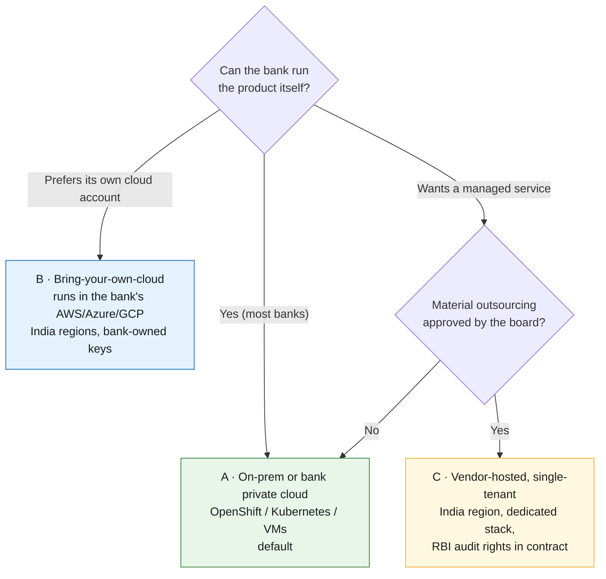
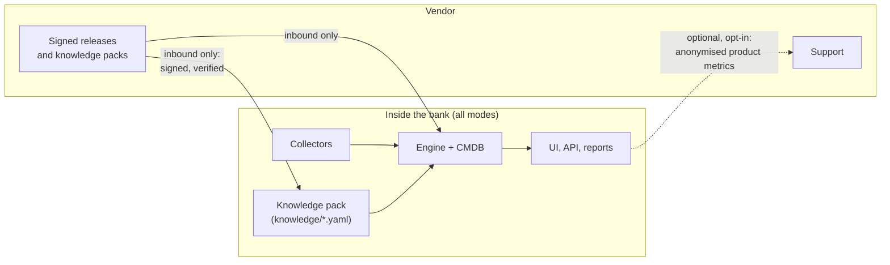
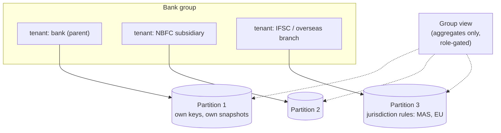

# 24 · Deploying the product at many banks

**Ship it as single-tenant software that runs inside each bank, with nothing leaving the bank by default.** Indian banks will treat any vendor that processes their agent, identity and telemetry data as IT outsourcing, so the product must be built for audit rights, data kept in India, and a clean exit from day one.

## Three ways to deploy

| | A · On-prem | B · Bring your own cloud | C · Vendor-hosted single-tenant |
|---|---|---|---|
| Where data lives | Bank data centre | Bank's cloud account, India region | Vendor's dedicated stack, India region |
| Outsourcing burden | Lowest (software licence + support) | Low | Highest: likely **material outsourcing** under RBI's IT outsourcing directions |
| Who holds connector credentials | Bank | Bank | Vendor stack, under bank-controlled keys |
| Upgrades | Signed bundles, bank-scheduled | Same | Vendor-managed with bank change approval |
| Best for | Large and public-sector banks | Cloud-first private banks | Small banks, NBFCs with board approval |

RBI's *Outsourcing of Information Technology Services* Master Direction (10 April 2023; in force for new agreements from 1 October 2023) requires, per a Khaitan & Co summary: audit, monitoring and inspection rights for both the bank and RBI; data stored only in India as per extant requirements; board-approved exit strategies; and contract clauses on safe return or destruction of data at exit. Design every deployment so these are easy to grant.

## What crosses the bank boundary

- **Inbound only by default.** Software and knowledge-pack updates come in as signed bundles; the bank verifies signatures before applying. An offline bundle supports air-gapped segments.
- **Knowledge packs ship separately from code.** New detection signatures, endpoint lists, connector changes and scenarios ([22](22-change-watchlist.md)) can be updated weekly without a software release.
- **No telemetry home.** Product metrics, if any, are opt-in, anonymised, and never contain agent names, prompts, identities or business keys.
- **Support without data access.** Diagnostics bundles are generated by the bank, reviewed, and redacted before sharing.

## Separating banks, and entities inside a bank group

Every observation and record carries a `tenant_id` ([observation schema](../schemas/observation.schema.json)). Different banks never share a deployment. Within a group, each legal entity gets its own partition, encryption keys and regulatory snapshots; a group view shows aggregates only.

## Connector credentials stay with the bank

| Step | Who | How |
|---|---|---|
| 1 Create read-only roles in each cloud, SaaS and cluster | Bank platform teams | Terraform modules and role definitions shipped with the product ([15](15-pulling-inventory.md) permissions) |
| 2 Bind them to the product's workload identity | Bank IAM | Workload identity federation or SPIFFE; no static keys |
| 3 Approve privileged components (eBPF, operators) separately | Bank security | Capability list per component; optional |
| 4 Rotate and review quarterly | Bank IAM | Access reviews include the product's identities |

## The security-review pack

Bank security reviews are the slowest step. Ship this pack with every release so the review starts complete:

- CycloneDX SBOM and AI-BOM for every component; signed images.
- Threat model ([21](21-inventory-threat-model.md)) and data-flow diagram per deployment mode.
- Exact Linux capabilities, Kubernetes RBAC and cloud permissions per component, with which are optional.
- Pen-test summary and vulnerability disclosure policy.
- RBI IT outsourcing checklist mapping: audit rights, data location, exit and data return, sub-contractors.
- Incident cooperation clause aligned with the bank's CERT-In reporting obligations.
- Backup, HA and DR design: the CMDB feeds the gateway allow-list, so it is a control and needs HA; gateways cache the allow-list and fail static ([21](21-inventory-threat-model.md), T12).

## Licensing and commercial shape (for the vendor)

Price per bank entity and per covered agent or business flow, not per data volume, so banks are not penalised for capturing more telemetry. Keep connectors and knowledge packs in the base product; charge for provenance analytics and regulatory reporting modules.

---
[← 23 Telemetry without code changes](23-telemetry-without-code-changes.md) · [Index](README.md) · [Next: 25 Engine contracts →](25-engine-contracts.md)
