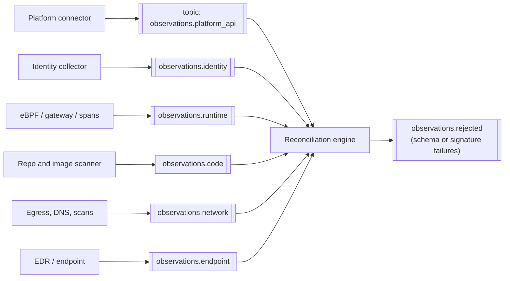
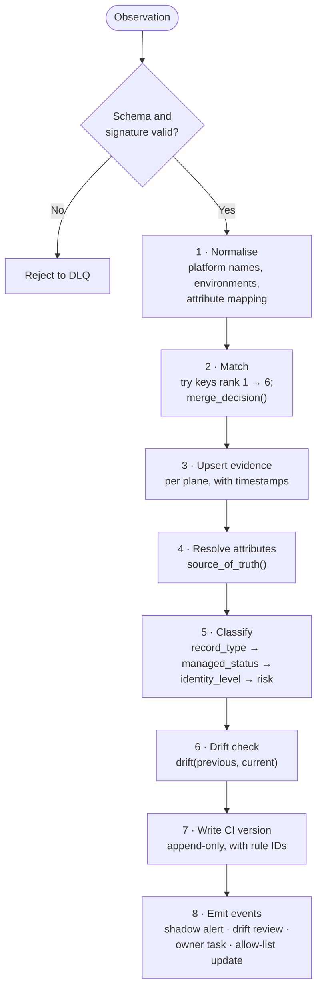
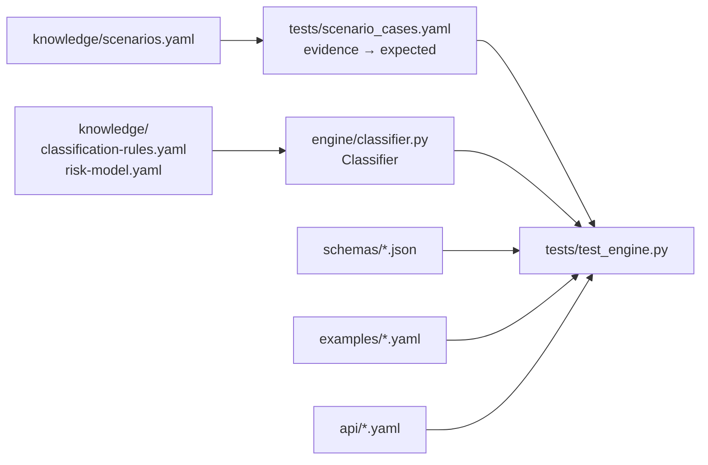

# 25 · Engine contracts: observations, reconciliation, API

**Three contracts let separate teams build collectors, the engine and the UI in parallel:** the observation format collectors publish, the reconciliation steps the engine runs, and the API everything else calls. A working reference classifier and its tests are in [`engine/`](../engine/classifier.py) and [`tests/`](../tests/test_engine.py).

## Contract 1 · Observations (collector → bus)



Every message validates against [`schemas/observation.schema.json`](../schemas/observation.schema.json). Key rules:

| Rule | Why |
|---|---|
| `subject.keys` carries every identification key the collector saw, strongest first | Lets the engine apply the identification ranks ([07](07-reconciliation.md)) |
| `facts` uses the engine's evidence vocabulary (`calls_llm`, `model_selects_tools`, `last_seen`, `tools`, `identity`…) | One vocabulary across collectors |
| `source.raw_ref` points to raw data held in bank storage; raw payloads never ride the bus | Keeps PII and prompts out of the inventory ([21](21-inventory-threat-model.md), T7) |
| `agent_key_claimed` is separate from attested keys | A self-asserted key never merges records on its own (T3) |
| Collectors sign observations | Detects forged or tampered evidence (T4, T8) |
| Partition by `tenant_id` | Bank and legal-entity separation ([24](24-deployment-model.md)) |

Example: [`examples/observation-ebpf-llm-call.yaml`](../examples/observation-ebpf-llm-call.yaml).

## Contract 2 · Reconciliation steps



```text
on observation o:
    validate(o) or reject
    o = normalise(o)
    ci = None
    for rank, key in keys_by_rank(o.subject.keys):          # ranks 1..6
        match = find_ci(key, o.tenant_id)
        if match:
            decision = merge_decision(rank, same_env(match, o))
            if decision == "auto_merge": ci = match; break
            if decision == "steward_review": open_candidate_merge(match, o); break
            # "no_merge": keep looking; a different environment is a different CI
    ci = ci or create_ci(o)
    ci.evidence[o.collector.plane].upsert(o)                 # keeps freshness per plane
    attrs = resolve_attributes(ci)                           # source_of_truth per attribute
    evidence = to_engine_evidence(ci, attrs, collector_health(o.tenant_id))
    result = classifier.classify(evidence)                   # deterministic, returns rule IDs
    changes = classifier.drift(ci.previous_profile, attrs.profile)
    write_version(ci, attrs, result, changes)                # append-only history
    emit_events(ci, result, changes)
```

Properties the engine must keep:

- **Idempotent**: replaying the same observation changes nothing.
- **Order-tolerant**: late events are applied by source timestamp; status never flips on a single late event (SC-I06).
- **Explainable**: every status, level and tier stores the rule IDs that produced it (`MS-6`, `IL-2`, `RO-1`…).
- **Health-aware**: a silent collector pauses rules that depend on its plane (`MS-3`, SC-I05).

## Contract 3 · Inventory API

The OpenAPI 3.1 spec is [`api/inventory-api.openapi.yaml`](../api/inventory-api.openapi.yaml). Every read takes `as_of` for point-in-time answers.

| Endpoint | Purpose | Scope |
|---|---|---|
| `GET /agents`, `GET /agents/{uid}` | Records with filters | `inventory.read` |
| `GET /agents/{uid}/history` | Append-only changes with rule IDs | `inventory.read` |
| `GET /agents/{uid}/graph` | Edges with evidence type and confidence | `inventory.read` |
| `PATCH /agents/{uid}/governance` | Approve, assign owner, set tier, retire (four-eyes for approvals) | `inventory.govern` |
| `POST /observations` | HTTP ingest for collectors that cannot reach the bus | `inventory.ingest` or mTLS |
| `GET /tree`, `GET /kpis` | Dashboard numbers ([02](02-inventory-tree.md), [12](12-kpis.md)) | `inventory.read` |
| `POST /snapshots` | Signed regulatory snapshot as of a date | `inventory.report` |
| `GET /provenance/entities/{ref}` | Everything that touched a loan, case or transaction | `inventory.read` |
| `GET /gateway/allowlist` | Signed allow-list for AI gateways | mTLS |
| `POST /agents/{uid}/kill-switch` | Suspend an agent across mechanisms | `inventory.kill` |
| `GET /ai-systems`, `GET /external-agents` | The two companion registers ([28](28-ai-systems-and-integrations.md), [20](20-external-agents.md)) | `inventory.read` |

## Reference engine and tests



```bash
pip install -r requirements-dev.txt
python3 -m pytest -q          # engine, scenario cases, schemas, examples, OpenAPI
scripts/validate.sh           # all of the above + generated docs + Mermaid parse check
```

The reference classifier is deliberately small and dependency-light so production engines in any language can be checked against the same test cases. The scenario page ([19](19-scenarios.md)) marks which scenarios have executable cases.

---
[← 24 Deployment model](24-deployment-model.md) · [Index](README.md) · [Next: 26 Operating model →](26-operating-model.md)
