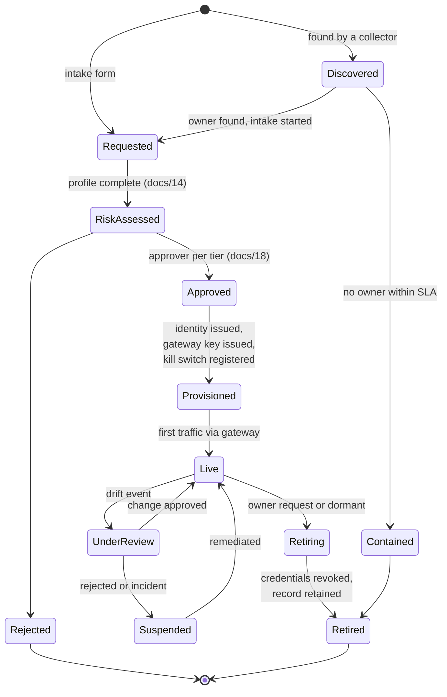
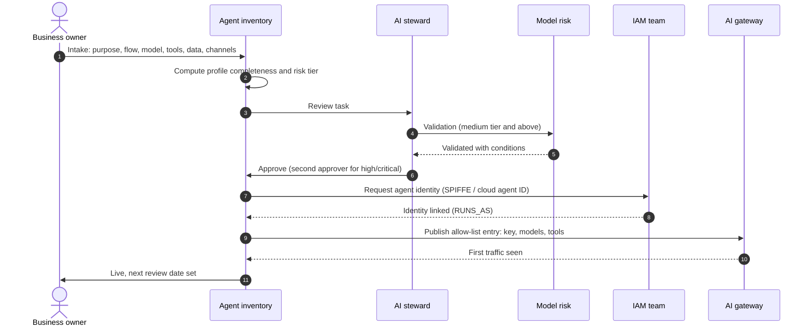

# 26 · Operating model: from request to retirement

**The software finds and classifies agents; people approve, own and retire them.** Without a defined workflow, the shadow queue grows faster than anyone clears it. This page sets the lifecycle, who does what, and the service levels the software should track.

## Lifecycle

## Onboarding a new agent

Intake asks only for the minimum viable profile ([14](14-agent-profile.md)); the rest fills in from discovery.

## Who does what (RACI)

| Activity | AI steward | Business owner | Technical owner | Model risk | CISO / SOC | IAM | Platform teams | Internal audit |
|---|---|---|---|---|---|---|---|---|
| Intake and profile | A | R | R | C | I | I | I | — |
| Risk tiering | A | C | C | R | C | — | — | I |
| Approval (high/critical) | R | C | C | R | C | — | — | I |
| Identity issuance | I | I | C | — | C | A/R | C | — |
| Gateway allow-list | A | I | C | — | C | — | R | — |
| Shadow triage | A/R | C | C | — | R | C | C | I |
| Drift review | A | R | R | R | C | C | — | I |
| Kill-switch drills | A | I | R | — | R | — | R | I |
| Retirement | A | R | R | I | I | R | R | I |
| Regulatory snapshot | R | I | — | C | C | — | — | A |

R = responsible, A = accountable, C = consulted, I = informed. Each bank adapts the roles; the software needs a named person for each R and A.

## Service levels the software tracks

| SLA | Starting target | Tracked by |
|---|---|---|
| Shadow or unmanaged finding triaged | 7 days | Open shadow agents KPI ([12](12-kpis.md)) |
| Owner reassigned after leaver | 14 days, then suspend if high/critical | `owner_reassignment_grace_days` in [rules](../knowledge/classification-rules.yaml) |
| Drift review closed | Per tier ([18](18-risk-scoring.md)); 14 days default | Drift reviews overdue KPI |
| Intake decision (low/medium) | 5 working days | Intake queue age |
| Identity issued after approval | 3 working days | Approved-not-provisioned count |
| Kill-switch drill | Per tier: monthly to annually | `kill_switch.last_tested` |
| Credentials revoked after retirement | 1 day | Dormant with live credentials KPI |

## Retirement checklist

- [ ] Owner confirms retirement (or steward retires after dormancy and no response).
- [ ] Gateway key revoked; platform agent disabled or deleted; workloads scaled to zero.
- [ ] Agent identity and every credential in `additional_credentials` revoked.
- [ ] MCP server and tool tokens held for this agent rotated.
- [ ] Record set to `retired`; `retain_until` set (at least 10 years per the RBI draft, as reported).
- [ ] Provenance links remain queryable.

## Exceptions

Some agents cannot meet a rule on day one (no identity platform yet, legacy runtime). Exceptions are records too: who granted it, which rule, compensating control, expiry date. The `grant_exception` governance action needs a second approver, and expired exceptions reopen the finding automatically.

---
[← 25 Engine contracts](25-engine-contracts.md) · [Index](README.md) · [Next: 27 Business-key provenance →](27-business-key-provenance.md)
