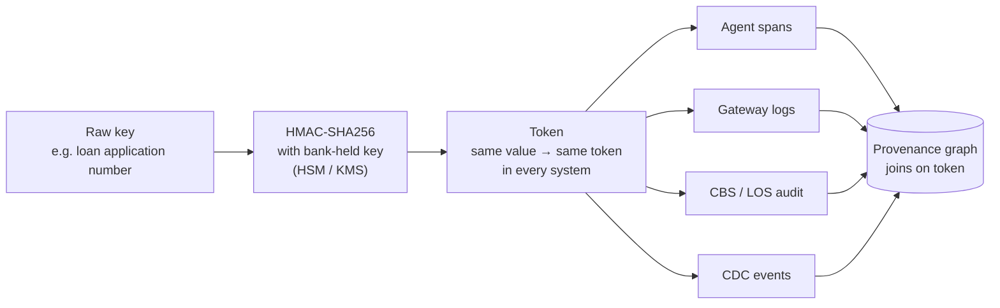
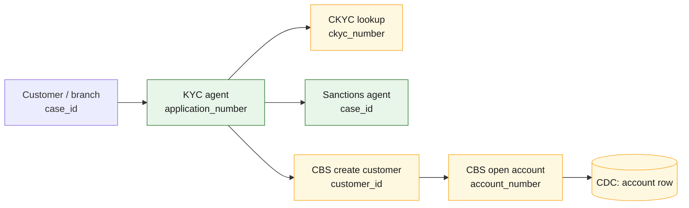
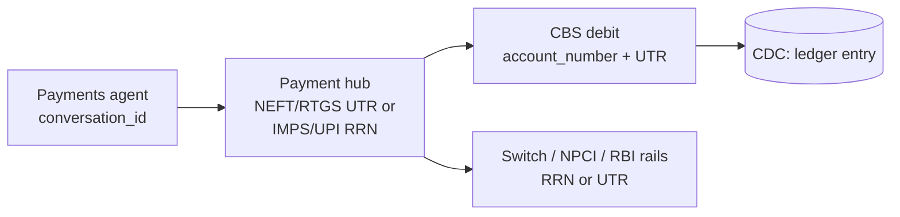
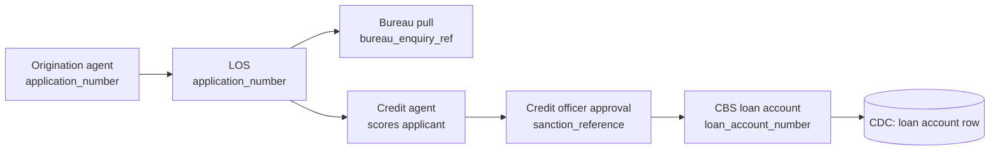
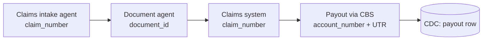

# 27 · Provenance through business keys, flow by flow

**Every bank flow already carries identifiers that every system records: application numbers, UTRs, loan account numbers, claim numbers.** Tokenise them once with a bank-held key and they join agent traces, core-banking logs and database changes into one lineage chain, even where no trace context survives. The key catalogue is [`knowledge/business-keys.yaml`](../knowledge/business-keys.yaml).

## Tokenise once, join everywhere

- Deterministic tokens allow joins without exposing values. Plain hashes of short numeric IDs can be reversed by brute force, so use a keyed HMAC.
- Aadhaar numbers never enter telemetry; use the reference token from the bank's Aadhaar data vault.
- Tokenisation happens in the bank's Collector ([23](23-telemetry-without-code-changes.md)), not in the applications.

## Account opening

Green: usually joined by trace context. Amber: usually joined by business key or data change.

## Transfers

## Loan sanction

The credit officer's approval is a `prov:Activity` by a human agent; the credit agent's score is an input `prov:Entity` it `used`. This is how the graph shows a human in the loop for a decision regulators treat as high-risk ([10](10-regulatory.md)).

## Claims

## Edge confidence

| How the edge was made | Confidence | Shown to auditors as |
|---|---|---|
| Same trace (propagated `traceparent`) | High | Observed |
| Same tokenised business key | Medium-high | Stitched by key |
| Data change written by A and read by B | Medium | Data lineage |
| Same identity in a short time window | Low; needs review | Inferred |

Report coverage per flow: the share of steps joined by observed or key-stitched edges. A loan file where every step is green or amber is audit-ready; any "inferred" step is a gap to close.

## What to ask each bank in week 0

- [ ] For each flow, which of the keys in the catalogue exist, and in which systems?
- [ ] Where do they appear: URL path, header, body, message key, database column?
- [ ] Which keys are already masked or tokenised, and with what scheme?
- [ ] Can CDC or audit logging be turned on for the tables agents write?
- [ ] Who owns the HMAC key, and where is it held?

---
[← 26 Operating model](26-operating-model.md) · [Index](README.md) · [Next: 28 AI systems and integrations →](28-ai-systems-and-integrations.md)
