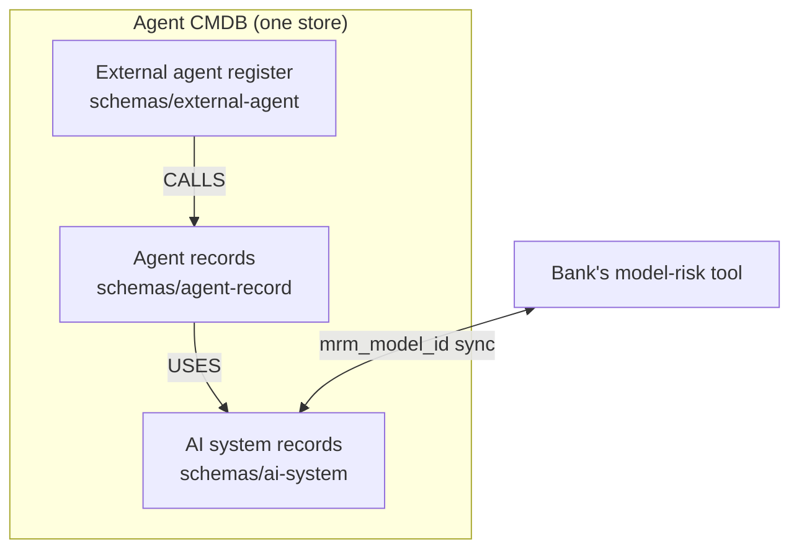
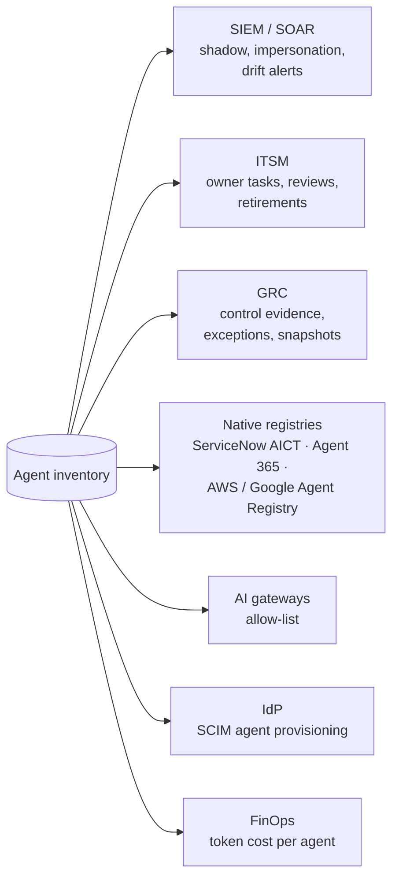

# 28 · AI systems register, integrations and remaining platforms

**Regulators want every AI system inventoried, not just agents, and the bank already has tools the inventory must feed.** This page covers the companion register for non-agent AI, the outbound integrations, token cost per agent, and platforms not covered elsewhere.

## Three registers, one store

| Register | Holds | Schema | Example |
|---|---|---|---|
| Agents | Bank-operated and vendor-operated agents, endpoint agents | [`agent-record`](../schemas/agent-record.schema.json) | [KYC agent](../examples/kyc-onboarding-agent.yaml), [shadow agent](../examples/shadow-loan-agent.yaml) |
| AI systems | Chatbots, RAG apps, ML models, LLM features, vendor-embedded AI | [`ai-system`](../schemas/ai-system.schema.json) | [FAQ chatbot](../examples/ai-system-faq-chatbot.yaml) |
| External agents | Customer, partner, merchant and network agents | [`external-agent`](../schemas/external-agent.schema.json) | [Partner agent](../examples/external-agent-partner.yaml) |

The AI system record carries the fields FREE-AI's inventory recommendation asks for (models, use cases, target groups, dependencies, risks, grievances) and the RBI draft's named roles and lifecycle states. Banks usually already run a model-risk tool; sync by `mrm_model_id` rather than replacing it.

## Outbound integrations

| Target | What is sent | Format | Notes |
|---|---|---|---|
| SIEM / SOAR | Shadow alerts, impersonation flags (SP-3), dormant-with-credentials, kill-switch events | JSON events; OCSF mapping where the SIEM supports it | Include rule IDs and evidence links, never raw prompts |
| ITSM | Owner-assignment, drift-review, retirement tasks | Ticket API | Close the loop: ticket state updates the record |
| GRC | Control evidence per agent, exceptions, signed snapshots | API or export | Lets audit test controls from the inventory |
| Native registries | Write back discovered agents as "unapproved" | ServiceNow CI APIs, AWS/Google registry APIs, Agent 365 where licensed | Keeps the bank's existing tools accurate instead of competing with them |
| AI gateways | Signed allow-list | [`/gateway/allowlist`](../api/inventory-api.openapi.yaml) | Enforcement ([21](21-inventory-threat-model.md)) |
| IdP | Agent identities joiner-mover-leaver | SCIM agents extension where supported | Draft standard ([22](22-change-watchlist.md)) |

## Token cost per agent

The AI gateway already records tokens and cost per call (LiteLLM's OpenTelemetry integration emits cost and token attributes and tags spans with a hash of the calling key). Map key → `agent_uid` and the inventory gets cost per agent, per business flow and per model for free: useful for budget owners, and a cheap anomaly signal (a sudden cost spike often means a loop or misuse).

## Platforms not covered elsewhere

| Platform | How agents show up | How to inventory |
|---|---|---|
| **Red Hat OpenShift AI (Llama Stack)** | Llama Stack is a unified API server for inference, RAG, agents and safety, with built-in MCP client support; agents also run as ordinary workloads using LangGraph, LangChain or CrewAI | Treat the Llama Stack server as an inventory point (its callers are agent candidates); collect agents as Kubernetes workloads ([04](04-discovery.md), [16](16-repository-scanning.md)) |
| **NVIDIA NeMo Agent Toolkit / NIM** | Agents built with the toolkit; models served by NIM | NIM fingerprints in [model-server list](../knowledge/llm-endpoints.yaml); the toolkit has an OpenTelemetry exporter package for traces |
| **VMware and other private clouds** | VMs and Kubernetes on private infrastructure | Same as on-prem collectors |
| **Indian sovereign or community clouds** | IaaS and managed Kubernetes | Treat as on-prem: workload, eBPF, model-server and egress collectors; no agent-aware APIs assumed |
| **Bank mobile apps with on-device or embedded AI** | Assistants inside customer apps, calling bank or vendor AI APIs | Code and app-SBOM scanning in the mobile CI; gateway logs for server-side calls; record as AI system or agent per [16](16-repository-scanning.md) |

---
[← 27 Business-key provenance](27-business-key-provenance.md) · [Index](README.md) · [Next: 29 Implementability scorecard →](29-implementability-scorecard.md)
