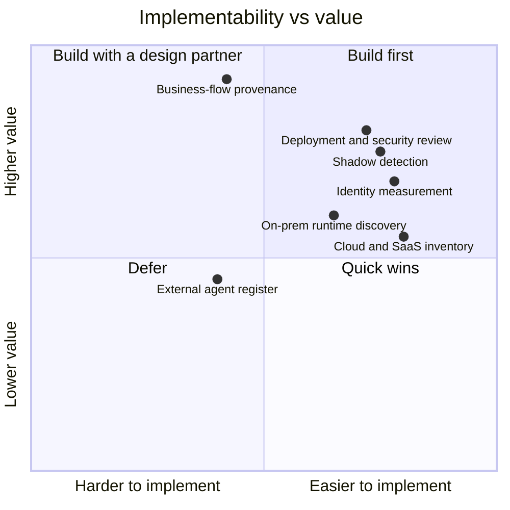
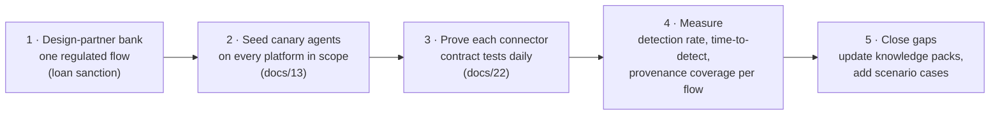

# 29 · Implementability scorecard

**What is designed, what is proven, and what still depends on things outside the product.** Scores are an honest judgement on a 1–10 scale of how buildable each part is at a typical Indian bank. They were first given before pages 24–28 and the reference engine existed; this page shows what changed and what is left.

## Scores now

| Part | Before | Now | What raised it | What still limits it |
|---|---|---|---|---|
| Cloud and SaaS inventory | 8 | **9** | Connector specs with permissions and gotchas ([15](15-pulling-inventory.md), [connectors](../knowledge/platform-connectors.yaml)); observation contract ([25](25-engine-contracts.md)) | Licence-gated Microsoft APIs; UiPath, Pega and OCI list APIs unconfirmed |
| Shadow detection | 7 | **8** | Observe-then-enforce gateway modes ([21](21-inventory-threat-model.md)); audit-log and eBPF fallbacks; tested rules (MS-4 to MS-7) | Only as strong as the bank's willingness to force traffic through the gateway |
| Identity measurement | 7 | **8** | Tested identity-level rules; exceptions process ([26](26-operating-model.md)) | Fixing levels 0–1 is the bank's IAM work |
| On-prem runtime discovery | 5 | **7** | Capture ladder with no-privilege fallbacks ([23](23-telemetry-without-code-changes.md)); security-review pack with exact capabilities ([24](24-deployment-model.md)) | Hardened clusters may still refuse eBPF; then coverage drops to gateway, operator and logs |
| Business-flow provenance | 4 | **6–7** | Business-key catalogue and tokenisation ([27](27-business-key-provenance.md)); CDC; edge confidence model | Core banking internals stay dark; keys must actually exist in each system; some edges stay "inferred" |
| External agent register | 3 | **4** | Schema and register design ([20](20-external-agents.md)) | Standards (NPCI protocol, KYA framework, Web Bot Auth) are not final; nothing to verify against yet |
| Deployment and security review | — | **8** | Three deployment modes, credential model, RBI outsourcing mapping, review pack ([24](24-deployment-model.md)) | Each bank's review is still slow; no vendor can shorten it below the bank's own process |
| Engine correctness | — | **8** | Reference classifier; 58 of 99 scenarios executable; schema, example and API tests ([25](25-engine-contracts.md)) | Remaining scenarios are procedures or need a live environment |

**Overall: about 7.5 as a design, up from about 6.** It cannot honestly be 10 on paper: the remaining limits sit in bank environments, in vendor APIs nobody has tested here, and in standards that are not final.

## What would take it to 9+

| Proof point | Target in the pilot |
|---|---|
| Seeded agents detected and correctly classified | 100% of seeds, within 24 hours |
| Production LLM egress through the gateway | 100% for the pilot flow |
| Identity level known for every pilot agent | 100% |
| Loan files with every step observed or key-stitched | ≥ 95% |
| Security review | Passed with the standard pack, no bespoke work |

Scores move from "designed" to "proven" only with these numbers from a real bank.

---
[← 28 AI systems and integrations](28-ai-systems-and-integrations.md) · [Index](README.md) · [References →](references.md)
