# Docs index

Read in order the first time; each page stands alone after that.

```mermaid
flowchart LR
    W["01 Why<br/>inventory first"] --> T["02 Inventory<br/>tree"] --> DM["03 Data<br/>model"]
    DM --> DI["04 Discovery"] --> SH["05 Shadow<br/>agents"] --> ID["06 Identity"]
    ID --> RE["07 Reconciliation"] --> PA["08 ServiceNow<br/>or scratch"]
    PA --> TP["09 Telemetry and<br/>provenance"] --> RG["10 Regulation"]
    RG --> AR["11 Architecture<br/>and roadmap"] --> KP["12 KPIs"] --> OQ["13 Open<br/>questions"]
    OQ --> PR["14 Agent<br/>profile"] --> PU["15 Pulling the<br/>inventory"] --> RS["16 Repository<br/>scanning"]
    RS --> TL["17 Tools"] --> RK["18 Risk<br/>scoring"] --> SC["19 Scenarios"]
    SC --> EX["20 External<br/>agents"] --> TM["21 Threat<br/>model"] --> CW["22 Change<br/>watchlist"]
    CW --> TC["23 Telemetry without<br/>code changes"]
    TC --> DM["24 Deployment<br/>model"] --> EC["25 Engine<br/>contracts"] --> OM["26 Operating<br/>model"]
    OM --> BK["27 Business-key<br/>provenance"] --> AS["28 AI systems and<br/>integrations"] --> SCR["29 Implementability<br/>scorecard"]

```

| # | Page | One-line summary |
|---|---|---|
| 01 | [Why inventory is step 1](01-why-inventory.md) | Provenance is only as good as the actor IDs inside it |
| 02 | [The inventory tree](02-inventory-tree.md) | Four governance states × two identity states |
| 03 | [Agent CMDB data model](03-data-model.md) | Definition → governance record → deployment CI, plus a relationship graph |
| 04 | [Discovery by environment](04-discovery.md) | Platform APIs for hosted agents, four evidence planes for everything else |
| 05 | [Finding shadow agents](05-shadow-agents.md) | Compare registered vs code vs runtime and classify every mismatch |
| 06 | [Agent identity onboarding](06-identity-onboarding.md) | Onboarded = own directory identity + owner + short-lived credentials |
| 07 | [Reconciliation engine](07-reconciliation.md) | One agent seen by five collectors must become one record |
| 08 | [ServiceNow vs from scratch](08-servicenow-vs-scratch.md) | Same engine; only the system of record changes |
| 09 | [Telemetry and provenance](09-telemetry-provenance.md) | One agent key on every span, mapped onto W3C PROV |
| 10 | [Regulatory drivers](10-regulatory.md) | Every regulator now expects an AI inventory |
| 11 | [Architecture and roadmap](11-architecture-roadmap.md) | Components, data flow, four phases with gates |
| 12 | [KPIs and dashboard](12-kpis.md) | Four headline numbers and what drives them |
| 13 | [Open questions and risks](13-open-questions.md) | What to settle before build |
| 14 | [Agent profile](14-agent-profile.md) | 12 core + 5 bank-specific attributes, OWASP-mapped |
| 15 | [Pulling the inventory](15-pulling-inventory.md) | List APIs, fan-out, permissions, code |
| 16 | [Repository scanning](16-repository-scanning.md) | Code finds agents before they run |
| 17 | [Tools landscape](17-tools-landscape.md) | What each tool sees, and the gaps |
| 18 | [Risk scoring](18-risk-scoring.md) | Score, overrides, tiers |
| 19 | [Scenario catalogue](19-scenarios.md) | 99 situations, 58 with executable tests; generated from `knowledge/scenarios.yaml` |
| 20 | [External agents](20-external-agents.md) | Agents the bank does not own but must recognise |
| 21 | [Threat model of the inventory](21-inventory-threat-model.md) | The inventory is a target and a control |
| 22 | [Change watchlist](22-change-watchlist.md) | What will move under the software |
| 23 | [Telemetry without code changes](23-telemetry-without-code-changes.md) | Capture first, SDK last; stitch lineage by business keys |
| 24 | [Deployment model](24-deployment-model.md) | Single-tenant inside each bank; RBI outsourcing; security-review pack |
| 25 | [Engine contracts](25-engine-contracts.md) | Observation format, reconciliation steps, API, reference engine |
| 26 | [Operating model](26-operating-model.md) | Lifecycle, RACI, SLAs, retirement, exceptions |
| 27 | [Business-key provenance](27-business-key-provenance.md) | Tokenised keys join lineage for each flow |
| 28 | [AI systems and integrations](28-ai-systems-and-integrations.md) | Non-agent AI register, SIEM/ITSM/GRC, cost, extra platforms |
| 29 | [Implementability scorecard](29-implementability-scorecard.md) | Honest scores, what raised them, what a pilot must prove |
| — | [References](references.md) | Sources |
| — | [Knowledge base](../knowledge/README.md) | Machine-readable rules the software loads |

[← Back to repo README](../README.md)
