# Docs index

Read in order the first time; each page stands alone after that.

```mermaid
flowchart LR
    W["01 Why<br/>inventory first"] --> T["02 Inventory<br/>tree"] --> DM["03 Data<br/>model"]
    DM --> DI["04 Discovery"] --> SH["05 Shadow<br/>agents"] --> ID["06 Identity"]
    ID --> RE["07 Reconciliation"] --> PA["08 ServiceNow<br/>or scratch"]
    PA --> TP["09 Telemetry and<br/>provenance"] --> RG["10 Regulation"]
    RG --> AR["11 Architecture<br/>and roadmap"] --> KP["12 KPIs"] --> OQ["13 Open<br/>questions"]

```

| # | Page | One-line summary |
|---|---|---|
| 01 | [Why inventory is step 1](01-why-inventory.md) | Provenance is only as good as the actor IDs inside it |
| 02 | [The inventory tree](02-inventory-tree.md) | Four governance states × two identity states |
| 03 | [Agent CMDB data model](03-data-model.md) | Definition → governance record → deployment CI, plus a relationship graph |
| 04 | [Discovery by environment](04-discovery.md) | Platform APIs for hosted agents, four evidence planes for everything else |
| 05 | [Finding shadow agents](05-shadow-agents.md) | Compare registered vs code vs runtime and classify every mismatch |
| 06 | [Agent identity onboarding](06-identity-onboarding.md) | Onboarded = own directory identity + owner + short-lived credentials |
| 07 | [Reconciliation engine](07-reconciliation.md) | One agent seen by five collectors must become one record |
| 08 | [ServiceNow vs from scratch](08-servicenow-vs-scratch.md) | Same engine; only the system of record changes |
| 09 | [Telemetry and provenance](09-telemetry-provenance.md) | `agent_uid` = `gen_ai.agent.id`, mapped onto W3C PROV |
| 10 | [Regulatory drivers](10-regulatory.md) | Every regulator now expects an AI inventory |
| 11 | [Architecture and roadmap](11-architecture-roadmap.md) | Components, data flow, four phases with gates |
| 12 | [KPIs and dashboard](12-kpis.md) | Four headline numbers and what drives them |
| 13 | [Open questions and risks](13-open-questions.md) | What to settle before build |
| — | [References](references.md) | Sources |

[← Back to repo README](../README.md)
