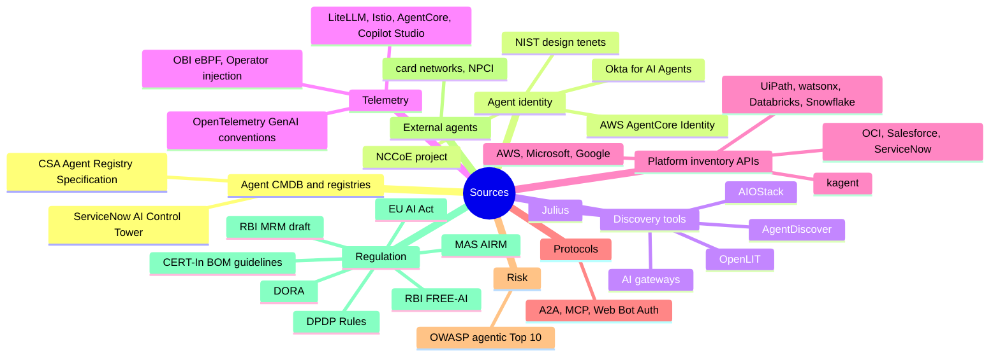

# References

Sources behind the claims in these docs, grouped by topic. Accessed November 2026. Vendor capabilities come from documentation and announcements, not hands-on testing.

## Agent CMDB and registries

- [Understanding the AI Inventory Data Model in ServiceNow](https://www.servicenow.com/community/cmdb-blog/understanding-the-ai-inventory-data-model-in-servicenow-product/ba-p/3546771) — ServiceNow Community, May 2026
- [Discovering and managing AI assets](https://www.servicenow.com/docs/r/zurich/intelligent-experiences/aict-discovering-ai-assets.html) — ServiceNow docs, Zurich
- [Managing your AI asset inventory](https://www.servicenow.com/docs/r/zurich/intelligent-experiences/disc-ai-asset-inventory.html) — ServiceNow docs, Zurich
- [Agent Registry Specification (draft)](https://labs.cloudsecurityalliance.org/agentic/agentic-agent-registry-specification-v1/) — Cloud Security Alliance Labs, March 2026

## Platform inventory APIs

- [ListAgentRuntimes](https://docs.aws.amazon.com/bedrock-agentcore-control/latest/APIReference/API_ListAgentRuntimes.html) — AWS AgentCore control-plane API reference
- [AWS Agent Registry is generally available](https://aws.amazon.com/about-aws/whats-new/2026/08/aws-agent-registry-generally-available/) — AWS What's New, August 2026
- [AWS Config supports new resource types](https://aws.amazon.com/about-aws/whats-new/2026/09/aws-config-new-resource-types/) — AWS What's New, September 2026
- [List agents (Foundry Agent Service)](https://ai.azure.com/api-reference/agents/list-agents/) — Microsoft Foundry API reference
- [Power Platform inventory and inventory API are now generally available](https://blog-en.topedia.com/2026/02/power-platform-inventory-and-inventory-api-are-now-generally-available/) — Topedia, February 2026
- [Retirement of the agentRegistry API and new licensing requirements for the Agent 365 Graph API](https://blog.topedia.com/posts/retirement-of-the-agentregistry-api-and-new-licensing-requirements-for-the-agent-365-graph-api) — Topedia
- [Microsoft Agent 365, now generally available](https://microsoft.com/en-us/security/blog/2026/05/01/microsoft-agent-365-now-generally-available-expands-capabilities-and-integrations) — Microsoft Security Blog, 1 May 2026
- [List agentIdentity objects](https://learn.microsoft.com/en-us/graph/api/agentidentity-list?view=graph-rest-1.0) — Microsoft Graph v1.0
- [AI agent inventory](https://learn.microsoft.com/en-us/defender-cloud-apps/ai-agent-inventory) — Microsoft Defender docs
- [Local AI agent discovery overview](https://learn.microsoft.com/en-us/defender-endpoint/local-agent-discovery-overview) — Microsoft Defender for Endpoint docs
- [reasoningEngines.list](https://docs.cloud.google.com/vertex-ai/docs/reference/rest/v1/projects.locations.reasoningEngines/list) — Google Cloud REST reference
- [Agent Registry overview](https://docs.cloud.google.com/agent-registry/overview) — Google Cloud docs
- [Gemini Enterprise Agent Platform overview](https://docs.cloud.google.com/gemini-enterprise-agent-platform/overview) — Google Cloud docs
- [Cloud Asset Inventory release notes](https://docs.cloud.google.com/asset-inventory/docs/release-notes) — Google Cloud docs
- [GenerativeAiAgentClient](https://docs.oracle.com/en-us/iaas/tools/python/2.135.1/api/generative_ai_agent/client/oci.generative_ai_agent.GenerativeAiAgentClient.html) — Oracle OCI Python SDK reference
- [BotDefinition](https://developer.salesforce.com/docs/atlas.en-us.object_reference.meta/object_reference/sforce_api_objects_botdefinition.htm) — Salesforce object reference
- [AI Agent API](https://servicenow.github.io/sdk/api/aiagent-api) — ServiceNow SDK docs
- [Managing UiPath agents](https://docs.uipath.com/agents/automation-cloud/latest/user-guide/managing-uipath-agents) — UiPath docs
- [AgentServiceModel](https://uipath.github.io/uipath-typescript/api/interfaces/AgentServiceModel/) — UiPath TypeScript SDK reference
- [List unified agents](https://developer.watson-orchestrate.ibm.com/apis/agents-v2/list-unified-agents) — IBM watsonx Orchestrate API reference
- [Agent Services in Unity Catalog](https://docs.databricks.com/aws/en/ai-gateway/agent-services) — Databricks docs
- [Serving endpoints: list](https://docs.databricks.com/api/workspace/servingendpoints/list) — Databricks REST reference
- [SHOW AGENTS](https://docs.snowflake.com/en/sql-reference/sql/show-agents) — Snowflake SQL reference
- [Agents (kagent concepts)](https://kagent.dev/docs/kagent/concepts/agents/) — kagent docs
- [Pegasystems expands agentic AI for business automation](https://www.techtarget.com/searchcustomerexperience/news/366625157/Pegasystems-expands-agentic-AI-for-business-automation) — TechTarget, June 2025

## Protocols

- [A2A v1.0: a builder's guide, part 1](https://aaif.io/blog/a2a-v1-0-a-builder-s-guide-part-1-discovery-tasks-and-clients) — Agentic AI Foundation
- [The 2026-07-28 MCP specification](https://blog.mcpservers.org/posts/mcp-spec-2026-07-28) — mcpservers.org blog
- [HTTP Message Signatures for automated traffic (draft-ietf-webbotauth-httpsig-protocol)](https://datatracker.ietf.org/doc/draft-ietf-webbotauth-httpsig-protocol/) — IETF Web Bot Auth WG, 29 October 2026

## Risk frameworks

- [OWASP Top 10 for Agentic Applications 2026](https://www.giskard.ai/knowledge/owasp-top-10-for-agentic-application-2026) — Giskard summary, December 2025

## External agents and payments

- [Ant International, Visa and Mastercard agree on agent identity standard](https://forkast.news/ant-international-visa-and-mastercard-agree-on-agent-identity-standard-now-comes-the-hard-part/) — Forkast, September 2026
- [India plans AI-powered UPI payments framework through Unified Agent Protocol](https://www.outlookbusiness.com/news/india-plans-ai-powered-upi-payments-framework-through-unified-agent-protocol) — Outlook Business, 9 July 2026
- [UPI AI agent plans raise fraud challenges](https://paymentexpert.com/2026/09/03/upi-ai-agent-plans-fraud-challenges/) — Payment Expert, 3 September 2026

## Code and AI-BOM

- [cdxgen](https://github.com/cdxgen/cdxgen) — CycloneDX generator
- [Cisco AI BOM](https://github.com/cisco-ai-defense/aibom) — Cisco AI Defense, open source
- [Snyk Agent Scan](https://deepwiki.com/snyk/agent-scan) — DeepWiki summary
- [Agentic Radar](https://deepwiki.com/splx-ai/agentic-radar) — DeepWiki summary

## Agent identity

- [Design Tenets for Agent Identity Management Systems](https://www.nist.gov/blogs/cybersecurity-insights/design-tenets-agent-identity-management-systems) — NIST, 27 October 2026
- [NCCoE Agentic AI Identity and Authorization project hub](https://pages.nist.gov/nccoe-ai-identity/) — NIST NCCoE
- [NIST's 10 Tenets for Securing Agentic AI Identities](https://www.secureworld.io/industry-news/nists-10-tenets-agentic-ai-identity) — SecureWorld, 2 November 2026
- [Authenticate and authorize with Inbound Auth and Outbound Auth](https://docs.aws.amazon.com/bedrock-agentcore/latest/devguide/runtime-oauth.html) — AWS AgentCore docs
- [Secure AI agents with Amazon Bedrock AgentCore Identity on Amazon ECS](https://aws.amazon.com/blogs/machine-learning/secure-ai-agents-with-amazon-bedrock-agentcore-identity-on-amazon-ecs/) — AWS, May 2026
- [Okta announces new blueprint for the secure agentic enterprise](https://www.okta.com/en-gb/newsroom/press-releases/showcase-2026/) — Okta, March 2026
- [Okta ISPM adds AI agent discovery](https://www.okta.com/en-in/blog/identity-security/okta-ispm-ai-agent-discovery/) — Okta, September 2026

## Discovery tools

- [AgentDiscover Scanner](https://pypi.org/project/agent-discover-scanner/2.4.2/) — DefendAI, MIT licence
- [OpenLIT Controller](https://docs.openlit.io/latest/controller/overview) — OpenLIT docs
- [AIOStack](https://scriptagc.wasmer.app/https_github_com/aurva-io/AIOstack) — Aurva, Apache 2.0 (GitHub mirror)
- [Julius LLM fingerprinting tool](https://dev.to/praetorian_guard/shadow-ai-is-everywhere-meet-julius-the-open-source-llm-fingerprinting-tool-410g) — Praetorian, February 2026
- [LiteLLM vs Kong AI Gateway](https://kosmoy.com/resources/blog/litellm-vs-kong-ai-gateway/) — Kosmoy (a competing vendor), July 2026

## Telemetry

- [OpenTelemetry eBPF Instrumentation reaches v1.0.0](https://opentelemetry.io/blog/2026/obi-v1-release/) — OpenTelemetry blog, 30 October 2026
- [OpenTelemetry eBPF Instrumentation](https://opentelemetry.io/docs/zero-code/obi/) and [context propagation](https://opentelemetry.io/docs/zero-code/obi/context-propagation/) — OpenTelemetry docs
- [Auto-instrumentation with the OpenTelemetry Operator](https://opentelemetry.io/docs/platforms/kubernetes/operator/automatic/) — OpenTelemetry docs
- [OpenLIT Operator overview](https://docs.openlit.io/latest/operator/overview) — OpenLIT docs
- [Instrument zero-code observability for LLMs and agents on Kubernetes](https://grafana.com/blog/ai-observability-zero-code) — Grafana Labs, March 2026
- [OpenTelemetry v2 integration](https://docs.litellm.ai/docs/observability/opentelemetry_v2) — LiteLLM docs
- [Distributed tracing overview](https://istio.io/latest/docs/tasks/observability/distributed-tracing/overview/) — Istio docs (header propagation requirement)
- [Add observability to your AgentCore resources](https://docs.aws.amazon.com/bedrock-agentcore/latest/devguide/observability-configure.html) — AWS docs
- [Environment-level telemetry with Application Insights (preview)](https://learn.microsoft.com/en-us/microsoft-copilot-studio/advanced-environment-level-agent-telemetry) — Microsoft Copilot Studio docs
- [Configure zero-code instrumentation for Python AI applications](https://help.splunk.com/en/splunk-observability-cloud/observability-for-ai/splunk-ai-agent-monitoring/set-up-ai-agent-monitoring/zero-code-instrumentation) — Splunk docs

- [Agent spans](https://github.com/open-telemetry/semantic-conventions-genai/blob/main/docs/gen-ai/gen-ai-agent-spans.md) — OpenTelemetry semantic-conventions-genai, main branch
- [Client agent invocations](https://github.com/open-telemetry/semantic-conventions-genai/blob/main/docs/gen-ai/client-invoke-agent.md) — OpenTelemetry semantic-conventions-genai, main branch
- [GenAI attribute registry](https://github.com/open-telemetry/semantic-conventions-genai/blob/main/docs/registry/attributes/gen-ai.md) — OpenTelemetry semantic-conventions-genai, main branch

- [OpenTelemetry GenAI Semantic Conventions Explained](https://www.dash0.com/knowledge/opentelemetry-genai-semantic-conventions-explained) — Dash0, September 2026
- [semantic-conventions-genai repository](https://github.com/open-telemetry/semantic-conventions-genai) — OpenTelemetry

## Regulation

- [RBI's move toward ethical and responsible AI (FREE-AI summary)](https://www.mondaq.com/india/financial-services/1672260/rbis-move-toward-ethical-and-responsible-ai-in-financial-sector) — Mondaq, September 2025
- [Draft Guidance on Regulatory Principles for Model Risk Management, 2026](https://www.rbi.org.in/Scripts/Bs_Connect2RegulateDetails.aspx?prid=487) — RBI, 24 June 2026
- [Singapore issues new AI Risk Management Guidelines](https://hlc.com/en/publications/mas-issues-new-ai-risk-management-guidelines-for-financial-institutions) — Hogan Lovells Cadwalader, 30 October 2026
- [New application dates for high-risk AI system rules](https://www.leaseurope.org/new-application-dates-high-risk-ai-system-rules) — Leaseurope, 2 July 2026
- [RBI's Draft Model Risk Management Guidelines, 2026](https://vinodkothari.com/2026/06/rbi-draft-model-risk-management-guidelines-2026/) — Vinod Kothari Consultants, June 2026 (secondary summary)
- [A human firmly in the loop: RBI proposes kill switch for AI](https://theprint.in/tech/a-human-firmly-in-the-loop-rbi-proposes-kill-switch-for-ai-used-by-banks-nbfcs/2970201/) — ThePrint, June 2026 (secondary summary)
- [India's DPDP Act: phased rollout and key compliance milestones](https://www.azbpartners.com/bank/indias-digital-personal-data-protection-act-phased-rollout-and-key-compliance-milestones/) — AZB & Partners, November 2025
- [CERT-In's Technical Guidelines on SBOM, QBOM & CBOM, AIBOM and HBOM](https://www.azbpartners.com/bank/cert-ins-technical-guidelines-on-sbom-qbom-and-cbom-aibom-and-hbom/) — AZB & Partners, September 2025
- [DORA RTS Article 4: ICT asset management policy](https://advisera.com/cdr-2024-1774/ict-asset-management-policy/) — Advisera (full text of CDR 2024/1774)

---
[← 23 Telemetry without code changes](23-telemetry-without-code-changes.md) · [Index](README.md) · [Repo README](../README.md)
