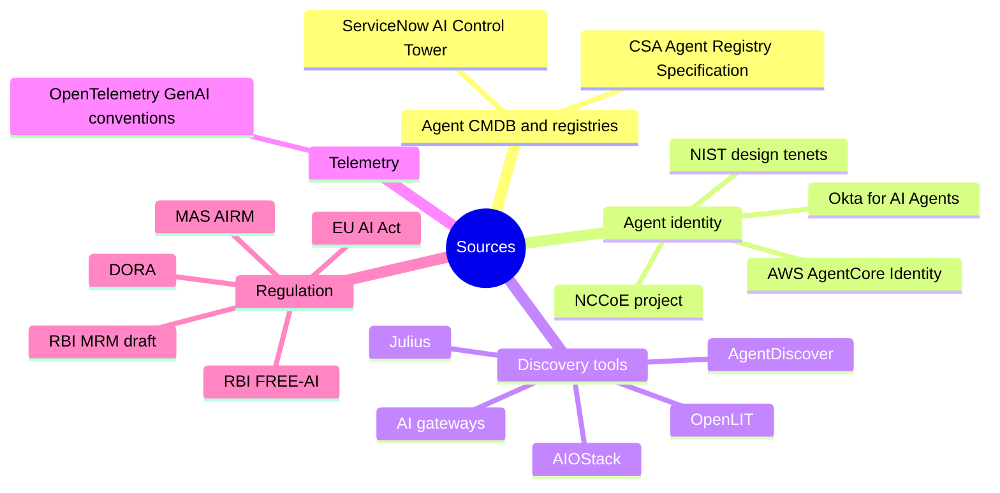

# References

Sources behind the claims in these docs, grouped by topic. Accessed November 2026. Vendor capabilities come from documentation and announcements, not hands-on testing.

## Agent CMDB and registries

- [Understanding the AI Inventory Data Model in ServiceNow](https://www.servicenow.com/community/cmdb-blog/understanding-the-ai-inventory-data-model-in-servicenow-product/ba-p/3546771) — ServiceNow Community, May 2026
- [Discovering and managing AI assets](https://www.servicenow.com/docs/r/zurich/intelligent-experiences/aict-discovering-ai-assets.html) — ServiceNow docs, Zurich
- [Managing your AI asset inventory](https://www.servicenow.com/docs/r/zurich/intelligent-experiences/disc-ai-asset-inventory.html) — ServiceNow docs, Zurich
- [Agent Registry Specification (draft)](https://labs.cloudsecurityalliance.org/agentic/agentic-agent-registry-specification-v1/) — Cloud Security Alliance Labs, March 2026

## Agent identity

- [Design Tenets for Agent Identity Management Systems](https://www.nist.gov/blogs/cybersecurity-insights/design-tenets-agent-identity-management-systems) — NIST, 27 October 2026
- [NCCoE Agentic AI Identity and Authorization project hub](https://pages.nist.gov/nccoe-ai-identity/) — NIST NCCoE
- [NIST's 10 Tenets for Securing Agentic AI Identities](https://www.secureworld.io/industry-news/nists-10-tenets-agentic-ai-identity) — SecureWorld, 2 November 2026
- [Authenticate and authorize with Inbound Auth and Outbound Auth](https://docs.aws.amazon.com/bedrock-agentcore/latest/devguide/runtime-oauth.html) — AWS AgentCore docs
- [Secure AI agents with Amazon Bedrock AgentCore Identity on Amazon ECS](https://aws.amazon.com/blogs/machine-learning/secure-ai-agents-with-amazon-bedrock-agentcore-identity-on-amazon-ecs/) — AWS, May 2026
- [Okta announces new blueprint for the secure agentic enterprise](https://www.okta.com/en-gb/newsroom/press-releases/showcase-2026/) — Okta, March 2026
- [Okta ISPM adds AI agent discovery](https://www.okta.com/en-in/blog/identity-security/okta-ispm-ai-agent-discovery/) — Okta, September 2026

## Discovery tools

- [AgentDiscover Scanner](https://pypi.org/project/agent-discover-scanner/2.4.2/) — DefendAI, MIT licence
- [OpenLIT Controller](https://docs.openlit.io/latest/controller/overview) — OpenLIT docs
- [AIOStack](https://scriptagc.wasmer.app/https_github_com/aurva-io/AIOstack) — Aurva, Apache 2.0 (GitHub mirror)
- [Julius LLM fingerprinting tool](https://dev.to/praetorian_guard/shadow-ai-is-everywhere-meet-julius-the-open-source-llm-fingerprinting-tool-410g) — Praetorian, February 2026
- [LiteLLM vs Kong AI Gateway](https://kosmoy.com/resources/blog/litellm-vs-kong-ai-gateway/) — Kosmoy (a competing vendor), July 2026

## Telemetry

- [OpenTelemetry GenAI Semantic Conventions Explained](https://www.dash0.com/knowledge/opentelemetry-genai-semantic-conventions-explained) — Dash0, September 2026
- [semantic-conventions-genai repository](https://github.com/open-telemetry/semantic-conventions-genai) — OpenTelemetry

## Regulation

- [RBI's move toward ethical and responsible AI (FREE-AI summary)](https://www.mondaq.com/india/financial-services/1672260/rbis-move-toward-ethical-and-responsible-ai-in-financial-sector) — Mondaq, September 2025
- [Draft Guidance on Regulatory Principles for Model Risk Management, 2026](https://www.rbi.org.in/Scripts/Bs_Connect2RegulateDetails.aspx?prid=487) — RBI, 24 June 2026
- [Singapore issues new AI Risk Management Guidelines](https://hlc.com/en/publications/mas-issues-new-ai-risk-management-guidelines-for-financial-institutions) — Hogan Lovells Cadwalader, 30 October 2026
- [New application dates for high-risk AI system rules](https://www.leaseurope.org/new-application-dates-high-risk-ai-system-rules) — Leaseurope, 2 July 2026
- [DORA RTS Article 4: ICT asset management policy](https://advisera.com/cdr-2024-1774/ict-asset-management-policy/) — Advisera (full text of CDR 2024/1774)

---
[← 13 Open questions](13-open-questions.md) · [Index](README.md) · [Repo README](../README.md)
