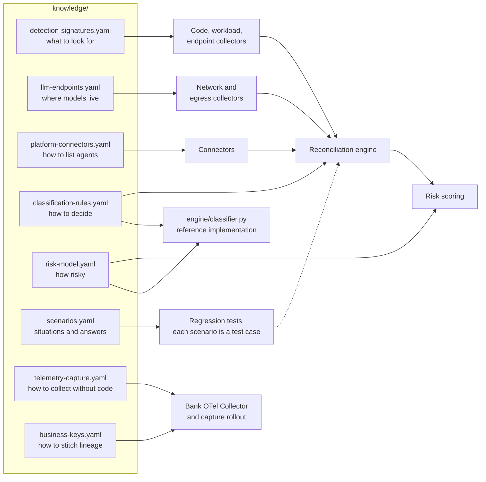

# Knowledge base: the inventory engine's "brain"

These YAML files hold the **facts and rules** the software needs, kept apart from code so they can be updated without a release. Docs explain *why*; these files say *what* in a form a program can load.



| File | Used by | Human-readable page |
|---|---|---|
| [`detection-signatures.yaml`](detection-signatures.yaml) | Repo and image scanners, workload and endpoint collectors | [16 Repository scanning](../docs/16-repository-scanning.md), [04 Discovery](../docs/04-discovery.md) |
| [`llm-endpoints.yaml`](llm-endpoints.yaml) | Egress, DNS and network-scan collectors | [04 Discovery](../docs/04-discovery.md) |
| [`platform-connectors.yaml`](platform-connectors.yaml) | Cloud and SaaS connectors | [15 Pulling the inventory](../docs/15-pulling-inventory.md) |
| [`classification-rules.yaml`](classification-rules.yaml) | Reconciliation and classification | [05](../docs/05-shadow-agents.md), [06](../docs/06-identity-onboarding.md), [07](../docs/07-reconciliation.md) |
| [`risk-model.yaml`](risk-model.yaml) | Risk scoring | [18 Risk scoring](../docs/18-risk-scoring.md) |
| [`scenarios.yaml`](scenarios.yaml) | Test suite, steward playbooks, docs generator | [19 Scenario catalogue](../docs/19-scenarios.md) |
| [`telemetry-capture.yaml`](telemetry-capture.yaml) | Collector enrichment, client onboarding, lineage stitching | [23 Telemetry without code changes](../docs/23-telemetry-without-code-changes.md) |
| [`business-keys.yaml`](business-keys.yaml) | Collector tokenisation, provenance stitching | [27 Business-key provenance](../docs/27-business-key-provenance.md) |

## Rules for using these files

1. **Deterministic first.** `classification-rules.yaml` decides status, identity level and record type. If an LLM helps (for example to summarise an unfamiliar repo), its output is a suggestion that these rules must confirm. Discovery inputs such as tool descriptions and agent cards are untrusted data ([21](../docs/21-inventory-threat-model.md)).
2. **Every scenario is a test.** [`tests/scenario_cases.yaml`](../tests/scenario_cases.yaml) holds evidence → expected outcome for 58 scenarios, run against the reference engine [`engine/classifier.py`](../engine/classifier.py) with `python3 -m pytest -q`. Add a case whenever a rule changes.
3. **Version and review.** Each file has `version` and `last_reviewed`. Re-check against [22 Change watchlist](../docs/22-change-watchlist.md) at least quarterly.
4. **Confidence travels with facts.** Connector entries carry `confidence` (documented, secondary, unverified); treat anything below *documented* as needing a pilot check.
5. **Statuses beyond the four in the tree.** Rules also produce `standby` (disaster-recovery copies), `retired` (kept for retention) and `declared` (record only); see the schema enum.

## Regenerating the scenario docs

```bash
python3 scripts/render_scenarios.py          # rewrite docs/19-scenarios.md tables
python3 scripts/render_scenarios.py --check  # CI: fail if the doc is stale
```

---
[← Repo README](../README.md) · [Docs index](../docs/README.md)
